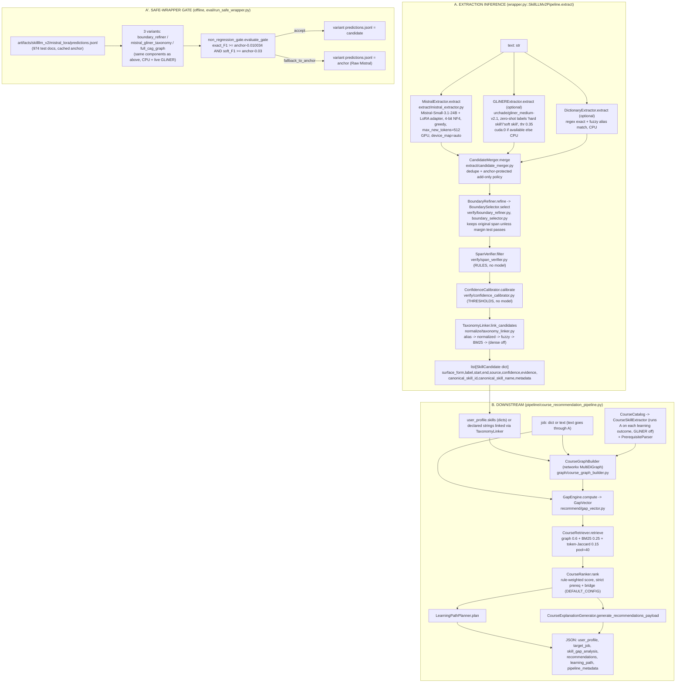

# SkillLLM_v2 Stage-2: Inference, Training and Evaluation (as the code and files stand today)

Scope: read-only audit of `/home/923873155/Sem 4 Research/SkillLLM_v2_stage2` on 2026-10-22. Every number below was read from a file in `reports/skillllm_v2/` or `artifacts/skillllm_v2/` (path given next to it). Anything that could not be verified is marked **[UNVERIFIED]**. Statements about code behaviour were checked by reading the code and by an AST import-graph walk (script kept outside the repo); they are not inferred from docs.

Contents: (1) inference, (2) training, (3) evaluations, (4) what is missing. Section 0 is the short list of things a reader most needs to know.

---

## 0. Ten things to know first

1. **The headline extraction system is "Raw Mistral LoRA" (Mistral-Small-3.1-24B + LoRA r=16, 80 epochs)**; every "wrapper" variant is deterministic CPU post-processing of its cached predictions. Wrapper gains are +0.0024 exact-F1 at best (significant only for `boundary_refiner`, on 10 of 974 documents differing; I diffed them: 7 are paraphrased/offset-less Mistral spans that the verifier drops, 3 are spans whose character offsets were re-aligned, so it is cleanup of offset reconstruction, not better skill recognition).
2. **The "safe wrapper falls back to the Mistral anchor" logic is an offline, dataset-level gate** (`eval/non_regression_gate.py::evaluate_gate`, applied in `eval/run_safe_wrapper.py`), decided once on the same 974 test documents it is then scored on. There is **no per-request runtime fallback** in `wrapper.py::SkillLLMv2Pipeline`. All three variants currently pass the gate (`accept`); no fallback is triggered on disk.
3. **`run_safe_wrapper.py` does not run Mistral.** It reads `artifacts/skillllm_v2/mistral_lora/predictions.jsonl` (974 docs). Only GLiNER (live) and rule/CPU components run.
4. **`SkillLLMv2Pipeline()` with default arguments does NOT use the trained Mistral.** `MistralExtractor()` with no `model_path` silently falls back to an 8-alias string-match stub. This is what `CourseRecommendationPipeline`, `scripts/run_skillllm_v2_end_to_end_demo.sh`, `scripts/run_skillllm_v2_smoke.sh` and the `end_to_end_demo_smoke` stage execute. Only `smoke_runner.eval_*` stages in `--mode full` load the real 24B model.
5. **The "span verifier" and "calibrator" in inference are not learned models.** `SpanVerifier` is a rule filter; `ConfidenceCalibrator` is a per-source confidence threshold filter (no probability calibration, so ECE is not defined for it). The scikit-learn TF-IDF/LogReg verifier that *was* trained (`artifacts/skillllm_v2/span_verifier/model/verifier_model.joblib`) is **never loaded** by any code path.
6. **The "BERT baseline" is a token-memorisation lookup table, not BERT** (`artifacts/skillllm_v2/bert_baseline/model/model.json`, `training_mode: token_classification_memorized_baseline`). The "GLiNER baseline" is zero-shot. Both baselines are scored on all 3,569 test docs; Mistral and all wrapper rows on the 974 test docs that have gold spans, so the baseline rows are **not comparable** to the Mistral rows.
7. **"Linking accuracy" in the money table is linking *coverage*** (fraction of extracted spans that received any canonical name, `smoke_runner.py` lines 282/403, `run_safe_wrapper.py::_linking_coverage`), not accuracy against gold. The linker falls through to BM25, which returns a link for almost any string. No ESCO/O*NET/Lightcast data is loaded; the "taxonomy" is a 711-row alias table built from SkillSpan gold + 76 aliases mined from Raw Mistral **test** predictions.
8. **Course-recommendation benchmarks are on synthetic scenarios and a synthetic catalogue with rule-derived relevance labels**; the recommender was tuned on half the scenarios and its own gap/graph features generate the labels' vocabulary (details and caveats in Section 3).
9. **Two different 80-epoch Mistral trainings exist** (May 28 to Jun 1 and Jul 9 to Jul 13, both about 90 h on 2x RTX 3090). The anchor numbers differ: 0.675034 (first run; still hard-coded in the gate config and docstrings) vs 0.670069 (second run; what is on disk). The dev-loss minimum is epoch 3 (0.234); the shipped adapter is epoch 80 (dev loss 0.397), no best-checkpoint selection.
10. **No eval exists** for the span verifier (as used), calibrator, context compaction, graph explanation faithfulness, job matching, gap detection, linking accuracy, or any end-to-end path (Section 4).

---

## 1. Inference

### 1.1 Entry points and what each one actually executes

| Entry point | What runs | Mistral 24B? | Output |
|---|---|---|---|
| `src/skillllm_v2/wrapper.py::SkillLLMv2Pipeline.extract` (library) | Mistral -> (GLiNER, dictionary) -> merger -> boundary refiner -> verifier -> calibrator -> linker | Only if the caller passes a configured `MistralExtractor`; default constructor = stub | `list[dict]` of `SkillCandidate`-shaped dicts |
| `src/skillllm_v2/eval/run_safe_wrapper.py` (`python -m ...`, `scripts/run_skillllm_v2_safe_wrapper.sh`) | Cached Mistral predictions + live GLiNER + dictionary -> 3 variants -> non-regression gate -> select candidate or anchor | **No** (reads cache) | `artifacts/skillllm_v2/safe_wrapper/**`, `reports/skillllm_v2/safe_wrapper_{gate.md,summary.json}` |
| `pipeline/pipeline_runner.py` + `stage_registry.py` + `smoke_runner.py` (`scripts/run_skillllm_v2_pipeline.sh`, `..._80epoch_2gpu_pipeline.sh`, `resume_downstream_...sh`) | 31 gated stages (`STAGE_ORDER`); each stage function in `smoke_runner.py`; success markers in `artifacts/skillllm_v2/status/*.success.json` | Yes in `--mode full` for `eval_raw_mistral_lora`, `eval_mistral_gliner_taxonomy`, `eval_full_cag_graph`; stub in `--mode smoke` | per-stage metrics JSON, reports |
| `pipeline/course_recommendation_pipeline.py::CourseRecommendationPipeline` (`scripts/run_skillllm_v2_course_recommendation.sh`) | Downstream flow (Section 1.4) | **No** (default stub, see 1.3) | `reports/skillllm_v2/demo/course_recommendations.json` |
| `scripts/run_skillllm_v2_end_to_end_demo.sh`, `scripts/run_skillllm_v2_smoke.sh`, stage `end_to_end_demo_smoke` | `SkillLLMv2Pipeline()` -> `JobMatcher`/`GapDetector`/`CourseRecommender` | **No** (stub) | `reports/skillllm_v2/end_to_end_demo.json`, `smoke_results.json` |
| `eval/recommender_benchmark.py`, `recommend/loop_*.py`, `recommend/recommender_final.py` | Recommender-only harnesses with prebuilt profiles/scenarios | No (no extraction) | benchmark reports |

### 1.2 Data-flow diagram

Nothing in B calls the safe-wrapper gate, `context/` compaction, `graph/graph_builder.py`, `match/JobMatcher` or `retrieval/`.

### 1.3 Extraction inference, step by step

Schema: every candidate is a plain `dict` that follows `skillllm_v2/schema.py::SkillCandidate` (`surface_form, label in {HARD_SKILL,SOFT_SKILL}, start, end (character offsets, both-or-neither null), source in {bert,mistral,gliner,dictionary}, confidence in [0,1], evidence, canonical_skill_id, canonical_skill_name, metadata`); `schema.py::validate_skill` is called by merger/refiner/verifier/calibrator. `schemas.py` (note the plural) defines `MergedSkillCandidate`, `VerifiedSkill`, `TaxonomyLink`, `JobMatchResult`, `CourseRecommendation`; **none of these five classes is used anywhere in `src/` or `tests/`** (grep verified). Only `schemas.SkillCandidate`, `SystemBenchmarkResult`, `validate_skill_candidate`, `validate_system_result` are used (schema smoke stage, BERT baseline, tests).

| # | Step | Module::function | Input -> output | Model / weights / device | Notes |
|---|---|---|---|---|---|
| 1 | LLM extraction | `extract/mistral_extractor.py::MistralExtractor.extract` (`load`, `_generate`, `parse_skill_json`, `_skills_from_payload`) | `str` -> `list[dict]` | Base `models/mistral-small-3.1-24b-instruct-2503` loaded via `AutoModelForImageTextToText` (falls back to Vision2Seq/CausalLM), bitsandbytes 4-bit NF4, bf16 compute, `device_map="auto"` (GPU); LoRA adapter `artifacts/skillllm_v2/mistral_lora/model` (chosen by `smoke_runner._trained_mistral_adapter_path` when `adapter_config.json` exists, else `configs/...yaml: model.adapter_path`) | Chat prompt = `SYSTEM_PROMPT` + `USER_PROMPT_TEMPLATE` (same strings used in SFT by `train/mistral_lora_trainer.py`). Greedy decode, `max_new_tokens=512`. Output JSON `{"skills":[{"text","label"}]}` is parsed (`parse_skill_json` raises `ValueError` on unparsable output and nothing catches it in `extract`, so one malformed generation would abort the whole evaluation loop), then `schema.find_offsets` assigns character offsets by regex (first unused match; falls back to case-insensitive, then substring). **Confidence is the constant 0.86** for every Mistral span. `SKILL`/unknown label becomes `HARD_SKILL`. Latency stored per span in `metadata.latency_seconds` |
| 1b | **Stub fallback** | same file, `_fallback_extract` | `str` -> candidates for any of `["Python","SQL","machine learning","communication","leadership","AWS","Amazon Web Services","Docker"]` present in text | none (CPU string match) | Triggered silently when `model_path` is None/non-existent or loading throws and `allow_fallback=True` (the default). `SkillLLMv2Pipeline()` -> `MistralExtractor()` -> **always stub**. The error text is only kept in `metadata.mistral_load_error` |
| 2 | GLiNER (optional) | `extract/gliner_extractor.py::GLiNERExtractor.extract` | `str` -> candidates (`source="gliner"`, confidence = GLiNER score) | `urchade/gliner_medium-v2.1` from the HF hub, zero-shot, labels `["hard skill","soft skill"]`, threshold 0.35. Device: `SKILLLM_V2_GLINER_DEVICE` env, else `cuda:0` if torch sees CUDA, else CPU | If `gliner` is not installed the model stays `None` and a 4-phrase stub (teamwork/collaboration/problem solving/communication, conf 0.48) is returned. `eval/run_safe_wrapper.py --disable-gliner` skips it |
| 3 | Dictionary (optional) | `extract/dictionary_extractor.py::DictionaryExtractor.extract` | `str` -> candidates (`source="dictionary"`, exact alias conf 0.82; fuzzy `SequenceMatcher` >= 0.92 on multi-word aliases, conf <= 0.72) | CPU. Default alias set = **22 hard-coded strings** (`_default_aliases`). `CourseRecommendationPipeline` passes `data/skillllm_v2/taxonomy/skill_aliases.jsonl` (711 rows) instead | `run_safe_wrapper.py` uses the 22-string default |
| 4 | Merge | `extract/candidate_merger.py::CandidateMerger.merge` | `list[dict]` -> `list[dict]` with `metadata.sources/evidence/merged_count` | CPU. Tuned config `artifacts/skillllm_v2/candidate_merger/tuned_config.yaml` (loaded at construction): `min_confidence_new_span` gliner 0.95, dictionary 0.85, dictionary+gliner 0.65, default 0.85; `require_alias_evidence_for_new_span: true` | Group by (canonical key, label); confidence = max + 0.05 per extra source (cap 0.99); drop spans subsumed by a same-label larger span; **add-only policy**: any candidate whose `sources` contains `mistral` is always kept (`source_aware_policy.py`); non-Mistral candidates need confidence over the per-source bar, an exact alias-table hit, and **no overlap with any Mistral span** |
| 5 | Boundary refine | `verify/boundary_refiner.py::BoundaryRefiner.refine` -> `verify/boundary_selector.py::BoundarySelector.select` | `(text, list[dict])` -> `list[dict]` (a candidate may become 1 or more spans; `metadata.boundary_edit` records the edit) | CPU. Tuned config `artifacts/skillllm_v2/boundary_refiner/tuned_config.yaml`. Allowed edits: `trim_leading_filler`, `taxonomy_normalized`, `realign_word_boundary` (trailing-trim / head-skill / conjunction-split disabled) | Default is "keep original"; a variant replaces it only if its score beats the original by >= 0.08 (HARD) / 0.15 (SOFT). Alias evidence gives +0.30 |
| 6 | Verify | `verify/span_verifier.py::SpanVerifier.filter` | `list[dict]` -> filtered `list[dict]` (+`metadata.verification`) | CPU rules, **no model** | Drops spans with no offsets; Mistral-derived spans are never rejected; non-Mistral spans rejected for generic words (`experience, knowledge, tools, technologies, responsibilities, job, degree`), > 6 tokens, or confidence < 0.35 |
| 7 | Calibrate | `verify/confidence_calibrator.py::ConfidenceCalibrator.calibrate` | `list[dict]` -> filtered `list[dict]` (+`metadata.calibration_threshold/accepted`) | CPU thresholds, **no model**. `artifacts/skillllm_v2/confidence_calibrator/tuned_config.yaml` **does not exist**, so the built-in defaults apply (hard 0.45, soft 0.42, dictionary-only 0.70, multi-source 0.40; anchor sources always accepted) | It only filters; the `confidence` value is not recalibrated |
| 8 | Link | `normalize/taxonomy_linker.py::TaxonomyLinker.link_candidates` / `link` | `list[dict]` -> same with `canonical_skill_id/name` and `metadata.taxonomy_link{taxonomy,link_confidence,link_method,...}` | CPU. Entries come from `data/skillllm_v2/taxonomy/skill_aliases.jsonl` (711 rows: 601 `SKILLSPAN_GOLD` from train+dev gold spans with count>=2, 34 manual, 76 `mistral_high_confidence` mined from the **test-split** Raw Mistral predictions) | Cascade: exact alias (1.0) -> canonical-name match (0.96) -> `SequenceMatcher` >= 0.88 -> BM25 over alias terms (conf = min(0.84, 0.55 + s/(s+3)), **any positive score returns a link**) -> dense (only if `dense_model_name` is set; default `None`; `sentence_transformers` not installed per `gpu_component_availability.md`) |

Order in `SkillLLMv2Pipeline.extract` is exactly: Mistral, then optional GLiNER, then optional dictionary, `merge`, `refine`, `filter`, `calibrate`, optional `link_candidates` (`wrapper.py` lines 28-37).

**Latency / memory (only what was recorded).**
- Raw Mistral inference, 974 test docs, 2 x RTX 3090 (`device_map="auto"` split across both cards), one document at a time: the stage that produced the predictions on disk (`eval_raw_mistral_lora`, 2026-07-13 17:57 to 19:08) took **4,257.5 s = 1.18 h** (`artifacts/skillllm_v2/status/eval_raw_mistral_lora.success.json`), i.e. about 4.4 s per document including model load. The Jun 3 evaluation of the first adapter ran 08:18 to 09:26 (about 68 min; `logs/raw_mistral_eval_2gpu_20260603_081829.log`). The two later stages that regenerate Mistral outputs live (`eval_mistral_gliner_taxonomy` 4,343.7 s, `eval_full_cag_graph` 4,385.9 s) show the same order of magnitude. Per-doc `metadata.latency_seconds` over the 901 docs that have at least one predicted span (73 docs have an empty prediction list and carry no timing): mean 4.65 s, median 3.79 s, min 2.04 s, max 35.06 s (first-call outlier includes model-load time); summed 1.16 h. **[UNVERIFIED]** GPU memory: no peak-memory figure is recorded anywhere I read.
- Training-side memory configuration (`max_seq_length 512`, 4-bit, grad checkpointing) was chosen to fit 2 x 24 GiB cards (comment in `scripts/run_skillllm_v2_80epoch_2gpu_pipeline.sh`).
- Wrapper CPU stages: no timing recorded **[UNVERIFIED]**. `SystemBenchmarkResult.latency_per_doc_seconds` exists but is always `None` in `money_table`.

### 1.4 Where the "safe wrapper falls back to the Mistral anchor" logic lives

- Decision function: `src/skillllm_v2/eval/non_regression_gate.py::evaluate_gate(variant, candidate_metrics, anchor_metrics, guardrails)`. `accept` iff `candidate.exact_span_f1 >= anchor.exact_span_f1 - exact_span_f1.max_drop` **and** `candidate.soft_skill_f1 >= anchor.soft_skill_f1 - soft_skill_f1.max_drop`; otherwise `fallback_to_anchor`. `select_extraction()` in the same file returns candidate or anchor predictions. Parameters: `configs/skillllm_v2_wrapper_guardrails.yaml` (`max_drop` 0.010034 exact, 0.03 soft; `target` 0.675034).
- Application: `src/skillllm_v2/eval/run_safe_wrapper.py::run_safe_wrapper`, inside the per-variant loop (`selected_preds = candidate_predictions[variant] if result.decision == "accept" else anchor_preds`). Writes `artifacts/skillllm_v2/safe_wrapper/<variant>/predictions.jsonl` (selected), `candidate_predictions.jsonl` (always the variant's own), `linked_candidates.jsonl`, `metrics.json`; top-level `safe_wrapper/predictions.jsonl` = the `full_cag_graph` selection; `non_regression_status.json` records `extraction_output_policy` (`candidate_wrapper_predictions` or `fallback_to_raw_mistral_anchor`).
- Current outcome (`reports/skillllm_v2/safe_wrapper_summary.json`, `safe_wrapper_gate.md`): all three variants `accept`; `extraction_output_policy = candidate_wrapper_predictions`; **no fallback is active**.
- Important details a reader will trip over:
  1. The floors are computed from the live anchor (0.670069 - 0.010034 = 0.660035 exact; 0.604046 - 0.03 = 0.574046 soft; see the gate table). But `target` (0.675034), `anchor_metrics` in the YAML and the docstrings in `non_regression_gate.py`, `source_aware_policy.py`, `boundary_refiner.py` still quote the **first training run's** anchor (0.675034 exact, 0.609792 soft). So `improved_over_anchor` is `False` for all variants even though `boundary_refiner` (0.672444) beats the current anchor (0.670069); and the YAML comment "floor = 0.665000" is stale (actual floor 0.660035).
  2. The gate is evaluated on the same 974 test documents on which the results are then reported, so "accept" is a post-hoc test-set decision, not a held-out one.
  3. The gate compares two aggregate scalars; it never looks at individual documents or at false positives on documents without skills (those 2,595 test documents are excluded from scoring altogether).
  4. The variant name `full_cag_graph` refers only to the extraction chain (merge, refine, verify, calibrate, link). No CAG context packet or graph is used to produce its spans.
  5. The legacy pipeline stage `eval_full_cag_graph` (`smoke_runner.py`) calls `SkillLLMv2Pipeline.extract` directly with **no gate**; its metrics are the "Old Full CAG/Graph" row in `money_table.md`.

### 1.5 Downstream flow (not extraction)

Entry: `pipeline/course_recommendation_pipeline.py::CourseRecommendationPipeline.run(user_input, job_input, top_k)` (CLI `main()` uses the demo user text and a hard-coded "ML Platform Engineer" job; catalogue `inputs/courses/course_catalog.jsonl`).

| # | Step | Module::function | Input -> output | Weights / device | Notes |
|---|---|---|---|---|---|
| 0 | Build-time catalogue enrichment | `course/ingest_catalog.py::CourseCatalog.load_from_file`; `course/extract_course_skills.py::CourseSkillExtractor.extract_from_catalog`; `course/prerequisite_parser.py::PrerequisiteParser.parse` | catalogue JSONL -> enriched course dicts (`taught_skills_evidence`, `canonical_skills`, `parsed_prerequisites`) | CPU. Calls `SkillLLMv2Pipeline.extract(outcome, include_gliner=False, include_dictionary=True, normalize=True)` on every learning outcome (and the description if no skills found) | Run in the constructor, so it executes the Mistral **stub** over the whole catalogue |
| 1 | User skills | `CourseRecommendationPipeline.run` | `str` -> `SkillLLMv2Pipeline.extract` (full chain, GLiNER on); `dict` with string skills -> `TaxonomyLinker.link` per string (confidence fixed at 1.0) | GLiNER from HF hub if installed | Resulting `user_profile["skills"]` is the extraction list |
| 2 | Job requirements | same | `str` -> extract; HARD spans become `required_skills`, SOFT spans become `preferred_skills`; `dict` used as given | | A fixed HARD=required / SOFT=preferred rule |
| 3 | Graph | `graph/course_graph_builder.py::CourseGraphBuilder.ingest_user_profile / ingest_job / ingest_course` | -> `networkx.MultiDiGraph` (node types `graph/schema.py::NodeType`, edge types `EdgeType`) | CPU | `graph/graph_builder.py::SkillGraphBuilder` (the simpler graph) is used only in the `graph_smoke` stage |
| 4 | Gap vector | `recommend/gap_vector.py::GapEngine.compute` | `(user_profile, job, graph)` -> `GapVector` (`SkillGap` list with `gap_type`, `importance`, `user_strength`, `gap_weight`) | CPU | Mastery/strength multipliers are fixed constants |
| 5 | Retrieval | `recommend/course_retriever.py::CourseRetriever.retrieve` | `GapVector` + job -> `RetrievedCandidate` list | CPU; own BM25 + graph + token Jaccard; **no embeddings** | weights 0.6/0.25/0.15, pool `DEFAULT_CONFIG.retrieval_pool=40` |
| 6 | Ranking | `recommend/course_ranker.py::CourseRanker.rank` (config `recommend/config.py::DEFAULT_CONFIG`) | candidates -> `ScoredCourse` list | CPU rules | Weighted sum: gap 0.40, semantic 0.15, prereq 0.30, level 0.15, goal 0.10, minus redundancy (MMR 0.10) and workload 0.05, plus unlock 0.2; strict-bridge prerequisites; related-text fill. Config was frozen by a dev-half tuning loop (`recommend/loop_rounds.py`) |
| 7 | Path + explanation | `recommend/learning_path_planner.py::LearningPathPlanner.plan`; `recommend/explanation_generator.py::CourseExplanationGenerator.generate_recommendations_payload` | -> `LearningPath`, explanation packets (`explanation_path`, `evidence`, `prerequisite_status`, `limitations`, `next_profile_update_action`) | CPU templates, **no LLM** | "Explanations" are template strings over graph facts |

Legacy "match" layer used by the smoke stages and the demo scripts (a different, simpler path): `match/job_matcher.py::JobMatcher.score` (fixed formula `0.45*required_cov + 0.2*preferred_cov + 0.15*role_fit + 0.1*exp_fit + 0.1*pref_fit - 0.25*missing_frac`, where the three `*_fit` inputs are caller-supplied constants), `match/gap_detector.py::GapDetector.detect` (string-set membership), `match/course_recommender.py::CourseRecommender.recommend` (wraps `CourseRanker` + `CourseExplanationGenerator`).

Context compaction (`context/context_compactor.py::compact_context`, `context/cached_context_builder.py::build_cached_context_packet`, `context/profile_summarizer.py::summarize_profile`, `context/skill_memory_builder.py::build_skill_memory`): called **only** from `research_refresh.py::write_context_outputs`, which summarises the first 10 predictions of the first cached test document with a demo user id and writes `artifacts/skillllm_v2/context/`. It is not on the extraction or recommendation path.

### 1.6 Modules that exist but are NOT reachable from an inference entry point

Method: AST import graph of every `src/skillllm_v2/**/*.py` (relative imports resolved, parent packages counted), traversed from `wrapper.py`, `eval/run_safe_wrapper.py`, `pipeline/smoke_runner.py`, `pipeline/pipeline_runner.py`, `pipeline/stage_registry.py`, `pipeline/course_recommendation_pipeline.py`; then re-run with every `python -m skillllm_v2.*` module named in `scripts/*.sh` and `Snakefile` added as roots; grep for string-level references (`subprocess`, `-m`). "Imported-only" means it is imported (usually through a package `__init__`) but never called.

**(a) Not imported or executed by any entry point, script, Snakefile or test (dead or stub code):**

| File | What it is |
|---|---|
| `src/skillllm_v2/context/context_retriever.py` | `ContextRetriever` over a cached context packet (word-overlap). Never imported (not even in tests) |
| `src/skillllm_v2/retrieval/__init__.py`, `src/skillllm_v2/retrieval/contextual_retrieval.py` | `ContextualRetriever` lexical retriever. Never imported |
| `src/skillllm_v2/graph/skill_graph_explainer.py` | `explain_skill_path`. Never imported |
| `src/skillllm_v2/match/explanation_generator.py` | `generate_recommendation_explanation`. Never imported (the `recommend/` explainer is the live one) |
| `src/skillllm_v2/normalize/esco_loader.py`, `lightcast_loader.py`, `onet_loader.py` | 7-line stubs. Never imported. The alias builder looks for `esco_skills.*`, `onet_skills.*`, `lightcast_skills.*` in `data/skillllm_v2/taxonomy/`; none exist |
| `src/skillllm_v2/eval/linking_eval.py`, `eval/matching_eval.py` | 5-7 line helpers (`linking_accuracy`, `mean_match_score`). Never imported; the CSVs `reports/skillllm_v2/linking_eval.csv`, `matching_eval.csv` are not produced by them |
| `src/skillllm_v2/train/build_linker_dataset.py` | writes an empty file. The stage uses `smoke_runner.build_linker_dataset` instead (2 hard-coded rows) |
| `src/skillllm_v2/baselines/train_bert_baseline.py`, `baselines/train_gliner_baseline.py` | stand-alone CLIs duplicating the stage functions. No script calls them |
| `src/skillllm_v2/pipeline/run_safe_wrapper.py` | 7-line re-export of `eval/run_safe_wrapper.py` (duplicate of the entry point). No caller |
| `src/skillllm_v2/policy/__init__.py`, `policy/source_aware_policy.py` | re-export of `skillllm_v2/source_aware_policy.py`. Nothing imports `skillllm_v2.policy` |
| `src/skillllm_v2/evals/__init__.py`, `evals/contract.py` | **new today (mtime 2026-10-22 08:08)**: `EvalContext`, `EvalResult`, `bootstrap_ci`, `paired_bootstrap`. `__init__` says each eval module will be registered in `registry.py`, which does not exist yet. Presumably the other agent's work in progress; not part of inference |

**(b) Imported but never called on any path (kept alive by package `__init__` or tests only):**

| File | Evidence |
|---|---|
| `src/skillllm_v2/normalize/alias_resolver.py` (`AliasResolver`) | only referenced in `normalize/__init__.py` |
| `src/skillllm_v2/graph/graph_retriever.py` (`SkillGraphRetriever`) | only in `graph/__init__.py` and `tests/test_skillllm_v2_stage2.py` |
| `src/skillllm_v2/schemas.py`: `MergedSkillCandidate`, `VerifiedSkill`, `TaxonomyLink`, `JobMatchResult`, `CourseRecommendation` | defined, never instantiated anywhere |
| `src/skillllm_v2/extract` `GLiNERExtractor`/`MistralExtractor` model-loading in `--mode smoke` | smoke config (`configs/skillllm_v2_smoke.yaml`) disables real-model loading (`_mistral_extractor`), so smoke never exercises the 24B model |
| Trained span-verifier weights `artifacts/skillllm_v2/span_verifier/model/verifier_model.joblib` | produced by `train/train_span_verifier.py`, never loaded (`SpanVerifier` has no model code; `verifier_eval_smoke` evaluates the rule class) |
| `TaxonomyLinker` dense branch | requires `dense_model_name`, which no caller sets |

**(c) Reachable only from research/CLI scripts, not from the inference or recommendation entry points** (these run, but are evaluation/tuning tools): `context/*` (except `context_retriever.py`; only via `research_refresh.py` and tests), `research_refresh.py`, `eval/{significance, recommender_benchmark, course_recommendation_eval, build_relevance_labels, benchmark_scenarios_spec, ranking_metrics, metric_sanity, prediction_provenance_check, wrapper_error_analysis, generate_split_predictions, linking_error_analysis}`, `recommend/{loop_eval, loop_rounds, recommender_final}` (run via `python -m` per their docstrings; no shell script calls them), `train/{loop_trainer, tune_boundary_refiner, tune_candidate_merger, tune_confidence_calibrator, mistral_lora_trainer}`, `pipeline/{diagnose_stale_artifacts, gpu_preflight}`. `eval/linking_error_analysis.py` is runnable (`python -m`) but no script calls it.

Not Python-module-reachable but executed: `scripts/eval_qlora_loop_test.py`, `scripts/significance_qlora*.py`, `scripts/build_course_catalog_large.py`.

---

## 2. Training

### 2.0 Data used everywhere

All extraction training/eval uses SkillSpan (`data/source/skillspan_hf/{train,dev,test}.json`, JSON-lines of token/tag rows; `train/build_verifier_dataset.py::load_skillspan_split` joins tokens with spaces into `text` and converts BIO tags to character spans). Label mapping used by the code: SkillSpan `tags_knowledge` -> `HARD_SKILL`, `tags_skill` -> `SOFT_SKILL` (an assumption baked into the code; SkillSpan's own terms are "knowledge" and "skill").

Counts, computed by calling `load_skillspan_split` (not copied from a report):

| Split | Docs (sentence-like rows) | Docs with >= 1 gold span | Gold spans | HARD | SOFT |
|---|---:|---:|---:|---:|---:|
| train | 4,800 | 1,584 | 5,190 | 2,969 | 2,221 |
| dev | 3,174 | 914 | 2,163 | 1,093 | 1,070 |
| test | 3,569 | **974** | 2,265 | 1,174 | 1,091 |

`data/skillllm_v2/mistral_sft/{train,dev,test}.jsonl` have 4,800 / 3,174 / 3,569 rows (all docs, including those with empty gold). Training therefore sees about 67% empty-answer documents; **evaluation of Mistral and every wrapper variant uses only the 974 test docs that have gold spans**, so the 2,595 gold-free test docs (where a deployed system would produce false positives) are not scored for them. `reports/skillllm_v2/qlora_loop_summary.md` ("Leakage and protocol checks") reports that 177 train and 169 dev normalised texts also occur among the test docs (920 unique texts among the 974 gold-bearing test docs), mostly short strings; this repetition affects all systems equally **[quoted from that report, not recomputed]**.

### 2.1 Which trainings are real GPU training and which are not

From `reports/skillllm_v2/gpu_component_availability.md` plus the code:

| Component | Learned? | Hardware | Evidence |
|---|---|---|---|
| Mistral-Small-3.1-24B LoRA (80 epochs) | yes | **2 x RTX 3090 GPU, torchrun, 4-bit QLoRA** | `artifacts/skillllm_v2/mistral_lora/model/training_summary.json` (world_size 2) |
| QLoRA loop v1, v2 | yes | **1 x RTX 3090 (GPU1), 4-bit QLoRA** | `artifacts/skillllm_v2/qlora_loop*/loop_summary.json` (`num_gpus: 1`) |
| "BERT baseline" | memorised lookup table, not a neural net | CPU, 0.1 s | `artifacts/skillllm_v2/status/train_bert_baseline.success.json`; `baselines/bert_baseline.py` |
| GLiNER baseline | **not trained** (zero-shot) | GPU inference only | `gliner_baseline/metrics.json` (`training_mode: zero_shot`); fine-tuning code does not exist |
| Span verifier | TF-IDF + logistic regression, **never used at inference** | CPU scikit-learn, 1.3 s | `gpu_component_availability.md` ("CPU scikit-learn TF-IDF/logistic verifier by design"); `status/train_span_verifier.success.json` |
| Taxonomy reranker / linker | **not trained** | none | `artifacts/skillllm_v2/taxonomy_reranker/metrics.json` (`retrieval_only`), README is the placeholder "Placeholder for optional taxonomy reranker training." (`gpu_component_availability.md` lists `sentence_transformers` as missing) |
| Candidate merger / boundary selector / calibrator thresholds | grid search over thresholds (rule tuning) | CPU (needs cached dev predictions from the GPU model) | `train/tune_*.py` |
| Graph / matching / course ranking | hand-set weights, plus a manual dev-half tuning loop for the recommender | CPU (NetworkX, pure Python) | `recommend/config.py`, `recommend/loop_rounds.py` |

### 2.2 Mistral-Small-3.1-24B QLoRA, 80 epochs, 2 GPUs (the extraction anchor)

- Code: `train/train_mistral_lora.py` (prepares `mistral_lora_train_config.yaml`, launches `python -m torch.distributed.run --nproc_per_node 2 -m skillllm_v2.train.mistral_lora_trainer`), trainer in `train/mistral_lora_trainer.py` (HF `Trainer`, PEFT). Config: `configs/skillllm_v2_training_80ep_2gpu.yaml` (generated by `scripts/run_skillllm_v2_80epoch_2gpu_pipeline.sh`), effective values in `artifacts/skillllm_v2/mistral_lora/model/mistral_lora_train_config.yaml`.
- Data: `data/skillllm_v2/mistral_sft/train.jsonl` (4,800 rows) / `dev.jsonl` (3,174 rows). Each example is the same chat prompt as inference (`SYSTEM_PROMPT` + `USER_PROMPT_TEMPLATE`) with target JSON `{"skills":[{"text","label"}]}`.
- Hyperparameters (from the config file above): base `models/mistral-small-3.1-24b-instruct-2503`; 4-bit NF4 + double quant, compute bf16 (`bf16` if supported, else fp16); LoRA r=16, alpha=32, dropout 0.05, targets `.*language_model.*(q|k|v|o|gate|up|down)_proj`; per-device batch 1, grad accumulation 32, world size 2 -> **effective batch 64**; lr 1.2e-4, cosine schedule, warmup ratio 0.05, weight decay 0.01, `paged_adamw_8bit`, gradient checkpointing, `max_seq_length` 512, seed 42, 80 epochs = **6,000 optimizer steps** (`checkpoint-6000/trainer_state.json`: `global_step 6000`, `max_steps 6000`), `eval_strategy="epoch"` on the full 3,174-row dev set, `save_total_limit` 2.
- Loss is computed over **all tokens including the fixed ~300-token prompt** (`DataCollatorForLanguageModeling(mlm=False)`, no label masking; `docs/loop_training.md` says the same).
- Compute (from `artifacts/skillllm_v2/mistral_lora/model/training_summary.json`): `train_runtime` 324,217.8 s = **90.06 h wall clock x 2 GPUs = 180.1 GPU-hours**; `train_samples_per_second` 1.184; `total_flos` 1.857e19; final `train_loss` 0.1431 (average over the run); `eval_loss` 0.3974 (`eval_runtime` 700.1 s). Per-epoch evaluation is inside `train_runtime`; if each took as long as the final one (700 s) that is about 15.6 h of the 90 h **[derived estimate, not recorded]**. Peak GPU memory: **[UNVERIFIED]**, not recorded.
- Outputs: `artifacts/skillllm_v2/mistral_lora/model/adapter_model.safetensors` (369.7 MB), `adapter_config.json`, `checkpoint-5925/`, `checkpoint-6000/`, `training_summary.json`.
- **Dev-loss trajectory** (`checkpoint-6000/trainer_state.json`, 80 per-epoch evals): minimum **0.2340 at epoch 3**; 0.2439 (epoch 1), 0.3087 (epoch 10), 0.3971 (epoch 76), **0.3974 at epoch 80**. `best_model_checkpoint` is `None`: the shipped adapter is the epoch-80 weights, i.e. a heavily over-fit (by dev loss) model. Dev *F1* per epoch was not computed, so the loss curve is not proof that F1 degraded; the QLoRA loop results below (0.26 epoch of training reaching a test F1 within 1.4 points) are consistent with long training being unnecessary.
- **Two independent 80-epoch trainings were run with the same seed and config and give different anchors** (logs in `logs/`):

| Run | Log | train_runtime | train_loss | Test exact-F1 / token-F1 / soft-F1 / hard-F1 (974 docs) | Where the number lives |
|---|---|---|---|---|---|
| 1 (2026-05-28 09:18 to 06-01 03:28) | `stage2_80epoch_2gpu_20260528_091820.log`, eval `raw_mistral_eval_2gpu_20260603_081829.log` | 3.237e5 s | 0.1428 | 0.675034 / 0.797798 / 0.609792 / 0.731138 | the eval log line `Raw Mistral full eval metrics`; hard-coded in `configs/skillllm_v2_wrapper_guardrails.yaml`, `non_regression_gate.py`, `source_aware_policy.py` docstring, `wrapper_error_analysis.md` |
| 2 (2026-07-09 23:37 to 07-13 17:56) | `stage2_direct_full_pipeline_2gpu_setsid_20260709_233709.log` | 3.242e5 s | 0.1431 | **0.670069** / 0.787886 / 0.604046 / 0.726450 | **on disk**: `artifacts/skillllm_v2/mistral_lora/{model/,metrics.json,predictions.jsonl}` (eval stage `eval_raw_mistral_lora`, 4,257.5 s, from `artifacts/skillllm_v2/status/eval_raw_mistral_lora.success.json`) |

  Run 1's adapter and predictions were overwritten by run 2. The 0.0050 gap between runs is larger than every wrapper delta below (+0.0024 at best), i.e. run-to-run training variance (one seed each, GPU nondeterminism) exceeds the wrapper's effect. This is not discussed in any report.
- Reproducibility note: `scripts/run_skillllm_v2_80epoch_2gpu_pipeline.sh` overwrites the YAML each run; the effective hyperparameters above were verified from the saved `mistral_lora_train_config.yaml`, not from the script.

### 2.3 QLoRA loop runs (1 GPU, low-compute replacement)

- Code: `train/loop_trainer.py`; config `configs/skillllm_v2_loop_qlora.yaml`; launcher `scripts/train_mistral_qlora_loop.sh`; method write-up `docs/loop_training.md`; unit tests `tests/skillllm_v2/test_loop_trainer.py`.
- Shared setup (from `configs/skillllm_v2_loop_qlora.yaml` and each run's `resolved_config.json`): same base model, 4-bit NF4 + double quant + bf16, all attention/MLP linears; micro-batch 2 x grad accum 8 (effective 16); lr 1.5e-4 multiplied by 0.85 each round (cosine inside a round, floor ratio 0.1), warmup 0.1, `paged_adamw_8bit`, `max_seq_length` 768 (longer examples **dropped, not truncated**); loss on **assistant tokens only**; 640 examples per round (about 0.13 epoch of the 4,800-doc train split); hard-example mining on a 192-doc rotating **train** probe (35% of each round drawn from the hard pool, repeat cap 3; empty-doc share ramps 10% to 25%); dev subset = gold-bearing docs from `dev.json` (`dev_empty_frac: 0.0`), metric `exact_span_f1`, best-by-dev adapter saved to `<out>/best`; hard budget 5.0 GPU-h and 2.5 M tokens; seed 42.
- Differences between runs (diff of `resolved_config.json`): v1 `lora.r=8, alpha=16, eval.dev_size=160, loop.max_rounds=8, patience=2`; v2 `lora.r=16, alpha=32, eval.dev_size=400, max_rounds=6, patience=3`. These are the only config differences.

| | QLoRA loop v1 (`artifacts/skillllm_v2/qlora_loop`) | QLoRA loop v2 (`artifacts/skillllm_v2/qlora_loop_v2`) |
|---|---|---|
| Rounds completed / stop reason | 4 / `plateau` (patience 2) | 6 / `max_rounds` (cap hit; patience-3 never fired) |
| Best round (dev exact-F1) | round 1 (index from 0): **0.7052** on 160 dev docs | round 3: **0.7029** on 400 dev docs |
| Dev curve | 0.6730, 0.7052, 0.7020, 0.6965 | 0.6584, 0.6652, 0.6913, 0.7029, 0.6772, 0.7005 |
| Training GPU-hours (`loop_summary.json` / `loop_state.json` `gpu_seconds`) | **1.591** (5,728 s) | **3.173** (11,424 s) |
| Train tokens | 945,329 | 1,419,175 |
| GPUs | 1 | 1 |
| Adapter size (`best/adapter_model.safetensors` dir) | 177 MB (r=8) | 353 MB (r=16) |
| Selected adapter's cost to reach | 0.76 GPU-h (rounds 0-1) | 2.09 GPU-h (rounds 0-3) |
| Test inference for evaluation (`timing_segments.jsonl`) | 3,524.4 s generation + 16.6 s load, 974 docs, peak alloc 16.13 GB / reserved 18.51 GB | 4,303.1 s generation + 20.4 s load, peak alloc 16.32 GB / reserved 18.38 GB |
| Training peak memory | 17.9 GB allocated per `qlora_loop_summary.md` **[taken from the report; not independently re-derived from a log]** | not stated |

  Test F1 of these adapters is in Section 3 (E-rows). A smoke run (`artifacts/skillllm_v2/qlora_loop_smoke`, 1 tiny round, 20 docs) also exists and is not an evaluation.
- Single-GPU wall time equals GPU-hours here (1 GPU). The v1/v2 per-round seconds (v1 about 1,360-1,500 s; v2 about 1,800-2,000 s) include training, dev evaluation and mining (`loop_state.json: history[*].seconds`).

### 2.4 BERT baseline

- `baselines/bert_baseline.py::BertBaseline.train`: for every non-`O` token in `data/skillllm_v2/bio/train.jsonl` (4,800 rows), count labels per lower-cased token and keep the most frequent; prediction labels each token independently by lookup and merges B/I runs into spans (confidence fixed 0.65). `training_mode: token_classification_memorized_baseline` in `artifacts/skillllm_v2/bert_baseline/model/model.json` (102 KB). The `bert-base-uncased` and `epochs: 80` entries in the YAMLs are never read by this class. CPU, 0.1 s (`status/train_bert_baseline.success.json`). **It is not a BERT model**; any thesis text calling it BERT is misleading. It also predicts a skill for every token it ever saw inside a skill span (even function words such as "to", "and"; see `model.json`), which explains its precision of 0.033.

### 2.5 GLiNER baseline

- No training. `GLiNERBaseline.train_or_prepare` only writes a note; `predict` runs zero-shot `urchade/gliner_medium-v2.1` through `GLiNERExtractor` (threshold 0.35, `cuda:0`; the 557 predicted spans in `artifacts/skillllm_v2/gliner_baseline/predictions.jsonl` all carry `metadata.gliner_label` and `device: cuda:0`, so real GLiNER ran).
- **Stale-artifact conflict:** `artifacts/skillllm_v2/gliner_baseline/model/config.json` (rewritten 2026-10-21 08:15) says `training_mode: skipped_dependency_missing` (written by a run in an environment without the `gliner` package, probably a test), while `metrics.json` (2026-07-09) says `zero_shot`. The predictions show GLiNER really ran; the `config.json` is the one that is wrong for the evaluated predictions.

### 2.6 Span verifier (scikit-learn)

- Data: `train/build_verifier_dataset.py` builds `data/skillllm_v2/verifier_train.jsonl` (**11,418 rows: 5,190 positives = every gold span of the train split, 6,228 negatives**) and `verifier_dev.jsonl` (4,784 rows: 2,163 positive, 2,621 negative; counts from `artifacts/skillllm_v2/span_verifier/verifier_config.json`). Negatives are synthetic: a "boundary-expanded" version of each gold span (label `boundary_noise`) plus generic phrases (`synthetic_negative`), not real extractor errors.
- Model: `train/train_span_verifier.py` fits `TfidfVectorizer(ngram_range=(1,2)) + LogisticRegression(max_iter=500, class_weight="balanced")` on `"<surface_form> [SEP] <text>"`; saved as `artifacts/skillllm_v2/span_verifier/model/verifier_model.joblib` (1.28 MB). CPU, 1.3 s. Writes `verifier_config.json` (`model_type: tfidf_logistic_regression_span_verifier`).
- **Use at inference: none.** `verify/span_verifier.py::SpanVerifier` is rule-based and nothing loads the joblib. **Evaluation of the trained classifier: none.** The only verifier evaluation (`smoke_runner.verifier_eval_smoke`) applies the *rule* verifier to the first 20 dev rows (`artifacts/skillllm_v2/span_verifier/metrics.json`: precision 0.5263, recall 1.0, F1 0.6897, FPR 0.4737).

### 2.7 Taxonomy reranker / linker

- Nothing is learned. `smoke_runner.build_linker_dataset` writes the same 2 hard-coded rows to `data/skillllm_v2/linker_{train,dev}.jsonl`; `train_taxonomy_reranker` writes the placeholder README and `metrics.json` (`"Supervised taxonomy reranker labels unavailable; retrieval-only linker used."`). The linker's table comes from `normalize/skill_alias_builder.py` (rule-based): 711 alias rows = 34 manual + 601 `SKILLSPAN_GOLD` (train+dev gold spans occurring >= 2 times) + 76 mined from the **test-split** Raw Mistral predictions (confidence >= 0.8, count >= 2). **That last source puts test-set model outputs into a component that is then evaluated on the test set** (it feeds the merger's alias-evidence gate, the boundary selector's +0.30 alias bonus, and the linker). Impact is probably small but unquantified.

### 2.8 Boundary refiner / merger / calibrator "tuning"

- Scripts: `train/tune_boundary_refiner.py`, `tune_candidate_merger.py`, `tune_confidence_calibrator.py`. Each grid-searches thresholds on cached **dev-split** Raw Mistral predictions (`artifacts/skillllm_v2/mistral_lora/predictions_dev.jsonl`, produced by `eval/generate_split_predictions.py`; GLiNER and dictionary candidates are computed live), selecting the configuration with the best dev exact-F1 subject to soft-F1 not dropping more than 0.03 from the no-op. Grids: merger 6 GLiNER x 5 dictionary x 2 alias-evidence settings (+ no-op); boundary 3 non-empty edit-type subsets x 4 hard x 4 soft margins (+ no-op); calibrator 3^4 = 81 combinations. Pure CPU, seconds.
- **What is on disk:** `artifacts/skillllm_v2/candidate_merger/tuned_config.yaml` and `artifacts/skillllm_v2/boundary_refiner/tuned_config.yaml` (both 2026-10-21 08:43). **Not on disk:** `predictions_dev.jsonl`, `dev_tuning_results.csv`, `dev_candidates_cache.jsonl`, `reports/skillllm_v2/{candidate_merger,boundary_refiner,confidence_calibrator}_tuning.md`, and any `confidence_calibrator/tuned_config.yaml` (the calibrator therefore runs on built-in defaults).
- **Provenance doubt:** the two existing YAMLs lack the `tuning_meta` block the tuner writes (`_write_tuned_config`), and contain values outside the tuner's grids (merger `gliner: 0.95`, not in `GLINER_THRESHOLD_GRID`; boundary `allowed_edit_types` includes `realign_word_boundary`, not in `ALLOWED_EDIT_TYPE_GRID`). The boundary YAML is value-identical to `BoundarySelector.DEFAULT_CONFIG`. They appear to be hand-edited, not tuner outputs. **No dev F1 achieved by any tuning is verifiable from files.** Anything in the repo that says the wrapper is "dev-tuned" should be read with this in mind. Which adapter (run 1 or run 2) produced the dev predictions is also unknown.

### 2.9 Recommender "training"

No learning. `recommend/loop_rounds.py` ran a 5-round manual dev-half tuning loop (rounds 1, 2, 3, 5 accepted; round 4 rejected) on 24 dev scenarios and froze `DEFAULT_CONFIG` (`reports/skillllm_v2/recommender_loop_log.md`, `recommender_loop_log.json`). The 24/24 dev/test split is fixed by sha256-sorted scenario ids with salt `skillllm-recsys-loop-v1` (`reports/skillllm_v2/recommender_split.json`).

---

## 3. Evaluations

### 3.0 Conventions and metric definitions (`eval/extraction_eval.py::evaluate_extraction`)

- **Exact-span** F1: a prediction is correct iff `(start, end, label)` equals a gold `(start, end, label)`; counts are pooled over documents (micro). Predictions are de-duplicated per document by that key. Offsets are **character offsets** into the space-joined token string.
- **Partial-span**: a prediction counts if it overlaps a not-yet-matched gold span with the same label (one-to-one, greedy).
- **Token F1**: despite the name, this is **character-level** (`_tokens` returns `(char_index, label)` pairs), so it is a character-overlap F1 that also requires the label to match.
- **HARD / SOFT F1**: exact-span F1 restricted to one label. `macro_f1` is the mean of the two; `micro_f1` equals exact F1.
- Test set used for all extraction numbers unless noted: SkillSpan `test`, the **974 docs with >= 1 gold span** (2,265 gold spans). One trained model, one split, one seed per system.
- Mistral outputs only the surface text; offsets are reconstructed by `schema.find_offsets` (first unused regex match of the string). Repeated mentions of the same skill in one document can therefore be aligned to the wrong occurrence, a source of exact-span error that is independent of what the model "knows". The only wrapper gains observed (Section 3.3, row E7) come from this layer.

### 3.1 Master evaluation table

All "value" cells are copied from the file in the "source" column. "ex P/R/F1" = exact-span precision/recall/F1; "par" = partial-span F1; "tok" = character-level token F1; "H"/"S" = HARD_SKILL / SOFT_SKILL F1.

**A. Extraction (SkillSpan)**

| ID | Eval | What it measures | Dataset / split / n | Metric values | Source file | Caveats |
|---|---|---|---|---|---|---|
| E1 | "BERT baseline" (token-memorisation lookup) | Span extraction from a train-set token-to-tag table | SkillSpan **test, all 3,569 docs** (not the 974) | ex P/R/F1 0.0331 / 0.2751 / **0.0592**; par 0.1764; tok 0.2749; H 0.1298; S 0.0188 | `artifacts/skillllm_v2/bert_baseline/metrics.json`, `reports/skillllm_v2/bert_baseline_metrics.json`, `money_table.md` | Not BERT (see 2.4). Scored on a different population than Mistral: 2,595 gold-free docs add only false positives, so precision is deflated vs the 974-doc rows. **Not comparable** to E3 |
| E2 | GLiNER zero-shot baseline | Off-the-shelf `gliner_medium-v2.1`, labels "hard skill"/"soft skill", thr 0.35 | SkillSpan test, all 3,569 docs | ex P/R/F1 0.1921 / 0.0472 / **0.0758**; par 0.1354; tok 0.1144; H 0.0546; S 0.0966 | `artifacts/skillllm_v2/gliner_baseline/metrics.json` | Same 3,569-doc caveat; only 557 spans predicted in total; label prompts untuned; `model/config.json` contradicts (2.5) |
| E3 | **Raw Mistral LoRA (anchor), run 2 = on-disk artifacts** | 24B LoRA SFT extractor | SkillSpan test, **974 docs** | ex P/R/F1 0.6735 / 0.6667 / **0.6701**; par 0.8138; tok 0.7879; H 0.7265; S 0.6040; macro 0.6652 | `artifacts/skillllm_v2/mistral_lora/metrics.json` = `reports/skillllm_v2/raw_mistral_lora_metrics.json` = `money_table.md` | Single seed; excludes gold-free docs; offsets reconstructed heuristically; test used also for gate selection (E7-E9); train runtime 90 h |
| E3b | Raw Mistral LoRA, **run 1** (adapter no longer on disk) | Same recipe, first training | same 974 docs | ex P/R/F1 0.6855 / 0.6649 / **0.6750**; par 0.8216; tok 0.7978; H 0.7311; S 0.6098 | only in `logs/raw_mistral_eval_2gpu_20260603_081829.log` (line "Raw Mistral full eval metrics") | Source of the 0.675034 hard-coded in the gate YAML and docstrings. Run-to-run gap 0.0050 (Section 2.2) |
| E4 | "Old Boundary Refiner" stage (`eval_mistral_boundary_refiner`) | Boundary refiner on cached anchor, before verify/calibrate | 974 docs | ex F1 **0.670069** (identical to E3); par 0.813845; tok 0.787886; H 0.726450; S 0.604046 | `artifacts/skillllm_v2/mistral_boundary/metrics.json`, `money_table.md` | The refiner changed 0 of 974 documents (verified by diffing predictions) because the stage artifact predates `realign_word_boundary` |
| E5 | "Old Mistral + GLiNER + Taxonomy" stage | merge + link on **live** Mistral regeneration | 974 docs | ex F1 **0.670062**; par 0.814438; tok 0.787575; H 0.728020; S 0.602305; link-coverage 0.890271 | `artifacts/skillllm_v2/mistral_gliner_taxonomy/metrics.json`, `money_table.md` | Stage regenerated Mistral outputs (4,343.7 s); 0.000007 below E3 is nondeterminism plus merge, not separable |
| E6 | "Old Full CAG/Graph" stage (`eval_full_cag_graph`, `SkillLLMv2Pipeline`) | full chain, no gate | 974 docs | ex F1 **0.671102**; par 0.815702; tok 0.787575; H 0.728618; S 0.603755; link-coverage 0.890374 | `artifacts/skillllm_v2/full_cag_graph/metrics.json`, `money_table.md` | Also regenerated Mistral live (4,385.9 s). Still quoted by `README.md`, `docs/thesis/skillllm_v2_research_refresh.tex`, `metric_sanity_report.md` (see 3.4) |
| E7 | **Safe wrapper `boundary_refiner`** (refine, verify, calibrate on cached anchor) | Non-destructive boundary edits + rule filters | 974 docs | ex P/R/F1 0.6770 / 0.6680 / **0.672444**; par 0.816444; tok 0.788000; H 0.729518; S 0.605505; gate **accept** | `reports/skillllm_v2/safe_wrapper_summary.json`, `safe_wrapper_gate.md`, `money_table.md`, `artifacts/skillllm_v2/safe_wrapper/boundary_refiner/metrics.json` | +0.002376 vs E3 rests on **10 docs**: 7 offset-less Mistral spans dropped by `SpanVerifier` and 3 spans re-aligned by `realign_word_boundary` (e.g. `java` moved from 0-4 to 19-23 in `test-12` and `test-19`) (diff of `candidate_predictions.jsonl` vs `mistral_lora/predictions.jsonl`, run by me). It is cleanup of the offset-reconstruction defect, not learned boundary improvement |
| E8 | **Safe wrapper `mistral_gliner_taxonomy`** (merge + link) | adds GLiNER/dictionary spans under the add-only policy | 974 docs | ex P/R/F1 0.6732 / 0.6658 / **0.669478**; par 0.814206; tok 0.787829; H 0.726898; S 0.602595; link-coverage 0.889732; gate accept | same files as E7 (`.../mistral_gliner_taxonomy/metrics.json`) | Net effect vs anchor: 5 spans added (all `dictionary+gliner`), 7 spans removed; 9 docs differ. GLiNER+dictionary contribute essentially nothing |
| E9 | **Safe wrapper `full_cag_graph`** (merge, refine, verify, calibrate, link) | full extraction chain | 974 docs | ex P/R/F1 0.6767 / 0.6671 / **0.671854**; par 0.816807; tok 0.787942; H 0.729975; S 0.604046; link-coverage 0.889834; gate accept | same files | 19 docs differ: 8 span keys added (5 `dictionary+gliner`, 2 `dictionary+mistral`, 1 `mistral`), 17 anchor span keys removed or changed. Name "CAG/graph" is misleading: no context or graph is used |
| E10 | QLoRA loop **v1** (r=8, 4 rounds, best round 1) | Test-set check of the low-compute adapter | 974 docs | ex P/R/F1 0.6864 / 0.6291 / **0.6565**; par 0.8040; tok 0.7846; H 0.7046; S 0.5996 | `reports/skillllm_v2/qlora_loop_test_metrics.json`, `artifacts/skillllm_v2/qlora_loop_eval/metrics.json`, `qlora_loop_summary.md` | Dev F1 of the selected round (0.7052, 160 docs) overstated test by 4.9 points (selection bias); one seed |
| E11 | QLoRA loop **v2** (r=16, 6 rounds, best round 3) | same | 974 docs | ex P/R/F1 0.6720 / 0.6512 / **0.6614**; par 0.8170; tok 0.7957; H 0.7159; S 0.5989 | `reports/skillllm_v2/qlora_loop_v2_test_metrics.json`, `artifacts/skillllm_v2/qlora_loop_v2_eval/metrics.json`, `qlora_loop_v2_summary.md` | Dev 0.7029 (400 docs) vs test 0.6614; anchor was not scored on the loop dev subset, so only the test comparison is valid |
| E12 | Original (pre-fix) wrapper stages, **historical** | Shows the destructive boundary refiner/verifier | 974 docs, vs run-1 anchor 0.675034 | boundary 0.5704, gliner+tax 0.6515, full 0.5616 exact F1; SOFT 0.4258 / 0.5777 / 0.4080; regressions 194 / 0 / 225 docs | `reports/skillllm_v2/wrapper_error_analysis.md` (2026-06-10) | Describes code that has since been replaced; kept only as the motivation for the gate. Anchor is run 1, not on-disk run 2 |
| E13 | Extraction ablation A-G (`ablation_runner.py`) | Component-wise ablation | SkillSpan **dev, first 20 gold docs (65 gold spans)** | A_mistral_only 0.0571, B 0.0571, C 0.0563, D 0.2025, E 0.2025, F 0.2025, G (safe) 0.2025 exact F1; SOFT 0.0 everywhere | `reports/skillllm_v2/extraction_ablation.{md,csv}`, `ablation_raw.json`, `ablation_gate_result.json` | **Not an ablation of the real system**: `SkillLLMv2Pipeline()` is built with no model path, so "Mistral" is the 8-alias stub. 20 docs, dev split. Do not cite. The gate "accept" in `ablation_gate_result.json` compares stub against stub |
| E14 | Safe-wrapper GPU smoke | Smoke of the gate | first 20 test docs | all three variants 0.666667 exact / 0.64 soft, accept; link-coverage 1.0 | `reports/skillllm_v2/research_refresh/safe_wrapper_gpu_smoke_{summary.json,gate.md}` | 20 docs; smoke only |
| E15 | `run_skillllm_v2_smoke.sh` / `smoke_results.json` | Pipeline smoke | first 5 dev gold docs, stub Mistral | exact F1 0.3158 (P 1.0, R 0.1875), tok 0.3358 | `reports/skillllm_v2/smoke_results.json` | Stub extractor; not a quality number |

**B. Statistical tests on extraction**

| ID | Eval | What it measures | Data / n | Metric values | Source file | Caveats |
|---|---|---|---|---|---|---|
| S1 | Paired bootstrap (10,000, seed 20260710) + sign-flip permutation, Holm over 15 tests | Wrapper variants minus anchor E3 | 974 test docs, unit = doc | exact-F1 delta: boundary_refiner **+0.002376** CI [+0.000893, +0.004232], Holm p boot 0.0030 / perm 0.0293 (**significant**); gliner_taxonomy **-0.000590** [-0.002289, +0.000939], Holm p 1.0 (n.s.); full_cag_graph **+0.001785** [-0.000566, +0.004225], Holm p 0.939 / 0.990 (n.s.). MDE at 80% power 0.0024 / 0.0023 / 0.0034. Doc win/loss/tie 8/0/966, 3/4/967, 11/4/959 | `reports/skillllm_v2/significance_f1.{md,json}`; code `eval/significance.py`, `scripts/run_significance_test.sh` | Resamples documents only (not training seeds); only 10/9/19 docs differ; the one "significant" row is the offset cleanup (E7). Inputs hashed (anchor `ac5917d0267670b0`) |
| S2 | QLoRA v1 minus anchor | non-inferiority-style check | 974 test docs | exact delta **-0.0135** [-0.0342, +0.0071], p 0.201 / 0.199, Holm 0.80; token -0.0033; partial -0.0099; HARD -0.0218; SOFT -0.0044; doc W/L/T 180/191/603; MDE about 0.030 | `reports/skillllm_v2/significance_qlora_vs_anchor.{md,json}` | Not significant but CI allows a 3.4-point deficit; MDE 3 points |
| S3 | QLoRA v2 minus anchor | same | 974 | exact delta **-0.0086** [-0.0286, +0.0114], p 0.403; token +0.0078; partial +0.0032; HARD -0.0105; SOFT -0.0051; doc W/L/T 165/151/658 | `reports/skillllm_v2/qlora_loop_v2_significance_vs_anchor.{md,json}` | same |
| S4 | QLoRA v2 minus v1 | does the larger loop help | 974 | exact delta **+0.0049** [-0.0133, +0.0232], p 0.602; partial +0.0131 [-0.0003, +0.0264] p 0.057 (Holm-5 0.28); McNemar on perfect docs p 0.024 uncorrected | `reports/skillllm_v2/qlora_loop_v2_significance_vs_v1.{md,json}` | v1/v2 differ in rank, dev size, patience and rounds at once |

**C. Non-regression gate**

| ID | Eval | What it measures | Data / n | Values | Source | Caveats |
|---|---|---|---|---|---|---|
| G1 | `non_regression_gate.evaluate_gate` x 3 variants | exact-F1 >= anchor-0.010034 and soft-F1 >= anchor-0.03 | 974 test docs | floors 0.660035 / 0.574046; candidate exact 0.672444 / 0.669478 / 0.671854; soft 0.605505 / 0.602595 / 0.604046; **all `accept`**, all `improved_over_anchor=False` | `reports/skillllm_v2/safe_wrapper_gate.md`, `artifacts/skillllm_v2/safe_wrapper/gate_results.json`, `non_regression_status.json` (`non_regression_passed: true`, `extraction_output_policy: candidate_wrapper_predictions`) | Gate is on the evaluation set itself; `improved` uses the stale 0.675034 target; floors and soft guard are loose relative to the +-0.002 effects, so almost any variant passes |

**D. Linking (taxonomy)**

| ID | Eval | What it measures | Data / n | Values | Source | Caveats |
|---|---|---|---|---|---|---|
| L1 | "linking accuracy" in money table | **coverage**: share of predicted spans that received a `canonical_skill_name` | 974 test docs | safe `mistral_gliner_taxonomy` 0.889732; safe `full_cag_graph` 0.889834; Old gliner+tax 0.890271; Old full 0.890374 | `reports/skillllm_v2/money_table.md`, `safe_wrapper_summary.json` | No gold links exist; BM25 returns a link for any string with one shared term, so coverage says little about correctness |
| L2 | Linking error analysis (re-link with the 696-entry alias table) | coverage, TP coverage, link-method mix | test docs, stage artifacts `mistral_gliner_taxonomy` (2,469 spans) and `full_cag_graph` (2,601 spans) | coverage 0.882139 / 0.838908; TP coverage 0.896239 / 0.874909; method mix (gliner+tax): bm25 1,139, alias 999, none 291, fuzzy 40; previous 4-entry fallback coverage 0.069259 / 0.062284 | `reports/skillllm_v2/linking_error_analysis.{md,json}`, `linking_error_cases.jsonl` (331 lines) | 46% of links in the first stage are BM25 guesses. Table is built from SkillSpan gold + test-mined aliases (Section 2.7), so "TP coverage" is partly circular. Numbers differ from L1 (see 3.4) |
| L3 | `linking_eval.csv` | placeholder | none | `taxonomy_linking_accuracy,0.0` | `reports/skillllm_v2/linking_eval.csv` (dated 2026-05-28), `linking_eval.md` ("labels unavailable") | Not an evaluation; contradicts L1/L2 if read as accuracy |

**E. Span verifier**

| ID | Eval | What it measures | Data / n | Values | Source | Caveats |
|---|---|---|---|---|---|---|
| V1 | `verifier_eval_smoke` | **Rule** `SpanVerifier` accept/reject vs synthetic labels | first 20 rows of `verifier_dev.jsonl` | precision 0.5263, recall 1.0, F1 0.6897, FPR 0.4737 | `artifacts/skillllm_v2/span_verifier/metrics.json`, `eval_predictions.jsonl` (20 rows) | n=20, synthetic negatives, all candidates given source "dictionary" conf 0.7; the trained sklearn model is not evaluated at all |

**F. Job matching / gap detection**

| ID | Eval | Values | Source | Caveats |
|---|---|---|---|---|
| M1 | Job-match nDCG@10 | **NA** everywhere (`job_match_ndcg_at_10: NA`) | `reports/skillllm_v2/matching_eval.csv`, `money_table.md` | no labelled job data; `JobMatcher.score` is a fixed formula whose `*_fit` inputs are caller-supplied constants |
| M2 | Gap detection (`GapDetector`, `GapEngine`) | no evaluation file exists | none | unit tests only (`tests/skillllm_v2/test_gap_detector.py`, `test_gap_vector.py`) |

**G. Course recommendation (synthetic benchmark; extraction is bypassed, users/jobs are given as skill lists)**

| ID | Eval | What it measures | Data | Metric values | Source | Caveats |
|---|---|---|---|---|---|---|
| C1 | Benchmark **v1**, legacy Full recommender vs 7 baselines | ranking and prerequisite quality | **48** scenarios (41 archetypes, 7 with synthetic rewritten job text), **171 synthetic courses**, graded labels from a deterministic rule (`inputs/courses/relevance_labels.jsonl`), relevant = grade >= 2 | Full: nDCG@10 **0.868** [0.846, 0.889]; P@5 0.617 [0.550, 0.683]; R@10 0.813 [0.754, 0.869]; MAP@10 0.688; weighted gap cov@5 0.877; prereq violation@5 0.046; redundancy@5 0.045; explanation completeness 1.0; 8.4 courses returned. Strongest baseline Gap-Overlap Greedy + prereq filter nDCG@10 0.852 [0.826, 0.876]; Full minus it +0.016 [-0.004, +0.036], Holm p 0.117 (**n.s.**). Content-only labels: Full 0.859 vs Gap-Overlap Greedy (no graph) 0.895 (Full worse, Holm p 0.002) | `reports/skillllm_v2/course_recommendation_benchmark.{md,json}`, `course_recommendation_eval.csv` | Synthetic catalogue and archetype users; labels share catalogue skill/prerequisite metadata with skill-aware systems (favours them); **human validation not done: 0 of 60 `human_grade_0to3` cells filled** in `human_review_sample.csv`; 48 non-independent scenarios; explanation completeness is 1.0/0.0 by construction; prereq violation 0 for filtered baselines by construction |
| C2 | Benchmark **v2**, tuned Full on the **held-out test half** | same, after a dev-half tuning loop | **24 test scenarios** (24 dev used for tuning), same catalogue/labels | tuned Full nDCG@10 **0.885** [0.851, 0.916]; P@5 0.608 [0.533, 0.683]; R@10 0.878; MAP@10 0.732; gap cov@5 0.838; prereq violation 0.000; redundancy@5 0.036; 9.9 courses. Strongest baseline 0.851 [0.808, 0.890]; diff **+0.035** [-0.006, +0.072], Holm p **0.094 (n.s.)**. Legacy Full on test 0.855. Tuned minus legacy nDCG@10 +0.030 [+0.007, +0.055], raw p 0.005 | `reports/skillllm_v2/course_recommendation_benchmark_v2.{md,json}`, `recommender_loop_log.{md,json}`, `recommender_split.json` | n = 24; config frozen from dev with 24 scenarios (changes of +-0.01 are within noise per the loop log); same synthetic caveats; no seeds/variants (deterministic system) |
| C3 | v2 dev half and all-48 | optimistic views | 24 dev; 48 all | dev: tuned 0.902 vs legacy 0.881 nDCG@10; all-48 tuned **0.894** vs strongest baseline 0.852, diff +0.042 [+0.016, +0.066], Holm p 0.002 | same v2 files | "partly dev-tuned, do not read as held-out" (the file's own warning) |
| C4 | Money-table "Course Rec P@5 = 1.000000" | stale | n/a | 1.000000 for Old Full, safe `mistral_gliner_taxonomy`, safe `full_cag_graph` | `reports/skillllm_v2/money_table.md` | **Does not match any current benchmark file** (current P@5: 0.617 v1, 0.608 v2 test); `money_table_generator.py` reads `course_benchmark["SkillLLM_v2 Full Graph Recommender"]["Precision@5"]`, a key the current JSON does not have (it is `systems[...]["p5"]["mean"]`), so the 1.0 comes from an older benchmark JSON. Also not a property of the extraction rows it sits next to. Ignore it |

### 3.2 Which files agree on the wrapper numbers (the 0.670222 / 0.672602 question)

- **0.669478 (`mistral_gliner_taxonomy`) and 0.671854 (`full_cag_graph`) are the on-disk values**, identical in: `reports/skillllm_v2/safe_wrapper_summary.json`, `safe_wrapper_gate.md`, `money_table.csv/.md`, `significance_f1.json` (`recomputed`, `evaluate_extraction` and `stored` all equal, to 1e-6), `artifacts/skillllm_v2/safe_wrapper/<variant>/metrics.json`. The boundary variant is 0.672444 in the same files.
- **0.670222 / 0.672602 appear in no result file.** They occur only in `reports/skillllm_v2/significance_f1.md` (and the string in `eval/significance.py` that generates it), where the note says they come "from an earlier artifact version that is not on disk and are NOT what was tested here". `docs/loop_training.md` line 44 also quotes "0.6701/0.6726" (the latter is that stale figure; current full-wrapper value is 0.6719, boundary 0.6724). Treat 0.670222/0.672602 as superseded.
- A different pair, **0.670062 and 0.671102** (Old gliner+taxonomy, Old full), is what `README.md` (line 94), `docs/thesis/skillllm_v2_research_refresh.tex`, `reports/skillllm_v2/research_refresh/codebase_audit.md` and `metric_sanity_report.md` quote. Those come from the pre-gate stage artifacts E5/E6, not from the current safe-wrapper outputs.

### 3.3 What the numbers say, in plain terms

1. Raw Mistral LoRA is the only strong extractor: exact F1 0.670 (run 2) or 0.675 (run 1), partial 0.814, character-token 0.788. HARD 0.727 vs SOFT 0.604.
2. Everything the wrapper adds is within +-0.0025 exact F1 of the anchor, below the 0.0050 gap between two identical training runs, and driven by a handful of documents (S1). The sole statistically significant wrapper effect (boundary_refiner) is removal of 7 offset-less spans and re-alignment of 3 spans whose first-match offset landed inside a longer token.
3. The loop adapters at about 1% (v1) and 1.8% (v2) of the training GPU-hours land 1.4 and 0.9 exact-F1 points below the anchor on test, with CIs that include 0 and an MDE of about 3 points: "no significant difference detected", not "equivalent".
4. The course recommender's advantage over a user-aware, prerequisite-aware, graph-free baseline is not significant on the held-out half (+0.035 nDCG@10, p 0.094), and it depends on label construction.

### 3.4 Inconsistencies and stale artifacts found (not papered over)

| # | Inconsistency | Files |
|---|---|---|
| I1 | Anchor exact-F1 is 0.675034 (run 1) in `configs/skillllm_v2_wrapper_guardrails.yaml`, `non_regression_gate.py` (docstring and `DEFAULT_GUARDRAILS`), `source_aware_policy.py` docstring, `boundary_refiner.py` docstring ("0.675 ... 0.570"), `wrapper_error_analysis.md`, `research_refresh/safe_wrapper_gpu_smoke_gate.md` (target 0.675034), vs 0.670069 (run 2) in the actual metrics/predictions. Gate floors are recomputed from the live anchor, but `target` is not, so `improved_over_anchor` is wrong; the YAML comment "floor = 0.665000" is stale (actual 0.660035) | listed |
| I2 | Full wrapper exact-F1: 0.671854 (current safe wrapper) vs 0.671102 (README, thesis tex, `codebase_audit.md`, `metric_sanity_report.md`). The "SkillLLM_v2 Safe Wrapper" row in `metric_sanity_report.md`, the thesis table and `codebase_audit.md` (0.671102 / token 0.787886 / soft 0.603755) is a hybrid built by `research_refresh._display_metrics` (anchor metrics with exact and soft overwritten), not any system's output | listed |
| I3 | Money-table Course Rec P@5 = 1.000000 vs benchmark P@5 0.617 (v1) / 0.608 (v2 test) (see C4); README says course P@5 is "unavailable because labelled relevance data is not persisted", which is also out of date (labels now exist in `inputs/courses/relevance_labels.jsonl`) | `money_table.md`, `README.md`, benchmark files |
| I4 | Linking coverage for the same stage: 0.890374 (`full_cag_graph/metrics.json`, money table) vs 0.838908 (`linking_error_analysis.md`, re-linked against the current 696-entry table) vs 0.889834 (safe variant); `linking_eval.csv` says accuracy 0.0. Different alias-table versions and re-linking; I did not resolve the 0.89 vs 0.84 gap **[UNVERIFIED cause]** | listed |
| I5 | Baselines (E1, E2) scored on 3,569 test docs, Mistral and wrapper rows on 974; the money table puts them in one column | `money_table.md`, `bert/gliner metrics.json` |
| I6 | `artifacts/skillllm_v2/gliner_baseline/model/config.json` says GLiNER not installed, while predictions and `metrics.json` show real zero-shot GLiNER | listed |
| I7 | `extraction_ablation.*` reports F1 0.057-0.203 for "Mistral" variants because the stub extractor ran; never use as component ablation | `extraction_ablation.md`, `ablation_gate_result.json` |
| I8 | The "BERT baseline" is a lookup table; YAMLs set `epochs: 80` and `bert-base-uncased` for it, neither used | `configs/skillllm_v2_training_80ep_2gpu.yaml`, `baselines/bert_baseline.py` |
| I9 | Two 80-epoch trainings with the same seed disagree by 0.0050 exact F1 and their adapters share one output directory; only the second survives | Section 2.2 |
| I10 | "Tuned" merger/boundary YAMLs have no `tuning_meta` and values outside the tuner grids; tuning reports/CSVs/dev predictions are absent; no calibrator tuned config | Section 2.8 |
| I11 | `docs/loop_training.md` says the 80-epoch run was "~90 GPU-hours x2" (consistent with 180.1) but its comparability sentence cites 0.6701/0.6726 (stale 0.6726) | `docs/loop_training.md` |
| I12 | 76 of the 711 alias rows are mined from test-split Raw Mistral predictions and feed the merger/boundary/linker that are then evaluated on test | `skill_alias_builder.py`, `data/skillllm_v2/taxonomy/skill_aliases.jsonl` |

---

## 4. What is missing (no evaluation exists, or the evaluation is not of the thing that runs)

| # | Module / stage | Status | What is missing |
|---|---|---|---|
| 1 | Span verifier (trained TF-IDF/LogReg) | trained, unused | No held-out evaluation of the classifier; no code path loads it. The deployed `SpanVerifier` is a rule filter evaluated only on 20 synthetic rows (V1). No measurement of how many true spans it rejects on real extractor output after the fix (the only such count is the pre-fix `wrapper_error_analysis.md`: 29 false rejections) |
| 2 | Confidence calibrator | thresholds only | No ECE / reliability curve / Brier score; Mistral confidence is the constant 0.86, so it carries no information to calibrate; the calibrator never touches Mistral spans. No `tuned_config.yaml`, no tuning report |
| 3 | Candidate merger | rule policy | No precision/recall of the spans it adds (5 spans added in total, E8); no per-source (GLiNER vs dictionary vs both) contribution on the real model; E13 is not usable |
| 4 | Boundary refiner / selector | rule policy | Only the 10-doc effect in E7; no boundary-error taxonomy on current outputs; no per-edit-type contribution; tuning provenance absent |
| 5 | Taxonomy linking | alias/fuzzy/BM25 cascade | **No gold canonical ids, so no linking accuracy, Recall@k or MRR.** Coverage only (L1, L2). BM25 fallback (46% of links) unvalidated; known mis-links exist (the v1 benchmark mentions "Scikit-Learn" -> "learn"); no ESCO / O*NET / Lightcast taxonomy is loaded at all; the alias table partly derives from test predictions |
| 6 | Context compaction / CAG packet (`context/*`) | not wired into any pipeline | No fidelity measure (information retained vs raw profile), no token-saving measure, no effect on recommendations; only determinism unit tests (`test_context_compactor.py`, `test_cached_context_builder.py`, `test_profile_summarizer.py`). It is only executed once, on one demo profile, by `research_refresh.py` |
| 7 | Graph explanation faithfulness | template explanations | "Explanation Completeness@5" only checks that JSON fields exist (1.0 by construction). No check that cited evidence/prerequisite paths are true graph facts, no human rating, no counterfactual test. `graph/skill_graph_explainer.py` is dead code |
| 8 | Job matching (`JobMatcher`) | fixed formula | `job_match_ndcg_at_10` is NA everywhere; no labelled job data; the formula's fit inputs are caller-supplied constants |
| 9 | Gap detection (`GapEngine`, `GapDetector`) | rules | No precision/recall of the produced gap list against the authored gold needs (`inputs/courses/benchmark_scenarios.jsonl` has them, but the benchmark only uses them to score courses). No evaluation of weak/outdated/uncertain/transferable gap types, which no scenario exercises as far as I read **[UNVERIFIED]** |
| 10 | End-to-end (text -> extraction -> profile -> gaps -> courses) | not run with the real model | The recommender benchmark bypasses extraction (profiles and jobs are skill lists). `CourseRecommendationPipeline` and the demos use the stub Mistral. So there is no measurement of how extraction errors propagate to recommendations, and no run of the real 24B model inside the recommendation path |
| 11 | Real component ablation | missing | The only ablation (E13) ran the stub on 20 dev docs. No ablation of GLiNER only / dictionary only / verifier / calibrator / linker on the 974-doc test split with the real model |
| 12 | False positives on skill-free text | missing | The 2,595 gold-free test docs are excluded from Mistral/wrapper scoring; precision on such text is unmeasured. SkillSpan is job postings; **resume / profile text (the actual user input) is not evaluated** |
| 13 | Variance | missing | One seed per training; two identical 80-epoch runs already differ by 0.0050; no multi-seed or cross-validation for either the anchor or the loop adapters; no confidence intervals that include training variance |
| 14 | 80-epoch run diagnostics | partial | Dev loss per epoch exists (min epoch 3), but no dev F1 per epoch and no test F1 for earlier checkpoints, so the over-training question is unanswered directly |
| 15 | Leakage audit of the wrapper | missing | No re-run of the wrapper without the 76 test-mined aliases; no check that the 22-string default dictionary or the tuned thresholds are independent of test |
| 16 | Recommender labels | not validated | `human_review_sample.csv`: 0/60 graded; no inter-rater or label-sensitivity beyond the content-only variant |
| 17 | Latency / memory | mostly absent | No peak-memory for the 80-epoch training, no per-stage CPU timing for the wrapper, no end-to-end per-request latency for the full pipeline (GLiNER device placement, catalogue enrichment at startup) |
| 18 | Tests | not run by me | The repository has 31 test files (30 under `tests/skillllm_v2/` plus `tests/test_skillllm_v2_stage2.py`); I did not execute them, so their current pass status is **[UNVERIFIED]** |

---

## Appendix A. How the reachability and numbers were verified

- Reachability: an `ast`-based import graph over `src/skillllm_v2/**/*.py` (script: `/tmp/claude-1989081997/-home-923873155-Sem-4-Research/1a00f5a5-ec9c-4b91-9c05-6a08d40a371e/scratchpad/reach.py`, outside the repo), roots as listed in 1.6, plus `grep -rn` of each candidate module/class name across `src`, `scripts`, `tests`, `configs`, `docs`, `README.md`, `Snakefile`. Note that the graph treats an import inside a package `__init__` as reachability, so category (b) in 1.6 lists modules that are import-reachable but have no call site.
- Numbers: read from the cited JSON/MD/CSV/log files; recomputed directly: SkillSpan split counts (via `load_skillspan_split`), per-document `latency_seconds` statistics, the anchor-vs-variant prediction diffs in E7-E9, the dev-loss trajectory (from `checkpoint-6000/trainer_state.json`), the alias-table composition, GPU-hours (`train_runtime x world_size`).
- Not run: pytest, any training, any inference, any evaluation script. No code, report or artifact was modified; this file is the only addition.

## Appendix B. Short list for whoever wires the unreachable modules

Dead (no importer anywhere): `context/context_retriever.py`, `retrieval/contextual_retrieval.py` (+ `retrieval/__init__.py`), `graph/skill_graph_explainer.py`, `match/explanation_generator.py`, `normalize/{esco,lightcast,onet}_loader.py`, `eval/linking_eval.py`, `eval/matching_eval.py`, `train/build_linker_dataset.py`, `baselines/train_bert_baseline.py`, `baselines/train_gliner_baseline.py`, `pipeline/run_safe_wrapper.py`, `policy/__init__.py`, `policy/source_aware_policy.py`, `evals/__init__.py` and `evals/contract.py` (new today; its `registry.py` does not exist yet).
Imported but never called: `normalize/alias_resolver.py` (`AliasResolver`), `graph/graph_retriever.py` (`SkillGraphRetriever`), `schemas.py` dataclasses `MergedSkillCandidate`, `VerifiedSkill`, `TaxonomyLink`, `JobMatchResult`, `CourseRecommendation`, the trained `verifier_model.joblib`, `TaxonomyLinker` dense branch.
Executed only by research/CLI scripts, not by an inference entry point: `context/{context_compactor, cached_context_builder, profile_summarizer, skill_memory_builder, profile_schema}.py` (only via `research_refresh.py`), `research_refresh.py`, `recommend/{loop_eval, loop_rounds, recommender_final}.py`, the `eval/*` benchmark and significance modules, `train/{loop_trainer, tune_*, mistral_lora_trainer}.py`, `pipeline/{diagnose_stale_artifacts, gpu_preflight}.py`.
