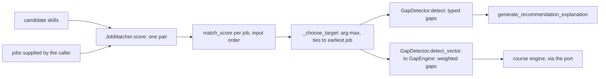
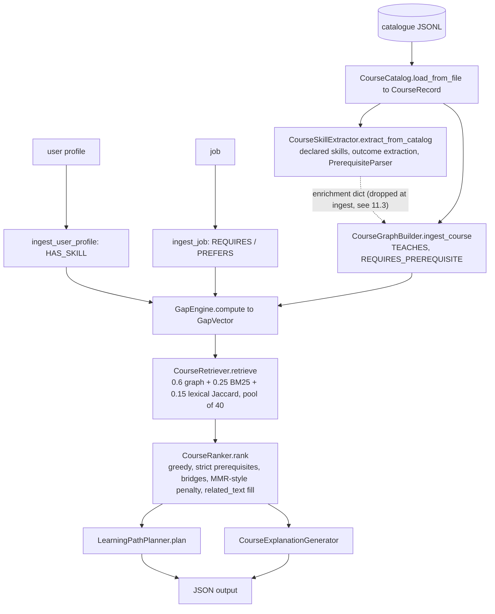
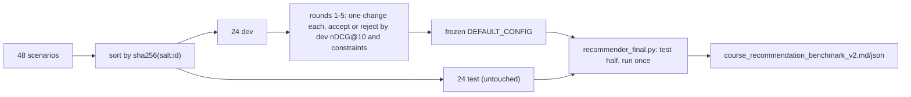

# How the job-recommendation and course-recommendation engines are built: process, algorithms and evaluations

Audience: the thesis author and the advisor. Written from a read-only investigation of `SkillLLM_v2_stage2` (CPU only; no model was run, no existing file was modified).
Every number below was read from a file in the repository; the file is named next to it (short tags are defined in section 0.2). Where two files disagree this is
said explicitly (collected in Appendix C). Statements about code behaviour were checked by reading the code, not by trusting the docs; a few were additionally checked with
a one-line pure-Python probe, and those are marked **[probe]**. Anything that could not be verified is marked **[UNVERIFIED]**.

Status of this document: describes the tree as it stands on 2026-10-28 (latest benchmark artefacts dated 2026-10-23).

---

## Table of contents

- 0. Reading guide (conventions, source tags, what "job recommendation" means here)
- 1. Executive summary (what exists, what was measured, what can be claimed)
- **Part A. Shared foundation**
  - 2. From text to canonical skills (brief)
  - 3. Data schemas (user profile, job, course, gap records, output)
  - 4. Knowledge-graph schema, the two builders, local vs Neo4j stores
  - 5. End-to-end flow (stages 8-12, the `CourseRecommenderPort` seam)
- **Part B. Job matching and the gap engine**
  - 6. What job-side functionality exists (and what does not)
  - 7. `JobMatcher`: formula, skill keys, alias handling
  - 8. Gap computation: `GapDetector` (typed gaps) and `GapEngine` (weighted vector)
  - 9. Job-side explanation, configuration, failure modes
- **Part C. Course recommendation engine, step by step**
  - 10. Ingestion, course-skill extraction, prerequisite parsing
  - 11. Course graph building
  - 12. Gap vector as the recommender's input
  - 13. Hybrid candidate retrieval
  - 14. The ranker (all score terms, prerequisite modes, bridges, redundancy, fill)
  - 15. Learning-path planner
  - 16. Explanation generator and the minimum JSON output
  - 17. The pipeline object, the frozen tuned config vs the legacy config
- **Part D. How it was developed and evaluated**
  - 18. The original benchmark and why it was replaced
  - 19. The rebuilt benchmark: catalogue, scenarios, labels, review sample
  - 20. Metrics, baselines, statistics
  - 21. The dev/test split and the 5-round tuning loop
- **Part E. Results**
  - 22. Course engine: benchmark v1, v2 (test, dev, all 48), tuned vs legacy, strongest baseline, sensitivity, trade-offs
  - 23. Job side: match / gap / e2e module evaluations, bug-fix before/after, integrity controls
- **Part F. Honest assessment**
  - 24. What can and cannot be claimed; open defects; threats to validity; ranked next steps
- **Part G. Reproduction**
  - 25. Commands, config locations, tests, file/module index
- Appendix A: glossary. Appendix B: numbers at a glance. Appendix C: disagreements between files and unverified items. Appendix D: files read.

---

## 0. Reading guide

### 0.1 Conventions

- "Gap" = a job skill the candidate does not (fully) have. "Gap weight" = the engine's priority for closing it (section 8.3).
- `nDCG@10` uses gain `2^grade - 1` (section 20.1). Relevant for P/R/MAP means grade >= 2.
- "Held-out test half" = 24 scenarios fixed by a sha256 split before tuning (section 21). Everything else is either tuned-on or partly tuned-on and is labelled so.
- "By construction" = a number that is guaranteed by how the metric and the system (or baseline) were built, so it carries no evidential weight.

### 0.2 Source tags used in tables

| tag | file |
|---|---|
| `V1` | `reports/skillllm_v2/course_recommendation_benchmark.md` (legacy Full, 48 scenarios) and `.json` |
| `V2` | `reports/skillllm_v2/course_recommendation_benchmark_v2.md` and `.json` (`V2J`) |
| `LOOP` | `reports/skillllm_v2/recommender_loop_log.md` / `.json` |
| `SPLIT` | `reports/skillllm_v2/recommender_split.json` |
| `SUITE` | `reports/skillllm_v2/eval_suite/REPORT.md`; `RES` = `eval_suite/results.json` |
| `BFM` | `docs/BUGFIX_LOG_MATCH.md` (match / gap / e2e fixes) |
| `BFG` | `docs/BUGFIX_LOG.md` (context / graph / explanation fixes, plus the privacy data-change note) |
| `IAE` | `docs/INFERENCE_AND_EVALS.md` (audit dated 2026-10-22; parts are superseded, see Appendix C) |
| `IP` | `docs/INFERENCE_PIPELINE.md` |
| `NEO` | `docs/NEO4J_GRAPH.md` |
| `EL` | `docs/EVAL_LANDSCAPE.md` |
| `ES` | `docs/EVAL_SUITE.md` |
| `TD` | `docs/thesis_drafts/evals.md` |
| code | paths under `src/skillllm_v2/` (written without the prefix `src/skillllm_v2/` in later tables only when unambiguous) |

### 0.3 What "job recommendation" means in this repository

Established by reading `match/*`, `recommend/gap_vector.py`, `pipeline/inference.py` (stages 8-12), `api.py` and the evals. **There is no component that retrieves or recommends jobs
from a job corpus for a user.** The job side consists of:

1. scoring one (candidate, job) pair with a fixed rule (`JobMatcher.score`);
2. detecting and weighting skill gaps for one (candidate, job) pair (`GapDetector`, `GapEngine`);
3. a convenience that, if several jobs are *supplied by the caller*, scores each of them and picks the best-scoring one as the "target job" for gap and course analysis
   (`SkillLLMV2Pipeline._choose_target`, ties resolved to the earliest supplied job); the per-job scores are returned in input order, not sorted (`MatchArtifact.matches`);
4. a lexical overlap lookup over the supplied jobs in stage 8 (`ContextualRetriever.search`, top 5) whose result is stored in `ProfileArtifact` but is not used by match or courses.

So the correct description is "matching and ranking of given jobs", not "job recommendation". The ranking quality of `JobMatcher` over a set of candidate jobs is measured on a synthetic
benchmark (section 23.1); no real job posting corpus is searched anywhere.

---

## 1. Executive summary

| Question | Answer (with source) |
|---|---|
| What is the course engine? | A rule-weighted, graph-assisted recommender over a skill gap: gap vector -> hybrid candidate pool -> greedy ranker with strict prerequisites, bridge courses, MMR-style redundancy and a "related text" fill -> prerequisite-ordered learning path -> template explanations (`pipeline/course_recommendation_pipeline.py`, `recommend/*`). No learned model is involved in ranking. |
| What is the job engine? | A fixed linear coverage formula (`JobMatcher`), a typed gap detector (`GapDetector`) and a weighted gap vector (`GapEngine`). No job retrieval. |
| Was the original benchmark valid? | No (circular; the code of the original benchmark is not in the repository history, only its residue, see section 18). It was replaced by an independent benchmark with hand-authored needs and rule-derived graded labels (section 19). |
| Headline result on held-out data | Tuned Full nDCG@10 = 0.885 [0.851, 0.916] on 24 test scenarios; strongest baseline (graph-free Gap-Overlap Greedy + prerequisite filter) 0.851 [0.808, 0.890]; difference +0.035 [-0.006, +0.072], Holm p = 0.094, **not significant** (`V2`). |
| What the tuned system clearly gains | Prerequisite violation rate 0.000 (legacy 0.067 on test), list length 9.88 instead of 8.3, nDCG@10 +0.030 [+0.007, +0.055] over legacy (raw p 0.005) (`V2`). The 0.000 violation rate is partly by construction (section 22.6). |
| What it does not show | Superiority over a simple graph-free baseline; validity of the labels (0 of 60 review rows graded); performance on real catalogues or learners (everything is synthetic); that the tuning gain survives a label rule without the prerequisite rule (tuned is *lower* than legacy there, section 22.5). |
| Job side | nDCG@10 0.9905 on an authored synthetic benchmark (ceiling-like, shares the notion of coverage with the matcher); informative parts are baselines, robustness deltas, ties (47.7% of scores are clamped to 0) and bug findings (`SUITE`, `BFM`). |
| Known open defects | `GapEngine` weak-vs-transferable inversion; `CourseGraphBuilder` non-idempotent ingest, colliding ids for `C/C++/C#`, fabricated relations in `trace_explanation_path`; gap-to-course linkage 0.52 vs oracle 1.0; learner-level suitability untested; the course-skill extraction enrichment never reaches the graph **[probe]** (section 11.3). |

---

# Part A. Shared foundation

## 2. From text to canonical skills (brief)

Both engines consume *canonical skills*. The text-to-skill layer is documented in `IP` (`docs/INFERENCE_PIPELINE.md`) and audited in `IAE`; only what the recommenders depend on is summarised here.

| Step | Component | What the recommenders rely on | Source |
|---|---|---|---|
| 1-7 | extract -> merge -> refine -> verify -> calibrate -> link -> gate (`pipeline/inference.py::SkillLLMV2Pipeline.stage_*`) | list of skill dicts `{surface_form, label HARD/SOFT, start, end, source, confidence, evidence, canonical_skill_id, canonical_skill_name, metadata}` (`schema.py::SkillCandidate`, validated by `schema.validate_skill`) | `IP`, code |
| link | `normalize/taxonomy_linker.py::TaxonomyLinker.link` | cascade exact alias (conf 1.0) -> normalised canonical name (0.96) -> `SequenceMatcher` >= 0.88 (fuzzy) -> BM25 over alias terms -> optional dense (off by default, `dense_model_name=None`). Falls back to a 4-entry table when no alias table loads | code |
| alias tables | `data/skillllm_v2/taxonomy/skill_aliases.jsonl` (711 lines), packaged `resources/offline_aliases.jsonl` (286 lines) | line counts read with `wc -l`; their composition (601 SkillSpan-gold rows, 76 mined from test-split predictions, ...) is quoted from `IAE` and not re-verified | `IAE` |
| canonical key for matching | `match/skill_keys.py::SkillKeyResolver`, `schema.graph_key`, `schema.normalize_text` | see section 7.2 and 4.2 | code |

Key points for interpreting the recommender evaluations:

- The extractor itself was measured on real data (SkillSpan test, 974 documents): Raw Mistral LoRA exact-span F1 0.6701 [0.6464, 0.6944] (`SUITE`, `extract.mistral_lora.exact_span_f1`). Nothing downstream was measured on real data.
- **The course benchmark bypasses extraction.** Scenario profiles and jobs are authored skill-name lists in the catalogue's own vocabulary (`inputs/courses/benchmark_scenarios.jsonl`), so linking, alias resolution and extraction errors play no role in the benchmark numbers (`IAE` item 10; confirmed by reading `eval/recommender_benchmark.py`).
- `normalize_text` (lower-case, non-word characters to spaces) maps `C`, `C++`, `C#` to `c` and `.NET` to `net`; `graph_key` was added to keep them apart in the new graph layer and matcher but is **not** used by `CourseGraphBuilder` or by `GapEngine` (section 4.2, `BFG` bug 10).

## 3. Data schemas

### 3.1 User profile (as consumed by the engines)

Defined by usage, not by one class. Two shapes are accepted (`GapEngine.compute`, `CourseGraphBuilder.ingest_user_profile`, `JobMatcher.score`):

| Field | Meaning | Notes |
|---|---|---|
| `user_id` | id | default `"user"` / `"default_user"` |
| `skills` | list of `str` or dict `{canonical_skill_id, canonical_skill_name, surface_form/name, confidence, mastery_level/mastery, last_seen, evidence, taxonomy}` | a string means confidence 1.0, mastery `proficient`. For a dict, `user_strength = confidence x MASTERY_WEIGHTS[mastery]` (section 8.3) |
| `skill_entries` | optional extra dict list merged into `JobMatcher` / `GapDetector` held skills | `pipeline/inference.py::_matching_profile` fills it (canonical id + name + surface + confidence) |
| `weak_skills`, `outdated_skills`, `uncertain_skills` | name lists | the inference pipeline derives only `uncertain_skills` (confidence < `matching.uncertain_confidence_below`, default 0.5); `weak_skills` are not derived (`IP`) |
| `transferable_skills` | `{skill: origin_skill}` | supplied by the caller; never derived by the pipeline (the graph route is inert, section 4.3) |
| `target_roles` | list of titles | used only by the ranker's goal-alignment term |
| `experience_level` | `junior/mid/senior` or `beginner/intermediate/advanced` | read by `CourseRanker.learner_level`; **the benchmark's `user_profile` dicts do not contain it** (it is stored one level up in the scenario record), so the learner level defaults to `intermediate` in all benchmark runs **[probe: `benchmark_scenarios.jsonl` user_profile keys are `user_id, skills, target_roles`]** |
| `preferences.max_course_hours` | float | default 60.0 (workload penalty) |

### 3.2 Job record

| Field | Meaning |
|---|---|
| `job_id`, `title`, `text` (optional) | text is read only by the text baselines of the benchmark, never by the recommender |
| `required_skills`, `preferred_skills` | lists of `str` or dict `{skill_name/name, canonical_skill_id, canonical_skill_name, importance, source_sentence}`. Defaults: importance 1.0 (required), 0.7 (preferred) |
| `semantic_role_fit`, `experience_level_fit`, `user_preference_fit` | floats in [0, 1] supplied by the caller; **0.0 if absent** (for text jobs they are always 0.0; the stage records a note, `pipeline/inference.py::stage_match`) |

### 3.3 Course record (`course/ingest_catalog.py::CourseRecord`)

`course_id, title, description, learning_outcomes[], teaches_skills[], prerequisites[], level (beginner|intermediate|advanced; anything else -> intermediate), duration_hours (default 20.0), provider (default "Generic"), rating (default 4.5), cost_usd (0.0), url, canonical_skills[], canonical_prerequisites[], metadata{}`.
`CourseCatalog._dict_to_record` accepts aliases (`id`, `course_name`, `name`, `outcomes`, `skills`, `taught_skills`, `prerequisite_skills`, `duration`, `cost`), splits delimited strings on `; , |` or JSON lists, and raises if `course_id` is missing. JSONL, JSON and CSV are supported. Note: duplicate `course_id`s silently overwrite each other (`self._courses[record.course_id] = record`); this is an id-collision hazard when catalogues are merged.

### 3.4 Skill-gap record (`recommend/gap_vector.py`)

| Class | Fields |
|---|---|
| `SkillGap` | `canonical_skill_id, skill_name, gap_type {missing_critical, missing_preferred, weak_skill, outdated_skill, uncertain_skill, covered_by_transferable_skill}, importance, requirement_strength {required, preferred}, user_strength in [0,1], gap_weight in [0,1], source_sentence, evidence, transferable_from, metadata` |
| `GapVector` | `user_id, job_id, gaps[SkillGap], vector {skill_id -> gap_weight}, total_gap_mass, critical_count, preferred_count, weak_count`; `get_gap_weight(id)` falls back to `normalize_text(id)` |

`GapDetector.detect` returns the legacy dict form `{skill, gap_type[, transferable_from], requirement_strength, skill_key[, also_listed_as_preferred]}` (section 8.1). `schemas.py` also defines `JobMatchResult` and `CourseRecommendation`
dataclasses; they are not instantiated anywhere (`IAE` section 1; the matcher returns plain dicts).

### 3.5 Recommendation output (minimum JSON contract)

Per recommended course (`recommend/explanation_generator.py::CourseExplanationGenerator.generate_explanation`): `course_id, title, rank, score, role {primary|bridge|related_text}, unlocks[], covered_missing_skills[], prerequisite_status{is_satisfied, status_code, satisfied[], missing[], explanation}, evidence[], explanation_path[], limitations[], next_profile_update_action{trigger, course_id, skills_to_add[], target_mastery, profile_update_schema}`.
Whole pipeline result (`CourseRecommendationPipeline.run`): `user_profile` summary, `target_job`, `skill_gap_analysis` (= `GapVector.to_dict()`), `recommendations`, `learning_path`, `pipeline_metadata {total_catalog_courses, graph_nodes, graph_edges}`.

## 4. Knowledge-graph schema, builders and stores

### 4.1 Node and edge types (`graph/schema.py`)

Nodes: `User, Profile, Job, Course, Skill, SkillCluster, Occupation, Prerequisite` (the last four are declared but not populated by the recommenders). Edges: `HAS_SKILL, MISSING_SKILL, REQUIRES, PREFERS, TEACHES, REQUIRES_PREREQUISITE, RELATED_TO, SIMILAR_TO, BELONGS_TO`.
`MISSING_SKILL` is created only in the inference pipeline's stage 9 (`stage_graph`) and is *derived* (not stored) in Neo4j (`NEO`).

Edge properties (provenance fields):

| Edge | Properties |
|---|---|
| `HAS_SKILL` | `confidence, evidence_text, source, last_seen (when known), mastery_level` (course builder only) |
| `REQUIRES` / `PREFERS` | `importance, requirement_strength, source_sentence` |
| `TEACHES` | `confidence, depth, learning_outcome_evidence, outcome_index` (course builder) / `source` (skill builder) |
| `REQUIRES_PREREQUISITE` | `prerequisite_evidence, level, strictness` (course builder); Neo4j: `level, strictness, evidence, source` |
| `RELATED_TO` | `relation_type, weight` |

### 4.2 Two builders with different guarantees

| | `graph/graph_builder.py::SkillGraphBuilder` | `graph/course_graph_builder.py::CourseGraphBuilder` |
|---|---|---|
| Used by | inference pipeline stage 9, `LocalGraphStore` | `CourseRecommendationPipeline`, `CourseRetriever`, `CourseRanker`, `GapEngine(graph=...)` |
| Node id | caller-supplied; the pipeline uses `skill:<graph_key(name)>` | skill node id = `normalize_text(name)` or the canonical id |
| Edge identity | one edge per `(source, target, type)` (edge key = type): idempotent | plain `MultiDiGraph.add_edge` without key: **re-ingest doubles edges** (`graph.ingest_idempotence` 0.5, `BFG`) |
| Retyping / dangling | warns, `strict=True` raises | silent |
| `last_seen` | explicit or injected clock, else absent | `_utc_now_iso()` wall clock when unknown (non-deterministic) |
| Symbols | `graph_key` keeps `c++`, `c#`, `.net`, `node.js` distinct | `normalize_text`: `C`, `C++`, `C#` collide on `c` |
| Explanations | `explain_skill_path`, `narrate_skill_trace` (narrates only existing edges) | `trace_explanation_path` fabricates "required"/"teaches" when the edge is missing (`BFG` bug 8, not fixed in place) |

`graph_key` (in `schema.py`): lower-case, keeps a trailing `+`/`#` run, a leading `.` before a word, and a `.` between a word and an alphabetic segment; everything else as `normalize_text`.

### 4.3 What the course graph actually contains in a run

`CourseRecommendationPipeline.__init__` ingests every enriched course; per request it ingests the user (`ingest_user_profile`) and the job (`ingest_job`) into the same graph. Edge types present: `HAS_SKILL`, `REQUIRES`, `PREFERS`, `TEACHES`, `REQUIRES_PREREQUISITE`.
`CourseGraphBuilder.add_skill_relation` (`RELATED_TO`) is **never called** by any pipeline code (`grep`), so the "transferable via graph edge" branch in `GapEngine.compute` (`graph.graph.has_edge(u_sid, sid)`) is inert in the course pipeline.
The demo output records a graph of 59 nodes and 75 edges for the 15-course demo catalogue (`reports/skillllm_v2/demo/course_recommendations.json`, `pipeline_metadata`).
The benchmark resets the graph per scenario (`full.graph.graph = base_graph.copy()`) so users and jobs do not accumulate (`eval/recommender_benchmark.py`).

### 4.4 Local NetworkX store vs Neo4j (`graph/store.py`, `local_store.py`, `neo4j_store.py`, `store_factory.py`; `NEO`)

- Contract `GraphStore` (Protocol); every call returns `StoreResult(value, backend, fell_back, error, elapsed_ms, ok)`. Operations: `upsert_nodes/edges`, `user_skills`, `job_skills(strength)`, `skill_gap`, `courses_teaching`, `prerequisite_chain`, `explain_path`, `stats`, `health`, `clear_namespace`.
- Global ids with prefixes `user:`, `job:`, `skill:`, `course:`; every node/edge carries `project` (namespace `skillllm_v2`) and `build_id` (content hash of the plan).
- Labels: `User, Job, Skill, Course`; relationships `HAS_SKILL, REQUIRES, PREFERS, TEACHES, REQUIRES_PREREQUISITE, RELATED_TO` (`store.py::LABELS/REL_TYPES`). `PREFERS` was added to the project's five types; `MISSING_SKILL` is derived.
- Backends and fallback (`store_factory.py`):

| mode | behaviour |
|---|---|
| `local` (pipeline default `graph.backend: local`) | NetworkX only |
| `neo4j` | Neo4j only; failures come back as `StoreResult(ok=False)`; missing credentials raise `SettingsError` |
| `auto` | try Neo4j; on any failure answer from the local graph (`fell_back=True`, redacted error, one warning); never raises because Neo4j is down |
| `mirror` | local always built and written; writes also synced to Neo4j when reachable; reads prefer Neo4j with mid-flight fallback |

  A health probe result is cached for 30 s (`health_ttl_seconds`); transient errors are retried twice with exponential backoff; TLS-only URIs (`neo4j+s`, `bolt+s`); parameterised Cypher only; writes restricted to the `skillllm_v2` / `skillllm_v2_test[_x]` namespaces; plans above 50,000 nodes are refused (`NEO`).
- Only the *catalogue* graph is read from Neo4j in stage 9; the user's skills and the target job stay in the in-memory graph; nothing about a user or job is written to Neo4j (`NEO`, `inference.py::_graph_store_lookup`).
- Live build quoted in `NEO` (not re-verified here, no network): 533 nodes (42 User, 43 Job, 275 Skill, 173 Course) and 857 relationships; 100/100 parity queries; Neo4j 100-1000x slower per call than in-process NetworkX. `NEO` says "173 Course" while the catalogue has 171 courses plus 2 demo courses (171 + 2 = 173; consistent with its "demo courses" bullet).
- `graph/neo4j_adapters.py` canonicalises ids through the curated alias table instead of `normalize_text`, so the adapter avoids the `C`/`C++` collision that `CourseGraphBuilder` has (`NEO`, "Limits"). 113 catalogue/scenario skills are not in the curated alias set and become `derived_skill` nodes (`NEO`).

## 5. End-to-end flow

```mermaid
flowchart LR
  subgraph TXT["Text layer (stages 1-7)"]
    P["profile text"] --> X1["extract, merge, refine, verify, calibrate"]
    X1 --> L["link: TaxonomyLinker"]
    L --> G7["gate: non-regression"]
  end
  J["job: text, one job dict, or a list of job dicts"] --> JX["job_extract: stages 1-6 if text"]
  G7 --> S8["8 profile: context packet, ContextualRetriever over supplied jobs"]
  S8 --> S9["9 graph: SkillGraphBuilder, MISSING_SKILL, explain_skill_path"]
  S9 --> S10["10 match: JobMatcher, GapDetector.detect, detect_vector"]
  JX --> S10
  S10 --> S11["11 courses: CourseRecommenderPort ONLY"]
  S11 --> S12["12 explain: generate_recommendation_explanation + limitations"]
  S11 -. adapter .-> CRP["CourseRecommendationPipeline.run"]
  CRP --> GE["GapEngine"] --> RET["CourseRetriever"] --> RK["CourseRanker"] --> LP["LearningPathPlanner"] --> EX["CourseExplanationGenerator"]
```



- Stage list and artifacts: `IP` table; code `pipeline/inference.py::SkillLLMV2Pipeline.stage_profile ... stage_explain`; `run()` calls them in order and treats stages 8-12 as optional (`continue_on_error: true` records `failed` and moves on).
- **Target selection** (`_choose_target`): explicit `target_job_id`; single job; otherwise the job with the highest `JobMatcher` score (ties -> earliest in the input list).
- **Stage 11 builds the request itself**: user skills with canonical id/name/confidence/evidence, `target_roles = [job title]`, and job skills as dicts with `canonical_skill_id` and importance 1.0 (required) / 0.7 (preferred) (`stage_courses`, `port_skill`). The gap list from stage 10 is passed but ignored by the adapter's pipeline, which recomputes its own `GapVector` (`course_port.py` docstring, `CourseRecommendationRequest.gaps`).
- **The seam**: `pipeline/course_port.py::CourseRecommenderPort` (`typing.Protocol`: `name`, `is_available()`, `recommend(request) -> CourseRecommendationResponse`). Implementations: `CourseRecommendationPipelineAdapter` (lazy construction; returns an `UNAVAILABLE` response rather than raising when the catalogue or import is missing; adds `course_name` from `title`) and `NullCourseRecommender` (explicit no-op with the note `NULL IMPLEMENTATION ...`). `build_course_recommender(mode)` accepts `null | adapter | auto`. `inference.py` imports nothing from `course/`, `recommend/` or `course_recommendation_pipeline` (a test enforces it, per `IP`; the test itself was not re-run).
- **Stage 12** (`stage_explain` -> `match/explanation_generator.py::generate_recommendation_explanation`) explains the *job match*: matched/missing skills, profile evidence per skill, computed limitations. It adds extraction-policy and course-recommender limitations. It is a different generator from the course explanation generator (section 16).
- Library entry points: `api.py::SkillLLM.analyze(profile_text, job_text)` runs the pipeline (falls back to plain set overlap with `method="set_overlap"` if the pipeline import fails); `SkillLLM.recommend(...)` calls the course adapter and **requires** an explicit `catalog_path`, a `networkx` install and the `recommend` extra, else raises `FeatureUnavailableError`.
- Default demo wiring uses the 15-course demo catalogue `inputs/courses/course_catalog.jsonl` (`configs/skillllm_v2_inference.yaml`, `courses.catalog_path`; 15 lines read with `wc -l`). The file `reports/skillllm_v2/demo/inference_result.json`, which `IP` says the demo script writes, **does not exist in the tree** (not generated or not committed), so no stored end-to-end demo output was available to read; the stored `reports/skillllm_v2/demo/course_recommendations.json` (2026-10-21) predates the switch of the pipeline default to the tuned config: its top-ranked course has unsatisfied prerequisites and no `role` field, i.e. it was produced by the legacy ranker.


---

# Part B. Job matching and the gap engine

## 6. What job-side functionality exists (and what does not)



| Capability | Exists? | Where | Notes |
|---|---|---|---|
| Score one (candidate, job) pair | yes | `match/job_matcher.py::JobMatcher.score` | fixed formula, section 7 |
| Rank a *given* set of jobs for a candidate | indirectly | caller sorts `match_score`; `inference.py::_choose_target` takes the arg-max (ties -> earliest job); `match_evals.py` ranks 42 jobs per candidate by `JobMatcher.score` | `MatchArtifact.matches` is in input order, not sorted |
| Retrieve jobs from a corpus for a user | **no** | - | stage 8 `ContextualRetriever` is a lexical overlap over the supplied jobs (`retrieval/contextual_retrieval.py`: share of query terms present; no BM25 despite its docstring), result stored but unused downstream |
| Typed skill gaps | yes | `match/gap_detector.py::GapDetector.detect` | section 8.1 |
| Weighted gap vector | yes | `recommend/gap_vector.py::GapEngine.compute`, `GapDetector.detect_vector` | section 8.2-8.3 |
| Importance weights | gap side only | `GapEngine` (per-skill `importance`, strength multipliers) | `JobMatcher` ignores per-skill importance |
| Career-path / "next best job" suggestions | no | - | - |
| Job-side explanation | yes | `match/explanation_generator.py::generate_recommendation_explanation`, called from stage 12 | section 9.1; `IAE` (written earlier) says it is never imported, which is out of date: `stage_explain` imports it |
| Evaluation | yes (synthetic) | `evals/match_evals.py`, `gap_evals.py`, `e2e_evals.py` | section 23 |

## 7. `JobMatcher`

### 7.1 Formula (read from `match/job_matcher.py`)

Let `R` be the set of distinct required skills (after key de-duplication), `P` the distinct preferred skills, `held` the union of keys of all candidate skills (`skills` + `skill_entries`).

```
required_coverage  rc = |{r in R : keys(r) ∩ held ≠ ∅}| / max(1, |R|)
preferred_coverage pc = |{p in P : keys(p) ∩ held ≠ ∅}| / max(1, |P|)
missing            = sorted names of required skills with no key in held
critical_penalty   cp = |missing| / max(1, |R|)            (= 1 - rc when R is non-empty, else 0)
score = clip_[0,1]( 0.45·rc + 0.20·pc + 0.15·semantic_role_fit + 0.10·experience_level_fit + 0.10·user_preference_fit − 0.25·cp )
```

| Aspect | Behaviour (verified in code) |
|---|---|
| Weights | hard-coded literals 0.45 / 0.20 / 0.15 / 0.10 / 0.10 / -0.25; no config file, no learning, no validation study (the `AnalysisResult` docstring in `api.py` itself says "no validation study behind it") |
| Fit fields | read with `float(job.get(...))`, default 0.0, **not individually clamped**; only the final score is clamped |
| Clamping | `max(0, min(1, score))`. Because `rc` is penalised twice (+0.45·rc and −0.25·(1−rc)), the score is `0.70·rc − 0.25 + 0.20·pc + fit terms`; with no fit fields it is negative (hence clamped to 0) whenever `rc` is small (e.g. `rc=0.2`, `pc=0.3` gives 0.14 − 0.25 + 0.06 = −0.05 -> 0; with `pc=0` the break-even is `rc` = 0.25/0.70 ≈ 0.357) |
| Maximum without fit fields | `0.45 + 0.20 = 0.65`, so the label "Strong fit" (threshold `score >= 0.7`) is **unreachable** when the three fit fields are 0.0 (always the case for text jobs in the pipeline) |
| Empty lists | no required skills -> `rc = 0` and `cp = 0`; no preferred skills -> `pc = 0` (not 1). A job with no preferred list therefore loses up to 0.20 relative to a job whose preferred skills are all matched |
| Ties | no tie-breaking inside the matcher; equal scores stay equal. 47.7% of (candidate, job) scores are exactly 0 and 43.1% of adjacent pairs in the top 10 are tied on the synthetic benchmark (`SUITE`/`RES`: `match.score_zero_clamp_rate`, `match.tie_rate_top10`). Reported nDCG@10 breaks ties by `job_id`; the optimistic-minus-pessimistic tie-break spread is 0.0102 [0.0031, 0.0197] (`match.tie_sensitivity_spread`) |
| Output | `{job_id, match_score, matched_skills (sorted union of matched required and preferred job-side names), missing_skills (required only, sorted), critical_missing_skills (identical to missing_skills), evidence ["required coverage=0.50", "preferred coverage=1.00"], recommendation_reason ("Strong fit" if >= 0.7 else "Fit depends on closing missing skill gaps")}` |
| Missing preferred skills | not reported anywhere in the match record |
| Worked check | stored demo `reports/skillllm_v2/demo/job_matches.json` (2026-08-10): job `ml-platform` (R = {Python, AWS}, P = {Docker, communication}, fits 0.8): `0.45·0.5 + 0.20·1 + 0.12 + 0.08 + 0.08 − 0.25·0.5 = 0.58`, which equals the stored `match_score` 0.58 |

### 7.2 Alias, case and symbol handling (`match/skill_keys.py`)

- `skill_key(value)`: NFKC, `casefold`, strip, remove whitespace before `+`/`#`, then `schema.graph_key`. Keeps `c++`, `c#`, `f#`, `.net`, `node.js` distinct from `c`, `net`, `node js`.
- `SkillKeyResolver.keys(item)` returns a *set* of keys; two skills are "the same" if the sets intersect. For a string: the literal key plus, if the surface is symbol-free, the key of its alias-resolved canonical name (only when the alias differs from the surface by more than erased symbols, so `C` never merges with `C++`). For a dict: canonical id and canonical name keys take precedence over a surface form whose alias resolves to a *different* skill. Lossy ids (id `c` for surface `C++`) are ignored.
- Alias evidence is exact only (`AliasResolver.resolve` is a dictionary lookup on `normalize_text`); no fuzzy matching. `default_alias_resolver()` loads the repo alias table and the packaged `resources/offline_aliases.jsonl` once per working directory; if neither loads, matching silently continues on literal keys (`use_default_aliases=False` forces literal keys).
- `unique(items)` de-duplicates by primary key, so `Python` and `python` count once.
- Residual blind spots are alias-table coverage, not logic: the log lists `py`/`python3` -> Python, `PowerBI`, `TF`, `TS`, `version control`, `REST`, `PM`, `automated testing` as unknown (`BFM`).

## 8. Gap computation

### 8.1 `GapDetector.detect` (typed gaps, `match/gap_detector.py`)

Iterates required then preferred skills; one entry per distinct job skill (a skill listed as both is reported once, as required, with `also_listed_as_preferred: true`).

| Condition (evaluated in this order) | `gap_type` |
|---|---|
| job skill not held and a transferable source exists for any of its keys | `covered_by_transferable_skill` (+ `transferable_from`) |
| not held, required | `missing_critical` |
| not held, preferred | `missing_preferred` |
| held and key in `weak_skills` | `weak_skill` |
| held and key in `outdated_skills` | `outdated_skill` |
| held and key in `uncertain_skills` | `uncertain_skill` |
| otherwise | no gap |

Each entry also carries `requirement_strength` and `skill_key` (the legacy types have no preferred variants, so strength is a separate field). `covered_by_transferable_skill` is assigned only to skills the user does **not** hold (a 2026-10 fix, `BFM` bug 2). The detector classifies only from the explicit lists; it does not infer weakness from a low strength.

### 8.2 `GapDetector.detect_vector` and the alignment step

`detect_vector` calls `GapEngine.compute` after `_align_profile`, which re-keys every user skill (and the weak/outdated/uncertain lists and the transferable map) onto the job's own skill ids whenever `SkillKeyResolver` says they are the same skill. The job ids themselves are unchanged so course linkage by id is unaffected. For skills that match no requirement, only `skills` entries are passed through (not `skill_entries`). Exact-input results are identical to calling the engine directly (tested in `tests/skillllm_v2/test_match_fixes.py`).

### 8.3 `GapEngine.compute` (weighted vector, `recommend/gap_vector.py`)

Constants: `STRENGTH_MULTIPLIER = {required: 1.0, preferred: 0.7}`; `MASTERY_WEIGHTS = {beginner 0.35, intermediate 0.70, proficient 1.0, advanced 1.0, master 1.0}` (unknown level -> 0.7); thresholds `weak_threshold = 0.5`, `uncertain_threshold = 0.6`, `obsolescence_days = 730`.

Held skills: string -> id `normalize_text(s)`, strength 1.0. Dict -> id `canonical_skill_id` or `normalize_text(surface/name)`, `user_strength = confidence × MASTERY_WEIGHTS[mastery]`.
Job requirements: required default importance 1.0, preferred default 0.7; the strength multiplier is applied on top, so a *string* preferred skill gets weight 0.7 × 0.7 = **0.49** (the demo output shows Kubernetes 0.56 = 0.8 × 0.7 and CI/CD 0.49 for importance 0.7).

| Situation | Gap type | `user_strength` | `gap_weight` |
|---|---|---|---|
| not held; `transferable_skills[id]` or a graph edge held-skill -> job-skill exists | `covered_by_transferable_skill` | fixed 0.4 | `importance × mult × (1 − 0.4)` = 0.6 × importance × mult |
| not held, required | `missing_critical` | 0.0 | `importance × 1.0` |
| not held, preferred | `missing_preferred` | 0.0 | `importance × 0.7` |
| held, in `outdated_skills` or `last_seen` older than 730 days | `outdated_skill` | held strength | `importance × mult × (1 − strength)` |
| held, in `weak_skills` or strength < 0.5 | `weak_skill` | held strength | same formula |
| held, in `uncertain_skills` or confidence < 0.6 | `uncertain_skill` | held strength | same formula |
| otherwise | no gap | - | - |

The checks for held skills run outdated -> weak -> uncertain and the first hit wins (the detector orders weak -> outdated -> uncertain; see 8.4). `total_gap_mass = Σ weights`; `critical_count` counts missing required skills only; `weak_count` counts weak skills only.

Observations from the code (not from docs):
- An *outdated* skill that is otherwise at full strength gets weight `(1 − 1.0) = 0`; it is in `vector` with weight 0 and therefore contributes no pull to any course.
- The graph-based transferable branch cannot fire in the course pipeline because no `RELATED_TO` edges are created (section 4.3).
- Importance can exceed 1 for caller-supplied dicts; weights are bounded by `importance × mult`.

### 8.4 Known inconsistencies

1. **Weak-vs-transferable inversion (open, not fixed).** A skill that is *not held but covered by a transferable skill* has fixed strength 0.4 (weight 0.6·importance·mult). Once the user *holds* the skill weakly (e.g. confidence 0.8 × beginner 0.35 = strength 0.28) the held branch never consults the transferable map and the weight becomes 0.72·importance·mult, i.e. **acquiring a weak version of the skill raises the gap**. Reproduced in `BFM` (0.60 vs 0.72) and measured: violation rate **0.8775** [0.845, 0.9075], 351 of 400 random cases (`gap.prop.engine.weakly_held_skill_not_worse_than_transferable_cover`, `RES`; the example stored there is Airflow 0.534 vs 0.784). A fix is proposed in `BFM` section 5 (`effective_strength = max(user_str, 0.4)` when a transferable cover exists); it is not implemented (`recommend/` was out of scope). The eval caveat text says "strength<0.4" while the code threshold is `weak_threshold = 0.5`; a stale text in the eval module.
2. **Detector and engine classify held skills differently.** The engine infers `weak_skill` from `strength < 0.5` and `uncertain_skill` from `confidence < 0.6`; the detector only reads explicit `weak_skills`/`uncertain_skills` lists. The engine prefers outdated over weak; the detector prefers weak over outdated. On the authored benchmark the two agree on gap *type* in 100% of shared gaps (782 gaps) and, after the fixes, on the gap *set* (Jaccard 0.8011 -> 1.0000, `BFM`), but that benchmark states each skill's state explicitly, so it does not exercise the derived-weakness path.
3. **Two "uncertain" thresholds**: the pipeline derives `uncertain_skills` at confidence < 0.5 (`matching.uncertain_confidence_below`), the engine flags < 0.6 by itself.
4. **`CourseRecommender.recommend` (legacy list path, `match/course_recommender.py`)** re-derives weights from a gap *list* as `importance` for `missing_critical` and `importance × 0.7` otherwise, a third weighting rule that differs from the engine (e.g. a `weak_skill` would get 0.7 × importance there, with `user_strength` fixed 0.0).

## 9. Job-side explanation, configuration, failure modes

### 9.1 `generate_recommendation_explanation` (`match/explanation_generator.py`)

Inputs: user profile (skill dicts with evidence lists), job match, gaps, course recommendations. Output keys: `matched_skills, missing_skills, gap_types, recommended_learning_path (course names), evidence, missing_skill_evidence, matched_without_evidence, confidence (= match_score), limitations`.
Evidence = best profile evidence line(s) (`evidence_per_skill=1`, ordered by confidence desc then text) for matched, missing and gap skills only, formatted `"<surface form>: <evidence text>"`. A missing skill has no profile evidence by definition; this is stated (`"no evidence in profile"`) rather than invented. `limitations` are computed: no match result supplied; missing skills without profile evidence; matched skills without evidence text or whose best evidence confidence is below 0.5; missing skills that no supplied course covers; no courses supplied. Stage 12 appends limitations for a stub/absent anchor, a gate fallback and an unavailable course recommender (`inference.py::stage_explain`). Stage 12 also adds `graph_paths` (user -> skill -> job explanation strings and attached course paths).
After the 2026-10 fix, 13 of 48 explanations in the explanation eval have an honestly empty `evidence` list (no matched skills), which lowered the eval's `completeness` from 1.0 to 0.729; this is documented as an eval artefact (`BFG`).

### 9.2 Configuration

No weights are configurable for `JobMatcher`. Pipeline keys (`configs/skillllm_v2_inference.yaml`): `matching.uncertain_confidence_below` (0.5), `profile.top_k_skills/top_k_jobs` (5/5), `graph.max_hops` (4), `graph.backend` (`local`). `GapEngine(weak_threshold, uncertain_threshold, obsolescence_days)` are constructor arguments; `GapDetector()` creates its own default `GapEngine()` (it cannot be configured through the detector).

### 9.3 Failure modes (verified in code or in `RES`)

| Failure mode | Behaviour |
|---|---|
| job dict without `job_id` | `KeyError` in `JobMatcher.score` (`job["job_id"]`); listed as informational, not scored, in `e2e.degradation` (`RES`) |
| `null` skill lists | `TypeError` in `GapEngine.compute` (for `skills=None`); `JobMatcher`/`GapDetector` accept `None` lists via `_as_list` |
| alias table missing/unloadable | literal-key matching only (silent) |
| clamped scores | 47.7% of benchmark pairs score exactly 0: weak candidates are indistinguishable |
| no fit fields | three terms are 0 and "Strong fit" is unreachable (section 7.1) |
| extractor exception in the text pipeline | now `degraded`/`failed` stage with the error text (`BFM` bug 4); previously escaped (graceful share 0.8182 -> 1.0, `BFM`) |
| canonical name vs surface name (`structured query language` vs `SQL`) | fixed in matcher, detector, `detect_vector` and the pipeline match stage; still lossy for course linkage (section 14.5) |

---

# Part C. Course recommendation engine, step by step (as implemented)



## 10. Ingestion, course-skill extraction, prerequisite parsing

### 10.1 Ingestion (`course/ingest_catalog.py`)

`CourseCatalog.load_from_file(path)` reads `.jsonl`, `.json` (list or `{"courses": [...]}`) or `.csv`; `_dict_to_record` normalises fields (section 3.3). No validation beyond a mandatory `course_id` and level normalisation (unknown level -> `intermediate`); no check that prerequisites are taught by any course, no duplicate-id detection.

**The 171-course synthetic catalogue** (`inputs/courses/course_catalog_large.jsonl`, built by `scripts/build_course_catalog_large.py`):

| Property | Value | Source |
|---|---|---|
| Provenance | fully synthetic; no real catalogue exists in the repo. Rows are authored as `(area, title, level, hours, taught_skills, prerequisites)` and expanded with one phrase template per skill into `learning_outcomes` (first four skills) and a one-sentence `description`; providers are fictional (`Synthetic <Area> Academy`); `rating = 3.9 + 1.0·h(id)` and `cost` (35% free) are hash-derived placeholders | script docstring and `main()` |
| Rules | a course never teaches a skill it lists as a prerequisite; the script prints orphan prerequisites (not taught by any course) and self-prerequisites | script `c()` and `main()` |
| Size, levels | 171 courses; beginner 43 / intermediate 78 / advanced 50 | computed from the file **[probe]** |
| Skills | 208 distinct taught skills; mean 1.81 taught skills per course | computed from the file |
| Prerequisites | 0 prerequisites: 67 courses; 1: 85; 2: 18; 3: 1 | computed from the file |
| Duration | mean 22.3 h, min 6, max 60 (the default `max_course_hours` is 60, so the workload penalty never fires on this catalogue) | computed from the file |
| Real-data grounding | the *skill vocabulary* was checked against the alias taxonomy and, if present, document frequencies over 1,887 real job postings (stored in `metadata.real_posting_df` as numeric counts, e.g. Python 959). Structure (levels, prerequisite chains, durations) is "common curriculum design, NOT derived from any real provider". The 1,887 figure is quoted from the script docstring; the private corpus was not read | script docstring |
| Demo catalogue | `inputs/courses/course_catalog.jsonl` (15 courses) and `inputs/demo/course_catalog.jsonl` (2 courses) for the demo path | `wc -l` |

### 10.2 Course-skill extraction (`course/extract_course_skills.py::CourseSkillExtractor`)

For each `CourseRecord` (run in the `CourseRecommendationPipeline` constructor over the whole catalogue):

1. **Declared** `teaches_skills`: each is linked with `TaxonomyLinker.link` (canonical id/name/taxonomy; unlinked -> `normalize_text` id, taxonomy `CUSTOM`); confidence 1.0, source `declared`, `depth` from `_map_level_to_depth` (beginner -> `introductory`, advanced/mastery -> `advanced`, else `intermediate`).
2. **Learning outcomes**: each outcome goes through `SkillLLMv2Pipeline.extract(outcome, include_gliner=False, include_dictionary=True, normalize=True)`; every candidate becomes an entry (source `learning_outcome`, evidence = the outcome sentence, `outcome_index`). Only the first entry per canonical id is kept in the `canonical_skills` map.
3. **Description**: only if steps 1-2 produced no skill.
4. **Prerequisites** via `PrerequisiteParser` (below), each linked to a canonical id.

Output: the course dict plus `taught_skills_evidence`, `canonical_skills` (sorted ids), `canonical_skill_names`, `parsed_prerequisites`, `canonical_prerequisites`, `canonical_prerequisite_names`. Which extractor runs inside the pipeline: `SkillLLMv2Pipeline(dictionary=..., linker=...)`, i.e. the legacy wrapper (`wrapper.py`), whose default `MistralExtractor()` without a model path is an alias-matching stub that the delegated pipeline flags as a stub (`IP`, `wrapper.py` warning text; `IAE` section 1.3 counts 8 aliases). The outcome extraction in the course pipeline is therefore dictionary/stub based, not the trained model.

### 10.3 Prerequisite parsing (`course/prerequisite_parser.py::PrerequisiteParser`)

| Input | Behaviour |
|---|---|
| list of strings (the catalogue form) | skip items matching `none / no prerequisites / no prior knowledge / open to all`; `strictness = "recommended"` if the item matches `recommended / prior experience / helpful / suggested / optional / good to have`, else `"strict"`; `level` = first matching key of `LEVEL_MAP` found as a substring (`basic, introductory, beginner, fundamental -> beginner; intermediate, working knowledge -> intermediate; advanced, proficient -> advanced`), default `beginner`; the cleaned skill name strips a leading `prerequisite(s):` / `requirements:` / `recommended:` / `prior knowledge in:` and the words `basic/intermediate/advanced/introductory` |
| free text | split into sentences on `. \n ;`, each sentence split on `,`, `and`, `;`; same strictness/level rules. (Splitting on "and" would also split names such as "Research and Development"; not guarded) |
| `known_skills` | optional mapping to restore canonical spelling |

Every prerequisite in the benchmark catalogue is a plain skill name (e.g. `"Python"`), so all benchmark prerequisites are `strict`/`beginner`; the parser's recommended/level logic is not exercised by the benchmark.

## 11. Course graph building (`graph/course_graph_builder.py::CourseGraphBuilder`)

### 11.1 Ingestion methods

- `ingest_course(course)`: course node with `title, description, level, duration_hours, provider, rating, cost_usd, learning_outcomes`. `TEACHES` edges: from `record.metadata["taught_skills_evidence"]` if present (depth, confidence, evidence, outcome index), else one edge per raw `teaches_skills` entry (`depth = course level`, confidence 1.0, evidence = course title). `REQUIRES_PREREQUISITE` edges: from `record.metadata["parsed_prerequisites"]` if present, else one per raw prerequisite (`strictness="strict"`, `level="beginner"`, evidence = the name). Skill node id = canonical id if supplied, else `normalize_text(name)`.
- `ingest_user_profile(profile)`: `HAS_SKILL` edges with confidence, evidence, `last_seen` (wall-clock now if absent), `mastery_level` property fixed at default `proficient` (the user's declared mastery is **not** copied to the edge).
- `ingest_job(job)`: `REQUIRES` (default importance 1.0) / `PREFERS` (0.7) edges with `source_sentence`.
- Helpers: `get_user_skills`, `get_job_requirements`, `get_course_taught_skills`, `get_course_prerequisites`, `evaluate_prerequisites(course_id, user_skill_ids)` (compat = satisfied / total, 1.0 when none), `trace_explanation_path` (narrative; fabricates the relation, section 4.2).

### 11.2 Provenance and alias handling

Skill nodes carry `canonical_skill_id`, `canonical_skill_name`, `taxonomy`, `aliases` (default `[name]`). Edges carry the provenance listed in section 4.1. Ids are `normalize_text` strings, so symbol-bearing names collide (`C`, `C++`, `C#` -> `c`; `BFG` bug 10, open for this builder). Idempotence is not guaranteed (`MultiDiGraph.add_edge` without a key): re-ingesting the same course doubles its edges (`graph.ingest_idempotence` 0.5, `BFG`). In the benchmark each scenario restores a graph copy so doubling does not accumulate; in a long-lived service it would.

### 11.3 Finding: the extraction enrichment does not reach the graph or the ranker **[probe]**

`CourseRecommendationPipeline.__init__` computes `enriched_courses = course_extractor.extract_from_catalog(catalog)` and then calls `graph.ingest_course(ec)` for each enriched dict. `ingest_course` converts the dict with `CourseCatalog._dict_to_record`, which reads only the nested `metadata` mapping; the enrichment keys `taught_skills_evidence` and `parsed_prerequisites` are **top-level** keys of the enriched dict and are discarded. A direct probe confirmed it: for a dict with top-level `taught_skills_evidence` and `canonical_skills`, `_dict_to_record(d).metadata` is `{'source': 'synthetic'}` (the enrichment is absent) although `canonical_skills` is carried on the record. Consequences (derived by reading `ingest_course`, `CourseRetriever`, `CourseRanker`; the pipeline itself was not run):

- the graph is always built from the raw catalogue fields (the `else` branches): ids are `normalize_text(skill)`, `TEACHES.depth` is the course level (`beginner`, never `introductory`), prerequisites are all `strict`/`beginner`;
- the retriever's depth discount for `depth == "introductory"` (x0.8) therefore never fires;
- the ranker works on the catalogue's own `CourseRecord`s (`self.catalog`), not on the enriched ones;
- the outcome-level extraction and the prerequisite parser's level/strictness are computed (and cost one extraction call per outcome at construction) but have no effect on recommendations, in the benchmark or in the demo.

No document in the repository mentions this; it should be fixed (pass the enrichment under `metadata`) or the extraction step removed before the pipeline is described as "extraction-grounded".

## 12. Gap vector as the recommender's input

`GapEngine.compute(user_profile, job, graph)` (section 8.3) is called with the course graph. In the benchmark the user skills are authored strings/dicts in the catalogue vocabulary (`confidence 1.0`; weak skills have `mastery_level: beginner` -> strength 0.35 -> `weak_skill`, weight `importance × (1 − 0.35)`), and job skills are plain strings (required weight 1.0, preferred 0.49). The weights the *system* optimises therefore differ from the *gold* weights used for scoring gap coverage and redundancy (required 3, implicit 2, preferred 1; section 19.3), which is intentional: implicit needs are never given to any system.

## 13. Hybrid candidate retrieval (`recommend/course_retriever.py::CourseRetriever`)

`retrieve(gap_vector, target_job, top_k=retrieval_pool, graph_weight=0.6, bm25_weight=0.25, semantic_weight=0.15)` builds three candidate sets and fuses them linearly.

| Component | Computation | Score range |
|---|---|---|
| **Graph traversal** (`retrieve_by_graph`) | for every gap skill id that is a node, every incoming `TEACHES` edge adds `gap_weight × depth_mult × edge.confidence` to that course (`depth_mult` 0.8 if `depth == "introductory"` else 1.0); the covered gap ids are recorded. If no graph is passed, falls back to catalogue `teaches_skills + canonical_skills` normalised. Divided by the maximum over courses | [0, 1] |
| **BM25** (`retrieve_by_bm25`) | own implementation (k1 = 1.5, b = 0.75) over `title + description + learning_outcomes + teaches_skills`, tokenised by `\b[a-zA-Z0-9_-]+\b`, length > 1; query = job title + all gap skill names; scores divided by the maximum | [0, 1] |
| **"Semantic"** (`retrieve_by_semantic`) | **lexical**: token-set Jaccard between (job title + gap names) and (course title + outcomes), multiplied by 3 and capped at 1 | [0, 1] |
| **Fusion** | `retrieval_score = 0.6·graph + 0.25·bm25 + 0.15·semantic`; sort descending; keep the first `retrieval_pool` (40 tuned / 15 legacy) | |

Facts that differ from some descriptions of the system:

- **There are no embeddings and no MiniLM in the recommender** (`grep` for `sentence`/`MiniLM` in `recommend/` and the pipeline finds nothing). all-MiniLM-L6-v2 appears only in the *Dense Semantic baseline* of the benchmark (`eval/recommender_benchmark.py::DenseIndex`, with a TF-IDF-cosine fallback that records its own backend name). `IAE` states the same ("no embeddings").
- The fused `retrieval_score` is **not passed to the ranker**: `CourseRecommendationPipeline.run` passes only the candidate *records* (`[c.course for c in candidates]`). The retriever therefore acts as a candidate-pool filter (top 40 of 171) and as a tie-break order, since the ranker re-scores everything and picks the first strictly-best candidate in pool order.
- `CourseRetriever` is constructed per request, so its BM25 index is rebuilt on every call.
- Bridge candidates are searched in the **whole catalogue** (`catalog_courses`), not only the pool.

## 14. The ranker (`recommend/course_ranker.py::CourseRanker`)

### 14.1 Score

For a candidate course `c`, with `T(c)` the ids of taught skills (`normalize_text` of `teaches_skills + canonical_skills`, plus graph `TEACHES` successors), `G` the gap ids, `m(s)` the gap weight, `M = max(1e-6, total_gap_mass)`, `C` the gap ids already covered by earlier picks:

```
matching   = T(c) ∩ G                       newly = matching \ C        redundant = matching ∩ C
gap_cov    = Σ_{s∈newly} m(s) / M
redundancy = min(1, Σ_{s∈redundant} m(s) / M)            (mode "mmr")      |redundant| / max(1,|T(c)|)   (mode "fraction")
score      = clip_[0,1]( w_gap·gap_cov + w_sem·sem + w_prereq·compat + w_level·lvl + w_goal·goal + w_unlock·unlock
                         − w_red·redundancy − w_workload·workload )
```

| Term | Definition (verified) | Tuned weight | Legacy weight |
|---|---|---|---|
| `gap_cov` | newly covered gap mass share, as above | 0.40 | 0.40 |
| `sem` | if the course has outcomes and the job-word set is non-empty: `min(1, |outcome_words ∩ job_words| / max(5, 0.3·|job_words|))`, job words = tokens of `normalize_text(job title + gap skill names)`; else constant 0.5 | 0.15 | 0.15 |
| `compat` | share of prerequisites satisfied (1.0 if none). Soft mode: `graph.evaluate_prerequisites` on learner skills; strict modes: catalogue prerequisites vs `known`; with `compat_basis="learner"` only the learner's own skills count, with `"chain"` the learner's plus skills taught by earlier picks | 0.30 | 0.20 |
| `lvl` | level suitability: `diff = course_level − learner_level` (ordinals 1-3); diff 0 or +1 -> 1.0; -1 -> 0.8; >= +2 -> 0.4; <= −2 -> 0.6. Learner level = `experience_level` if given, else 2 (intermediate) unless `infer_user_level` | 0.15 | 0.15 |
| `goal` | 1.0 if a target role string is a substring of the title or vice-versa; 0.9 if the job title is; else 0.7 (also 0.7 with no target roles) | 0.10 | 0.10 |
| `unlock` | for a bridge: `min(1, bridge_discount × Σ share × blocked_course_gap_cov)`; else 0 | 0.20 | 0.0 |
| `redundancy` | see above | 0.10 (mmr) | 0.15 (fraction) |
| `workload` | `max(0, (hours − max_course_hours) / 100)` | 0.05 | 0.05 |

On the benchmark: `lvl` is constant per course (learner level defaults to intermediate), `goal` is 0.7 for virtually every course (replicating the rule on the data: only 8 of the 48 × 171 = 8,208 (scenario, course) pairs have a course title that contains, or is contained in, the target role or job title; my computation from `benchmark_scenarios.jsonl` and the catalogue), `workload` is 0 (max catalogue duration = default budget = 60). So in practice the score is driven by `gap_cov`, `sem`, `compat`, `unlock` and `redundancy`. Round 5 of the tuning loop confirms it: varying `w_goal`, `w_workload` has no effect and `w_level` has a small one (`LOOP`).

### 14.2 Greedy selection loop

```
known = learner skill ids ; selected = []
repeat until |selected| = top_k:
    for each remaining candidate c in pool order:
        pe = prerequisite evaluation of c against `known`
        strict mode and pe not satisfied  ->  (strict_bridge) put c on `blocked` with its gap_cov;  skip
        else score c (needs matching ∩ G ≠ ∅)  ->  keep the first strictly best
    strict_bridge: for each blocked course X and each missing prerequisite p of X:
        b = find_bridge(p): best course in the whole catalogue that teaches p and whose prerequisites ⊆ known
            (key: more new gap mass first, then lower level, fewer hours, higher rating, id)
        score b with unlock_gain = min(1, bridge_discount · Σ share · gap_cov(X)), gap match not required
        a bridge competes with the best primary course
    stop if no candidate or best score <= max(0, min_score)
    append best; known ∪= skills it teaches; covered ∪= its matching gap ids
tier 2 (fill_related): while |selected| < top_k:
    candidates = remaining courses that are startable and whose text (title + description + outcomes) contains an open gap skill's name
        (related_match "phrase") or whose taught skills share a content word of length >= 4 with it ("token");
    score them with require_gap=False, multiply by related_discount (0.8), keep the best score > min_score
    mark role = "related_text", evidence_type = "text_mention_only"
```

### 14.3 Prerequisite modes

| Mode | Semantics | Used by |
|---|---|---|
| `soft` | prerequisites are only a score term (`compat`); unsatisfied courses stay eligible (a `filter_strict_prereq_violations` flag exists for a hard filter but is off) | legacy |
| `strict_drop` | a course is eligible only if every prerequisite is in `known` (learner skills + skills taught by earlier picks) | tuning arm only |
| `strict_bridge` | as `strict_drop`, and a blocked course can be unlocked by a startable bridge course placed before it | tuned default |

In strict modes the returned list is a valid learning order by construction under the catalogue-field rule (prerequisite = `normalize_text`-equal taught or known skill names).

### 14.4 Bridge courses, redundancy, fill, level

- **Bridge**: a course recommended because it teaches a prerequisite of a more relevant blocked course (`role="bridge"`; `metadata.unlocks` lists the unlocked courses, `u.in_list` and `u.unlocked_course_rank` are filled after the loop). A pure bridge covers no gap skill itself; its `covered_missing_skills` are the gap skills of the courses it unlocks.
- **Redundancy / MMR-style penalty**: a course is penalised for the gap mass it re-covers (`mmr`), instead of the share of its own skills (`fraction`). "MMR-style" is a name for this penalty on already-covered mass; it is not the textbook maximal-marginal-relevance diversification over an embedding similarity.
- **Fill to top-K with `related_text` items**: once no gap-covering or bridge candidate remains, courses that only *mention* a gap skill (or share a content word with a taught skill) fill the list. They are explicitly labelled and carry the limitation "Text-level relatedness only". On the benchmark's 48 tuned lists (top 10 each), the item roles are: primary 377, related_text 60, bridge 37 (474 items; `V2J.recommendation_roles`, counted by me); in the top 5: primary 223, bridge 16, related_text 1 (240 items).
- **Level suitability**: only through `lvl` (above); `learner_level` can infer a level from the skill count or from "catalogue depth" when `infer_user_level` is on; this was tested in round 4 and rejected (section 21), and the benchmark profiles carry no declared level, so the term is effectively constant. **Learner-level suitability is therefore untested.**

### 14.5 Gap-to-course linkage

Courses are matched to gaps by **string equality of normalised names/ids** (`normalize_text`). There is no alias resolution here. In the inference pipeline the job skills are passed with the alias-table canonical id/name (e.g. `structured query language`) while the catalogue teaches `SQL`, so the match fails: `e2e.recommend_pipeline.gap_to_course_linkage_at_5` = 0.6204 in the stored suite run and **0.5185** in the fix pass's later runs, vs 1.0 with authored names (`RES`, `BFM`). The shared `SkillKeyResolver` could be reused here (suggested in `BFM`); it has not been.

## 15. Learning-path planner (`recommend/learning_path_planner.py::LearningPathPlanner`)

1. Skill sets per recommended course: `teaches_skills + canonical_skills` plus graph `TEACHES`; prerequisites likewise plus graph `REQUIRES_PREREQUISITE`.
2. Dependency graph among the recommended courses: A depends on B if B teaches a prerequisite of A that the learner lacks.
3. Topological order (Kahn) with ties broken by `(level ordinal, ranker rank)`; courses in a cycle are appended at the end.
4. Simulation: for each step, record `prerequisites_satisfied_at_step`, collect any `unresolved_prerequisites`, add the course's skills to the simulated knowledge, and compute `cumulative_gap_coverage_ratio = Σ_{s ∈ known ∩ G} m(s) / total_gap_mass`.
5. Stages: <= 2 courses -> one stage "Target Role Skill Closing"; otherwise two stages split at `(n+1)//2`: "Core Foundations & Immediate Gaps" and "Advanced Specialization & Role Readiness". Output also has `total_duration_hours`.

Caveats from the code: the simulated knowledge starts with *all* learner skills including the ones that appear in the gap vector as weak/uncertain, so those already count as "covered" at step 0 and the cumulative coverage is overstated for learners with weak skills; coverage counts what a course *teaches*, so `related_text` courses that do not teach a gap skill add nothing. The planner is not part of any measured metric (no planner evaluation exists).

## 16. Explanation generator (`recommend/explanation_generator.py::CourseExplanationGenerator`)

Per recommended course it assembles (templates, no language model):

- **Evidence entries** per covered gap id: `skill`, `canonical_skill_id`, `job_requirement_evidence` (the job's `source_sentence` or `"Required by role <title>"`), `gap_classification`, `user_evidence` (`"User has strength x (gap weight: y)"`), `course_learning_outcome_evidence`. The outcome is the first learning outcome whose text contains the skill name (case-insensitive) or whose normalised text contains the id; **if none does it falls back to the course's first outcome (or its description)**. The stored demo shows this: the evidence for "CI/CD" is "Track experiments and artifacts with MLflow and weights & biases" (`reports/skillllm_v2/demo/course_recommendations.json`), i.e. an evidence line that does not support the skill.
- **Explanation path** strings: `Target role '<job>' requires '<skill>' -> User is <gap type> -> Course '<title>' teaches '<skill>' via outcome: "..."`. For `related_text` items the sentence says the skill is *not listed among the skills it teaches*. Bridge items get `enabling_prerequisite` evidence and a sentence naming the unlocked course. Primaries that unlock others get "Also enables: ...".
- **Prerequisite status**: `is_satisfied`, `status_code` (`satisfied_none_required`, `all_satisfied`, `flagged_missing_N_prerequisites`), satisfied/missing lists with `satisfied_by` (learner profile or `earlier_course:<id>`) and a sentence.
- **Limitations** (computed): missing prerequisites; text-level relatedness only; bridge course; workload above 40 h; "partial skill overlap with higher-ranked recommendations" when the redundancy penalty is positive; else "No blocking constraints detected."
- **Next profile update action**: on course completion add every `teaches_skills` entry as a profile skill (confidence 0.95, source `completed_course`, target mastery `proficient`).

Known weaknesses (code-level, not documented elsewhere; verified by reading): (a) skill names come from two sources in one packet, the gap's name (job-side or canonical) in `covered_missing_skills`/`evidence`, and the catalogue's raw names in `skills_to_add` with `canonical_skill_id = normalize_text(name)`, while the inference pipeline passes alias-table ids to the same engine, so ids and names of different styles can mix in one output; (b) the outcome-evidence fallback above; (c) `explanation_path` and `evidence` are not checked against the graph (the benchmark's "completeness" only checks that fields exist, section 20.1).

## 17. The pipeline object, tuned config vs legacy config

`pipeline/course_recommendation_pipeline.py::CourseRecommendationPipeline(catalog_path, linker, pipeline, config=DEFAULT_CONFIG)`; `run(user_input, job_input, top_k=5)`:

1. user: a string is extracted with the wrapper pipeline; a dict with string skills is linked with `TaxonomyLinker` (confidence fixed 1.0); a dict with dict skills is used as is;
2. job: a string is extracted (HARD -> required, SOFT -> preferred); a dict is used as is;
3. ingest user and job into the graph; `GapEngine.compute`; `CourseRetriever.retrieve(pool)`; `CourseRanker.rank(top_k)`; `LearningPathPlanner.plan`; `CourseExplanationGenerator.generate_recommendations_payload`;
4. return the JSON of section 3.5. `set_config(config)` swaps the ranker (used by the tuning harness).

CLI (`python -m skillllm_v2.pipeline.course_recommendation_pipeline` / `scripts/run_skillllm_v2_course_recommendation.sh`) runs a hard-coded "ML Platform Engineer" demo on the 15-course catalogue.

Frozen tuned config (`recommend/config.py::DEFAULT_CONFIG`, equal to `LOOP.final_config` and `V2J.config.full`, checked by me against the three) versus the legacy config (`LEGACY_CONFIG`, the default `RecommenderConfig()`):

| Parameter | Legacy | Tuned (frozen) | Adopted in |
|---|---|---|---|
| `prereq_mode` | `soft` | `strict_bridge` | round 1 |
| `compat_basis` | `chain` | `learner` | round 1 |
| `w_unlock` | 0.0 | 0.2 | round 1 |
| `fill_related` | `False` | `True` | round 2 |
| `related_match` | `phrase` | `token` | round 2 |
| `retrieval_pool` | 15 | 40 | round 2 |
| `redundancy_mode` | `fraction` | `mmr` | round 3 |
| `w_redundancy` | 0.15 | 0.10 | round 3 |
| `w_prereq` | 0.20 | 0.30 | round 5 |
| unchanged | `w_gap 0.40, w_semantic 0.15, w_level 0.15, w_goal 0.10, w_workload 0.05, bridge_discount 1.0, related_discount 0.8, min_score 0.0, infer_user_level False` | | |

Nine parameters differ (matches `V2`'s "Differences from the legacy config" list). Which config is used where: `CourseRecommendationPipeline` default and `Harness` = tuned; benchmark v1 (`recommender_benchmark.py`) = legacy, passed explicitly (the v1 report was regenerated with `LEGACY_CONFIG` after the pipeline default had become the tuned one, `BFG` note); `match/course_recommender.py::CourseRecommender` (legacy list path) = `CourseRanker()` -> legacy config.

---

# Part D. How it was developed and evaluated

## 18. The original benchmark and why it was replaced

What can be verified, and what cannot:

| Item | Evidence | Status |
|---|---|---|
| The first course benchmark claimed Course Rec P@5 = 1.000000 | `reports/skillllm_v2/money_table.md` still shows `1.000000` for "Old Full CAG/Graph" and for two safe-wrapper rows; `IAE` item C4 and inconsistency I3 state it matches no benchmark file; `eval/money_table_generator.py` reads `course_benchmark["SkillLLM_v2 Full Graph Recommender"]["Precision@5"]`, a key the current JSON does not contain (the current JSON has `systems[...]["p5"]["mean"]`) | verified residue; the number is stale and must not be used |
| The first version also claimed 0% prerequisite violations | requested in the task brief; **I found it in no file** (the only 0% statements are about the *new* tuned system on the held-out half, `V2`, and the commit message of `a8620ae`) | **[UNVERIFIED]** |
| The first benchmark was circular | the rebuilt module says so by what it changed: "Relevance labels are NOT derived from the recommender's own gap output ... Gap coverage / redundancy are now computed against the GOLD open needs for every system (not each system's own gap list)" (`eval/recommender_benchmark.py` docstring, "What changed relative to the first version"); `IAE` section 0 item 8 says "its own gap/graph features generate the labels' vocabulary" | description of the old method comes only from the rebuild's own text |
| Original code and report | not in git history: the first commit that contains the course recommender, `a8620ae` ("Course recommender: KG pipeline, independent benchmark, tuned ranker"), already contains the rebuilt benchmark; the previous `eval/course_recommendation_eval.py` was a 7-line `coverage_at_k` stub and `course_recommendation_eval.csv` held a single row `course_rec_precision_at_5,NA` (`git show a8620ae^`) | the old benchmark cannot be re-run or inspected |

Why a benchmark whose relevance labels or yardsticks come from the system under test is invalid: the system is graded against its own gap list, so perfect scores are guaranteed by construction (P@5 = 1.0 is exactly what a circular benchmark returns), nothing can be learned from baselines, and prerequisite or redundancy claims are untestable. Conclusion to carry into the thesis: **no result from the pre-rebuild benchmark may be cited**; the numbers in sections 22-23 supersede it.

## 19. The rebuilt benchmark

### 19.1 Components

| Component | File | Notes |
|---|---|---|
| 171-course synthetic catalogue | `inputs/courses/course_catalog_large.jsonl` (built by `scripts/build_course_catalog_large.py`) | section 10.1 |
| 48 hand-authored scenarios | `src/skillllm_v2/eval/benchmark_scenarios_spec.py` -> `inputs/courses/benchmark_scenarios.jsonl` | below |
| Graded labels | `src/skillllm_v2/eval/build_relevance_labels.py` -> `inputs/courses/relevance_labels.jsonl` (`label_version = "v1-rule"`) | section 19.3 |
| Human-review sample | `reports/skillllm_v2/human_review_sample.csv` | section 19.4 |
| Metrics, bootstrap, Holm | `eval/ranking_metrics.py`, `eval/course_recommendation_eval.py` | section 20 |
| Baselines and harness | `eval/recommender_benchmark.py` | section 20.2 |

### 19.2 The 48 scenarios (`benchmark_scenarios_spec.py`; counts computed from `benchmark_scenarios.jsonl`)

A scenario `S(sid, background, level, known, job_title, text, req, pref, implicit, weak, source, provenance)` is a hand-authored (learner, target role) pair.

| Field | Meaning | What systems see |
|---|---|---|
| `known` | skills the learner demonstrably has (proficient) | yes (`user_profile.skills`, confidence 1.0) |
| `weak` | skills held only at beginner level (`mastery_level: beginner`) | yes |
| `req`, `pref` | explicit skill lists of the posting | yes (`target_job.required_skills/preferred_skills`) |
| `text` | natural-language job text, sometimes with aliases (AWS, k8s, sklearn) | only the text baselines (BM25, Dense) |
| `implicit` | skills the text implies but does not list | **never** (gold only) |
| `level` | junior / mid / senior | stored at scenario level; not inside `user_profile`, so not seen by the ranker |

Composition: 41 archetype scenarios (`source: synthetic`) plus 7 (sc-42..sc-48) with `source: synthetic_rewrite`; levels 19 junior, 23 mid, 6 senior; mean 4.8 known skills, 3.2 required, 1.7 preferred, 6.1 gold needs; **every** scenario has at least one implicit need; **only 2 of 48 scenarios have a weak skill**, so the weak / outdated / uncertain / transferable gap types are almost unexercised by the recommender benchmark.

**Privacy clean-up, stated as it happened (`BFG`, "Data change note").** Scenarios sc-42..sc-48 originally used verbatim excerpts of real job postings from a private corpus as their job text, and their provenance records named the posting organisations, the corpus file and a row index. All of that was removed: each now carries a synthetic job description written from its authored skill lists (constants in `benchmark_scenarios_spec.py`), `source = "synthetic_rewrite"`, and a provenance note saying the text is synthetic; organisation names were dropped from titles. Scenario ids, user profiles, gold needs and the dev/test split are unchanged, so `relevance_labels.jsonl` is byte-identical (claimed in `BFG`, not re-verified here by hashing) and the review sample draws the same 60 rows. `build_relevance_labels.py` no longer reads the private corpus and refuses a `real_posting_excerpt` source; `scripts/check_no_private_text.py` scans the tree for 20-token runs shared with the private corpus and for flagged names (stored as hashes). **Effect on results (`BFG`):** only the text baselines read job text; their v1 nDCG@10 moved by +0.013 to +0.016; the Full recommender, Skill-Overlap, Gap-Overlap baselines and every prerequisite metric read only structured skill lists and did not change; one secondary v1 finding changed (Full's Redundancy@5 versus BM25 + prereq filter: Holm p 0.029 -> 0.058). Consequence for the thesis: all 48 scenarios are synthetic; the claim "7 scenarios use real postings" must not be made, and the text baselines on sc-42..48 are evaluated on rewritten text.

### 19.3 The label procedure (`build_relevance_labels.py`; no system output is read)

Notation: `N` gold needs with weight `w` (required 3, implicit 2, preferred 1; the maximum applies if a skill is in several lists); `K` known (proficient) skills; `W` weak skills; `N' = N \ K` (weak skills stay open: the learner still needs to improve them); a course teaches `T` and requires `P`.

1. **Content grade** `g0`: `useful = T ∩ N'`, `m = Σ w(useful)`, focus `f = |useful| / |T|`; `g0 = 0` if `m = 0`; `3` if `(m >= 3 and f >= 0.5) or (m >= 5 and f >= 0.4)`; `2` if `m >= 3` or `(m >= 2 and f >= 0.5)`; else `1`.
2. **Prerequisite feasibility**: `R0 = K ∪ W` (weak skills count as sufficient prerequisite exposure, a deliberately lenient choice); `R1 = R0 ∪ skills taught by any catalogue course whose prerequisites ⊆ R0` (one bridge step). `P ⊆ R0` -> grade `g0`; `P ⊆ R1` (needs one bridge) -> `min(g0, 1)`; otherwise grade 0.
3. **Enabler rule**: a course that would be 0 but is directly startable and teaches a missing prerequisite of some content-relevant (`g0 >= 2`) course gets grade 1.
4. **Content-only labels** (sensitivity): simply `g0` without steps 2-3, stored as `labels_content_only`.

Totals over all (scenario, course) pairs: 8,208 pairs = grade 0: 7,630; grade 1: 325; grade 2: 77; grade 3: 176 (`V1`, `V1.json`). Relevant (grade >= 2) per scenario: mean 5.27, minimum 1, maximum 10 (computed from `relevance_labels.jsonl`; `V1` reports the mean 5.3). No scenario has zero relevant courses.

Important design consequences (acknowledged in the module docstring and in `V1`/`V2` caveats):

- the labels read the same catalogue fields (`teaches_skills`, `prerequisites`) that the skill-aware systems read, so Skill-Overlap, Gap-Overlap and the graph recommender are **structurally favoured** over text-only retrieval;
- the grade cap for courses that need a bridge is what makes *strict, startable-now* prerequisite handling pay off; without that rule the benefit of prerequisite filtering changes sign (section 22.5);
- thresholds (3/2/1, focus 0.5) and the "weak counts as prerequisite-satisfying" convention are author choices, not validated against learners.

### 19.4 Human review

`reports/skillllm_v2/human_review_sample.csv` holds 60 rows (stratified, seed 13: 15 each from automatic grades 3, 2, 1; 8 "hard negatives" (content-relevant but zeroed by the prerequisite rule) and 7 random grade-0 rows). The column `human_grade_0to3` is **empty in all 60 rows** (counted: 0 of 60 filled). The labels are therefore unvalidated; agreement statistics (Cohen's kappa, Spearman) cannot be reported.

## 20. Metrics, baselines, statistics

### 20.1 Metric definitions (`eval/ranking_metrics.py`, `eval/course_recommendation_eval.py`; `K_SMALL = 5`, `K_RANK = 10`, relevant = grade >= 2)

| Metric | Definition | Direction |
|---|---|---|
| nDCG@10 | `DCG = Σ_{i<=10} (2^g_i − 1)/log2(i+1)`; the ideal ranking is taken over **all** judged courses of the scenario (gains 7 / 3 / 1 for grades 3 / 2 / 1); a scenario with ideal DCG 0 returns `None` and would be dropped | higher |
| Precision@5 | relevant in top 5 / 5 (a short list is penalised) | higher |
| Recall@10 | relevant in top 10 / total relevant in the catalogue for the scenario | higher |
| MAP@10 | AP@10 `= (1/min(R,10)) Σ P@i·rel_i`; MAP = mean over scenarios | higher |
| Weighted Gap Coverage@5 | gold open needs (weights 3/2/1) taught by the top-5 courses' *catalogue* `teaches_skills` / total gold open-need weight (same catalogue view for every system) | higher |
| Prerequisite Violation Rate@5 | share of the top-5 courses with a catalogue prerequisite not in `known` (learner known ∪ weak, plus skills taught by earlier courses in the same list: "chained learning") | lower |
| Redundancy@5 | mean over pairs in the top 5 of the number of shared gold open-need skills, divided by the number of gold open needs (0 if fewer than 2 items) | lower |
| Explanation Completeness@5 | share of the top-5 items that have non-empty covered skills, an `explanation_path` (or list-valued `explanation`), non-empty `evidence`, and a prerequisite-status field | higher |

Convention facts established in this investigation:

- **MAP convention and dropped scenarios.** `min(R, k)` versus trec_eval's `R` differ only when `R > k`. In this benchmark `R <= 10 = k` for every scenario (maximum 10), so the two conventions **coincide** and **no scenario is dropped** (`n = 48` for every metric in `V1.json`, `V2J`); `EL` documents that they diverge elsewhere (up to 0.249 per scenario on synthetic test data with `R > k`), which is why `match.map_at_10` (0.9848, min(R,k), 3 of 112 candidates dropped) and `match.map_at_10_trec_convention` (0.5452, zero-relevant counted as 0, 50 of 112) differ so much (`RES`, section 23.1).
- **Explanation completeness is a format check**: baselines return a string `explanation` and no `evidence`, so they score 0.0 and Full 1.0 by construction.
- **Prerequisite violation for filtered baselines and now for Full is by construction**: the filtered baselines (and Full's `strict_*` modes) apply the same chained catalogue-field rule that the metric checks.
- Gap coverage and redundancy use the gold needs (including implicit needs no system sees), not each system's own gap list.

### 20.2 Baselines (all in `eval/recommender_benchmark.py`; each non-graph baseline sees only what the rule allows)

| System | Input it sees | Method |
|---|---|---|
| BM25 Keyword | job title + job text | own BM25 (k1 1.5, b 0.75) over `title + description + outcomes + skills`; ties by rating then id; top 10 |
| BM25 + prereq filter | same | walk the BM25 ranking keeping a course only if its prerequisites are known or taught by an already kept course (chained) |
| Dense Semantic | same | all-MiniLM-L6-v2 cosine (local HF cache, CPU, normalised embeddings); falls back to TF-IDF cosine and records the backend name; reported backend in both JSONs: `all-MiniLM-L6-v2` |
| Dense + prereq filter | same | same filter |
| Skill Overlap (user-agnostic) | job skill lists | count of course skills in the job's required+preferred skills; ignores the learner |
| Gap-Overlap Greedy (no graph) | learner skills + job lists (not the gold needs) | gaps = required 1.0, preferred 0.7 minus the learner's non-beginner skills; greedy weighted set cover; ties: total overlap, rating, id |
| Gap-Overlap Greedy + prereq filter | same | same with chained prerequisite feasibility; the strongest simple non-graph baseline |
| Full (graph recommender) | learner profile + job lists + catalogue + graph | the system; v1 uses the legacy config, v2 the tuned |

The text baselines are learner-agnostic by design; the Gap-Overlap baselines are the user-aware, graph-free control that isolates what the graph/ranker adds.

### 20.3 Statistics

| Procedure | Implementation | Used for |
|---|---|---|
| Mean with 95% percentile bootstrap CI over scenarios | `bootstrap_mean_ci`, 10,000 resamples, seed 20260101 | every table cell |
| Paired bootstrap of the mean difference Full − baseline | `paired_bootstrap`: resample scenarios, CI, two-sided `p = 2·min(P*(d<=0), P*(d>=0))` with +1 smoothing, floor `1/(n_boot+1)` | per metric, per baseline; wins/losses/ties per scenario |
| Holm-Bonferroni | `holm_adjust` over the **7 baselines within each metric** | headline p-values; not corrected across metrics or across the three halves; "p = 0.001" is the printed floor of the Holm-adjusted value (2/10001 × 7 ≈ 0.0014) |
| Tuned vs legacy | paired bootstrap, raw p, no correction | `V2` |
| Sign-flip permutation, McNemar, doc-level bootstrap | `eval/significance.py` | **extraction only** (SkillSpan documents); not used for the recommender |

Scope limits: scenarios are not independent (shared catalogue, overlapping archetypes), CIs resample scenarios only and ignore label uncertainty and catalogue sampling.

**Cross-checks of the metric and statistics code.** `EL` section 3 compared `ranking_metrics.py` with ir_measures/trec_eval (gains pre-transformed to `2^g−1`) and ranx on 200 seeded synthetic scenarios: nDCG@10 and P@5 matched to 1.1e-16 and 0.0; AP matched only after rescaling by `min(R,k)/R` (convention); the bootstrap CI matched `scipy.stats.bootstrap(paired=True)` within 2e-4 to 1e-3; Holm matched `statsmodels.multipletests` on a 6-p-value example; on one synthetic example our bootstrap p 0.039 versus scipy permutation 0.035 and Wilcoxon 0.034, i.e. different tests with the same conclusion (`EL`; **tested in a throwaway venv by the author of that document, not re-run here**). The `SUITE` run of 2026-10-22 could re-verify only part of this: 5 cross-checks agreed (paired bootstrap delta and CI, bootstrap mean CI, Kendall tau-b, Spearman) and **6 were skipped** because `ir_measures`, `statsmodels` and `nervaluate` were not importable (including the ranking-metric and Holm checks). `ES` says the ir_measures/statsmodels adapters "were exercised in the throwaway venv"; the stored suite report does not show it (Appendix C). Unit tests of the metrics: `tests/skillllm_v2/test_recommender_metrics.py` (15 test functions).

## 21. The dev/test split and the five-round tuning loop

**Split** (`recommend/loop_eval.py::split_ids`, `SPLIT`): scenario ids sorted by `sha256("skillllm-recsys-loop-v1:<id>")`; the first 24 are dev, the rest test; fixed before tuning. Composition (`SPLIT`): dev = 7 junior / 14 mid / 3 senior, 21 synthetic + 3 synthetic_rewrite; test = 12 junior / 9 mid / 3 senior, 20 synthetic + 4 synthetic_rewrite. Note the test half contains more junior scenarios than dev (12 vs 7), a composition imbalance that comes from the hash split.

**Protocol** (`recommend/loop_rounds.py` docstring; `LOOP` header): objective dev nDCG@10; hard constraints for an accepted config: Prerequisite Violation Rate@5 not above the previous round, Explanation Completeness@5 = 1.0, dev Redundancy@5 <= previous + 0.001; round 1 is a constraint round (violation -> 0 within 0.005 nDCG); rounds 2-5 need >= +0.002 dev nDCG@10 else REJECTED; arms within 0.001 nDCG@10 of the best are tied and the tie goes to the longer list. No gold or relevance label is a recommender input; baselines, labels and metric code are untouched; the test half is touched once by `recommender_final.py`.



| Round | Change | Arms evaluated | Dev nDCG@10 before -> after | Other dev effects | Decision (`LOOP`) |
|---|---|---|---|---|---|
| 0 | start: legacy config | 1 | 0.881 | P@5 0.633, violation 0.025, redundancy 0.046, list 8.42 | - |
| 1 | strict prerequisites + bridge sequencing; `compat_basis=learner`, `w_unlock=0.2` | 6 (strict_drop x2, strict_bridge x4) | 0.881 -> 0.880 (−0.002; W/L/T 8/8/8) | violation 0.025 -> 0.000; list 8.42 -> 8.67; redundancy 0.046 -> 0.035 | ACCEPTED (constraint round) |
| 2 | fill to top-K with `related_text` courses; pool 15 -> 40; token match, discount 0.8 | 4 | 0.880 -> 0.886 (+0.006; 3/0/21) | list 8.67 -> 9.88 | ACCEPTED |
| 3 | MMR-style redundancy on gap mass, `w_redundancy = 0.10` | 12 (fraction x5, mmr x7) | 0.886 -> 0.899 (+0.013; 11/4/9) | redundancy unchanged 0.035; note `fraction, w=0.0` scored 0.909 but violated the redundancy constraint (0.045) | ACCEPTED |
| 4 | learner-level inference (skill count; catalogue depth) | 9 | 0.899 -> 0.899 (+0.000; 0/0/24) | best arm 0.899 | REJECTED (needs +0.002) |
| 5 | coordinate search over the interpretable weights (two passes) | 44 evaluations | 0.899 -> 0.902 (+0.004; 2/0/22) | one move: `w_prereq` 0.2 -> 0.3 (0.8987 -> 0.9022) | ACCEPTED |

Counted from the logs: 75 evaluated arms plus the starting point = **76 configurations**; `V2` says "~100 configurations in total"; the log supports 76 (Appendix C). Dev-set summary in `LOOP`: nDCG@10 0.881 -> 0.902, violation 0.025 -> 0.000, list 8.42 -> 9.88. `LOOP` itself warns that with 24 dev scenarios a change of +0.002 to +0.01 nDCG is well inside sampling noise and that "dev-set tuning of any kind can overfit - only the test half can say whether a gain is real". The log was written on 2026-10-21, before the privacy clean-up; the Full recommender and the loop's metrics do not read job text, so the clean-up does not affect it.

---

# Part E. Results

## 22. Course engine

Reading rules. (1) In Table E1 ("v1") the Full row is the **legacy** (pre-tuning) recommender (the report was regenerated with `LEGACY_CONFIG`, `BFG`). (2) In Tables E2-E4 ("v2") the row "SkillLLM_v2 Full Graph Recommender" is the **tuned** frozen config and the row "Full (legacy, pre-tuning)" is the legacy one on the same scenarios. (3) Only Table E2 (test half) is held-out; E3 is the half that was tuned on; E4 contains those 24 dev scenarios together with the 24 test scenarios, so it is **partly dev-tuned** and must not be read as a held-out result. (4) Baselines do not change between halves except through which scenarios are included. (5) Values: mean [95% percentile-bootstrap CI over scenarios]; `Expl@5` and `#ret` are means. (6) The baseline rows of E4 equal those of E1 (same 48 scenarios, same code), which is an internal consistency check that I verified by reading both files (e.g. BM25 nDCG@10 0.597 [0.544, 0.649] in both; legacy Full 0.868 [0.846, 0.889] in E1 and in the v2 "all 48" legacy row).

#### Table E1. Benchmark v1: legacy Full vs 7 baselines, all 48 scenarios (mean [95% CI])  Source: `V1` / `course_recommendation_benchmark.json`

| System | nDCG@10 | P@5 | R@10 | MAP@10 | GapCov@5 | PrereqViol@5 | Redund@5 | Expl@5 | #ret |
|---|---|---|---|---|---|---|---|---|---|
| BM25 Keyword | 0.597 [0.544, 0.649] | 0.404 [0.346, 0.467] | 0.599 [0.526, 0.673] | 0.392 [0.330, 0.459] | 0.719 [0.663, 0.775] | 0.321 [0.250, 0.396] | 0.039 [0.029, 0.049] | 0.000 | 10.0 |
| BM25 + prereq filter | 0.682 [0.628, 0.732] | 0.521 [0.454, 0.588] | 0.675 [0.601, 0.748] | 0.547 [0.477, 0.618] | 0.665 [0.599, 0.729] | 0.000 [0.000, 0.000] | 0.033 [0.025, 0.041] | 0.000 | 10.0 |
| Dense Semantic | 0.580 [0.529, 0.631] | 0.404 [0.342, 0.467] | 0.600 [0.539, 0.664] | 0.396 [0.332, 0.463] | 0.693 [0.634, 0.751] | 0.179 [0.117, 0.246] | 0.033 [0.025, 0.041] | 0.000 | 10.0 |
| Dense + prereq filter | 0.629 [0.577, 0.679] | 0.463 [0.404, 0.525] | 0.627 [0.564, 0.692] | 0.478 [0.410, 0.547] | 0.680 [0.616, 0.741] | 0.000 [0.000, 0.000] | 0.032 [0.024, 0.041] | 0.000 | 10.0 |
| Skill Overlap (user-agnostic) | 0.760 [0.719, 0.799] | 0.513 [0.438, 0.588] | 0.770 [0.711, 0.826] | 0.518 [0.456, 0.582] | 0.778 [0.730, 0.824] | 0.196 [0.133, 0.267] | 0.061 [0.050, 0.071] | 0.000 | 10.0 |
| Gap-Overlap Greedy (no graph) | 0.808 [0.772, 0.841] | 0.529 [0.463, 0.596] | 0.808 [0.747, 0.864] | 0.606 [0.545, 0.668] | 0.901 [0.875, 0.925] | 0.150 [0.096, 0.208] | 0.043 [0.034, 0.053] | 0.000 | 10.0 |
| Gap-Overlap Greedy + prereq filter | 0.852 [0.826, 0.876] | 0.583 [0.517, 0.654] | 0.823 [0.765, 0.877] | 0.697 [0.646, 0.747] | 0.860 [0.810, 0.904] | 0.000 [0.000, 0.000] | 0.045 [0.035, 0.056] | 0.000 | 10.0 |
| SkillLLM_v2 Full Graph Recommender | 0.868 [0.846, 0.889] | 0.617 [0.550, 0.683] | 0.813 [0.754, 0.869] | 0.688 [0.630, 0.744] | 0.877 [0.842, 0.909] | 0.046 [0.017, 0.083] | 0.045 [0.036, 0.054] | 1.000 | 8.4 |

#### Table E2. Benchmark v2, HELD-OUT TEST half (n = 24; config frozen before this run)  Source: `V2` / `V2J.results.test`

| System | nDCG@10 | P@5 | R@10 | MAP@10 | GapCov@5 | PrereqViol@5 | Redund@5 | Expl@5 | #ret |
|---|---|---|---|---|---|---|---|---|---|
| BM25 Keyword | 0.604 [0.533, 0.672] | 0.392 [0.308, 0.483] | 0.617 [0.515, 0.721] | 0.387 [0.306, 0.473] | 0.719 [0.651, 0.785] | 0.317 [0.217, 0.417] | 0.035 [0.023, 0.047] | 0.000 | 10.0 |
| BM25 + prereq filter | 0.695 [0.626, 0.762] | 0.542 [0.433, 0.650] | 0.705 [0.599, 0.809] | 0.558 [0.460, 0.660] | 0.684 [0.591, 0.775] | 0.000 [0.000, 0.000] | 0.037 [0.025, 0.050] | 0.000 | 10.0 |
| Dense Semantic | 0.601 [0.538, 0.663] | 0.425 [0.317, 0.525] | 0.623 [0.539, 0.712] | 0.417 [0.337, 0.500] | 0.705 [0.624, 0.784] | 0.200 [0.117, 0.300] | 0.035 [0.023, 0.047] | 0.000 | 10.0 |
| Dense + prereq filter | 0.651 [0.581, 0.715] | 0.492 [0.400, 0.583] | 0.656 [0.571, 0.743] | 0.506 [0.414, 0.599] | 0.713 [0.626, 0.797] | 0.000 [0.000, 0.000] | 0.034 [0.021, 0.048] | 0.000 | 10.0 |
| Skill Overlap (user-agnostic) | 0.759 [0.693, 0.820] | 0.475 [0.350, 0.600] | 0.752 [0.666, 0.833] | 0.515 [0.416, 0.610] | 0.791 [0.720, 0.860] | 0.250 [0.142, 0.367] | 0.058 [0.043, 0.074] | 0.000 | 10.0 |
| Gap-Overlap Greedy (no graph) | 0.819 [0.764, 0.870] | 0.508 [0.400, 0.617] | 0.802 [0.713, 0.882] | 0.610 [0.525, 0.692] | 0.887 [0.850, 0.924] | 0.167 [0.083, 0.258] | 0.046 [0.031, 0.061] | 0.000 | 10.0 |
| Gap-Overlap Greedy + prereq filter | 0.851 [0.808, 0.890] | 0.550 [0.450, 0.650] | 0.817 [0.729, 0.898] | 0.695 [0.623, 0.765] | 0.837 [0.757, 0.905] | 0.000 [0.000, 0.000] | 0.043 [0.029, 0.057] | 0.000 | 10.0 |
| SkillLLM_v2 Full Graph Recommender | 0.885 [0.851, 0.916] | 0.608 [0.533, 0.683] | 0.878 [0.804, 0.942] | 0.732 [0.665, 0.796] | 0.838 [0.771, 0.900] | 0.000 [0.000, 0.000] | 0.036 [0.026, 0.047] | 1.000 | 9.9 |
| SkillLLM_v2 Full (legacy, pre-tuning) | 0.855 [0.820, 0.889] | 0.600 [0.500, 0.700] | 0.811 [0.724, 0.890] | 0.670 [0.589, 0.748] | 0.882 [0.833, 0.930] | 0.067 [0.017, 0.133] | 0.044 [0.031, 0.057] | 1.000 | 8.3 |

#### Table E3. Benchmark v2, DEV half (n = 24; the half that was tuned on: optimistic by construction)  Source: `V2` / `V2J.results.dev`

| System | nDCG@10 | P@5 | R@10 | MAP@10 | GapCov@5 | PrereqViol@5 | Redund@5 | Expl@5 | #ret |
|---|---|---|---|---|---|---|---|---|---|
| BM25 Keyword | 0.591 [0.510, 0.668] | 0.417 [0.333, 0.500] | 0.581 [0.481, 0.684] | 0.398 [0.303, 0.500] | 0.718 [0.627, 0.806] | 0.325 [0.217, 0.433] | 0.043 [0.028, 0.058] | 0.000 | 10.0 |
| BM25 + prereq filter | 0.669 [0.588, 0.745] | 0.500 [0.425, 0.575] | 0.646 [0.543, 0.747] | 0.536 [0.438, 0.635] | 0.646 [0.554, 0.734] | 0.000 [0.000, 0.000] | 0.029 [0.018, 0.040] | 0.000 | 10.0 |
| Dense Semantic | 0.559 [0.479, 0.638] | 0.383 [0.317, 0.450] | 0.576 [0.489, 0.668] | 0.376 [0.279, 0.485] | 0.681 [0.593, 0.762] | 0.158 [0.075, 0.258] | 0.031 [0.021, 0.041] | 0.000 | 10.0 |
| Dense + prereq filter | 0.607 [0.532, 0.679] | 0.433 [0.358, 0.500] | 0.599 [0.509, 0.693] | 0.449 [0.356, 0.549] | 0.647 [0.554, 0.736] | 0.000 [0.000, 0.000] | 0.031 [0.021, 0.041] | 0.000 | 10.0 |
| Skill Overlap (user-agnostic) | 0.760 [0.710, 0.808] | 0.550 [0.467, 0.633] | 0.787 [0.707, 0.861] | 0.521 [0.445, 0.598] | 0.765 [0.702, 0.824] | 0.142 [0.083, 0.208] | 0.063 [0.049, 0.077] | 0.000 | 10.0 |
| Gap-Overlap Greedy (no graph) | 0.796 [0.750, 0.839] | 0.550 [0.467, 0.633] | 0.813 [0.728, 0.889] | 0.603 [0.512, 0.692] | 0.914 [0.881, 0.946] | 0.133 [0.075, 0.200] | 0.041 [0.030, 0.053] | 0.000 | 10.0 |
| Gap-Overlap Greedy + prereq filter | 0.853 [0.822, 0.883] | 0.617 [0.525, 0.708] | 0.828 [0.749, 0.898] | 0.699 [0.627, 0.770] | 0.882 [0.820, 0.935] | 0.000 [0.000, 0.000] | 0.048 [0.034, 0.063] | 0.000 | 10.0 |
| SkillLLM_v2 Full Graph Recommender | 0.902 [0.884, 0.921] | 0.617 [0.550, 0.692] | 0.879 [0.830, 0.925] | 0.746 [0.682, 0.811] | 0.863 [0.808, 0.911] | 0.000 [0.000, 0.000] | 0.036 [0.028, 0.044] | 1.000 | 9.9 |
| SkillLLM_v2 Full (legacy, pre-tuning) | 0.881 [0.856, 0.905] | 0.633 [0.550, 0.725] | 0.815 [0.732, 0.888] | 0.706 [0.626, 0.784] | 0.871 [0.823, 0.914] | 0.025 [0.000, 0.058] | 0.046 [0.035, 0.058] | 1.000 | 8.4 |

#### Table E4. Benchmark v2, all 48 scenarios (PARTLY DEV-TUNED; not a held-out result)  Source: `V2` / `V2J.results.all48`

| System | nDCG@10 | P@5 | R@10 | MAP@10 | GapCov@5 | PrereqViol@5 | Redund@5 | Expl@5 | #ret |
|---|---|---|---|---|---|---|---|---|---|
| BM25 Keyword | 0.597 [0.544, 0.649] | 0.404 [0.346, 0.467] | 0.599 [0.526, 0.673] | 0.392 [0.330, 0.459] | 0.719 [0.663, 0.775] | 0.321 [0.250, 0.396] | 0.039 [0.029, 0.049] | 0.000 | 10.0 |
| BM25 + prereq filter | 0.682 [0.628, 0.732] | 0.521 [0.454, 0.588] | 0.675 [0.601, 0.748] | 0.547 [0.477, 0.618] | 0.665 [0.599, 0.729] | 0.000 [0.000, 0.000] | 0.033 [0.025, 0.041] | 0.000 | 10.0 |
| Dense Semantic | 0.580 [0.529, 0.631] | 0.404 [0.342, 0.467] | 0.600 [0.539, 0.664] | 0.396 [0.332, 0.463] | 0.693 [0.634, 0.751] | 0.179 [0.117, 0.246] | 0.033 [0.025, 0.041] | 0.000 | 10.0 |
| Dense + prereq filter | 0.629 [0.577, 0.679] | 0.463 [0.404, 0.525] | 0.627 [0.564, 0.692] | 0.478 [0.410, 0.547] | 0.680 [0.616, 0.741] | 0.000 [0.000, 0.000] | 0.032 [0.024, 0.041] | 0.000 | 10.0 |
| Skill Overlap (user-agnostic) | 0.760 [0.719, 0.799] | 0.513 [0.438, 0.588] | 0.770 [0.711, 0.826] | 0.518 [0.456, 0.582] | 0.778 [0.730, 0.824] | 0.196 [0.133, 0.267] | 0.061 [0.050, 0.071] | 0.000 | 10.0 |
| Gap-Overlap Greedy (no graph) | 0.808 [0.772, 0.841] | 0.529 [0.463, 0.596] | 0.808 [0.747, 0.864] | 0.606 [0.545, 0.668] | 0.901 [0.875, 0.925] | 0.150 [0.096, 0.208] | 0.043 [0.034, 0.053] | 0.000 | 10.0 |
| Gap-Overlap Greedy + prereq filter | 0.852 [0.826, 0.876] | 0.583 [0.517, 0.654] | 0.823 [0.765, 0.877] | 0.697 [0.646, 0.747] | 0.860 [0.810, 0.904] | 0.000 [0.000, 0.000] | 0.045 [0.035, 0.056] | 0.000 | 10.0 |
| SkillLLM_v2 Full Graph Recommender | 0.894 [0.874, 0.912] | 0.612 [0.558, 0.667] | 0.878 [0.836, 0.920] | 0.739 [0.693, 0.786] | 0.850 [0.807, 0.890] | 0.000 [0.000, 0.000] | 0.036 [0.029, 0.043] | 1.000 | 9.9 |
| SkillLLM_v2 Full (legacy, pre-tuning) | 0.868 [0.846, 0.889] | 0.617 [0.550, 0.683] | 0.813 [0.754, 0.869] | 0.688 [0.630, 0.744] | 0.877 [0.842, 0.909] | 0.046 [0.017, 0.083] | 0.045 [0.036, 0.054] | 1.000 | 8.4 |

#### Table E5. Tuned Full minus each baseline, TEST half: mean diff [95% CI], Holm p over 7 baselines, scenario W/L/T  Source: `V2` section 1

| Baseline | nDCG@10 | P@5 | R@10 | MAP@10 | GapCov@5 | PrereqViol@5 | Redund@5 |
|---|---|---|---|---|---|---|---|
| BM25 Keyword | +0.281 [+0.205, +0.356] p=0.001 (22W/2L/0T) | +0.217 [+0.142, +0.292] p=0.001 (18W/1L/5T) | +0.261 [+0.142, +0.374] p=0.001 (18W/2L/4T) | +0.346 [+0.252, +0.439] p=0.001 (21W/3L/0T) | +0.119 [+0.045, +0.193] p=0.006 (14W/5L/5T) | -0.317 [-0.417, -0.217] p=0.001 (0W/18L/6T) | +0.001 [-0.014, +0.015] p=1.000 (11W/9L/4T) |
| BM25 + prereq filter | +0.191 [+0.123, +0.261] p=0.001 (20W/4L/0T) | +0.067 [-0.017, +0.142] p=0.129 (10W/4L/10T) | +0.173 [+0.064, +0.282] p=0.005 (14W/3L/7T) | +0.174 [+0.087, +0.264] p=0.001 (16W/6L/2T) | +0.154 [+0.070, +0.234] p=0.005 (17W/2L/5T) | +0.000 [+0.000, +0.000] p=1.000 (0W/0L/24T) | -0.002 [-0.014, +0.010] p=1.000 (10W/6L/8T) |
| Dense Semantic | +0.284 [+0.224, +0.346] p=0.001 (24W/0L/0T) | +0.183 [+0.100, +0.267] p=0.001 (13W/1L/10T) | +0.255 [+0.153, +0.345] p=0.001 (19W/1L/4T) | +0.315 [+0.233, +0.396] p=0.001 (21W/1L/2T) | +0.133 [+0.060, +0.205] p=0.001 (16W/4L/4T) | -0.200 [-0.300, -0.108] p=0.001 (0W/13L/11T) | +0.001 [-0.011, +0.014] p=1.000 (11W/7L/6T) |
| Dense + prereq filter | +0.235 [+0.172, +0.301] p=0.001 (24W/0L/0T) | +0.117 [+0.050, +0.183] p=0.004 (12W/2L/10T) | +0.223 [+0.117, +0.319] p=0.001 (17W/2L/5T) | +0.226 [+0.146, +0.307] p=0.001 (19W/3L/2T) | +0.126 [+0.062, +0.191] p=0.001 (17W/3L/4T) | +0.000 [+0.000, +0.000] p=1.000 (0W/0L/24T) | +0.002 [-0.013, +0.017] p=1.000 (11W/7L/6T) |
| Skill Overlap (user-agnostic) | +0.126 [+0.064, +0.192] p=0.001 (18W/5L/1T) | +0.133 [+0.042, +0.225] p=0.006 (10W/2L/12T) | +0.126 [+0.057, +0.200] p=0.002 (11W/2L/11T) | +0.217 [+0.121, +0.318] p=0.001 (18W/4L/2T) | +0.047 [-0.030, +0.126] p=0.486 (9W/8L/7T) | -0.250 [-0.367, -0.142] p=0.001 (0W/14L/10T) | -0.022 [-0.033, -0.012] p=0.001 (2W/16L/6T) |
| Gap-Overlap Greedy (no graph) | +0.066 [+0.007, +0.128] p=0.055 (17W/6L/1T) | +0.100 [+0.025, +0.175] p=0.029 (12W/3L/9T) | +0.076 [-0.001, +0.153] p=0.104 (9W/2L/13T) | +0.122 [+0.033, +0.218] p=0.011 (19W/3L/2T) | -0.049 [-0.110, +0.007] p=0.274 (4W/10L/10T) | -0.167 [-0.267, -0.083] p=0.001 (0W/10L/14T) | -0.010 [-0.019, -0.001] p=0.216 (5W/11L/8T) |
| Gap-Overlap Greedy + prereq filter | +0.035 [-0.006, +0.072] p=0.094 (19W/4L/1T) | +0.058 [-0.000, +0.117] p=0.129 (11W/4L/9T) | +0.061 [-0.014, +0.138] p=0.118 (7W/2L/15T) | +0.037 [-0.024, +0.092] p=0.218 (16W/5L/3T) | +0.001 [-0.056, +0.060] p=0.973 (5W/6L/13T) | +0.000 [+0.000, +0.000] p=1.000 (0W/0L/24T) | -0.007 [-0.016, +0.002] p=0.644 (5W/8L/11T) |

#### Table E6. Tuned Full minus the strongest baseline (Gap-Overlap Greedy + prereq filter), by half  Source: `V2J.results.*.paired_vs_full`

| Half | n | nDCG@10 | P@5 | R@10 | MAP@10 | GapCov@5 | Redund@5 |
|---|---|---|---|---|---|---|---|
| test | 24 | +0.035 [-0.006, +0.072] p=0.094 | +0.058 [-0.000, +0.117] p=0.129 | +0.061 [-0.014, +0.138] p=0.118 | +0.037 [-0.024, +0.092] p=0.218 | +0.001 [-0.056, +0.060] p=0.973 | -0.007 [-0.016, +0.002] p=0.644 |
| dev | 24 | +0.049 [+0.018, +0.081] p=0.003 | +0.000 [-0.083, +0.075] p=1.000 | +0.051 [+0.007, +0.097] p=0.024 | +0.046 [-0.016, +0.098] p=0.126 | -0.020 [-0.065, +0.020] p=0.368 | -0.012 [-0.027, +0.001] p=0.404 |
| all48 | 48 | +0.042 [+0.016, +0.066] p=0.002 | +0.029 [-0.025, +0.075] p=0.287 | +0.056 [+0.013, +0.100] p=0.012 | +0.042 [-0.002, +0.080] p=0.058 | -0.009 [-0.045, +0.027] p=0.589 | -0.010 [-0.018, -0.002] p=0.110 |

#### Table E7. Tuned Full minus legacy (pre-tuning) Full, paired bootstrap, RAW p (no multiplicity correction)  Source: `V2J.results.*.tuned_vs_legacy`

| Half | nDCG@10 | P@5 | R@10 | MAP@10 | GapCov@5 | PrereqViol@5 | Redund@5 | Avg #returned | nDCG@10 content-only labels |
|---|---|---|---|---|---|---|---|---|---|
| test | +0.030 [+0.007, +0.055] p=0.005 | +0.008 [-0.033, +0.050] p=0.771 | +0.067 [+0.002, +0.139] p=0.043 | +0.062 [+0.012, +0.117] p=0.012 | -0.044 [-0.086, -0.008] p=0.016 | -0.067 [-0.133, -0.017] p=0.008 | -0.008 [-0.015, -0.002] p=0.005 | +1.583 [+1.042, +2.167] p=0.000 | -0.010 [-0.036, +0.012] p=0.424 |
| dev | +0.021 [+0.002, +0.040] p=0.028 | -0.017 [-0.058, +0.025] p=0.440 | +0.063 [+0.019, +0.115] p=0.003 | +0.040 [+0.002, +0.078] p=0.039 | -0.008 [-0.042, +0.018] p=0.646 | -0.025 [-0.050, +0.000] p=0.084 | -0.010 [-0.021, -0.003] p=0.004 | +1.458 [+0.875, +2.083] p=0.000 | -0.024 [-0.050, +0.001] p=0.059 |
| all48 | +0.026 [+0.010, +0.041] p=0.001 | -0.004 [-0.033, +0.025] p=0.785 | +0.065 [+0.025, +0.110] p=0.001 | +0.051 [+0.018, +0.084] p=0.003 | -0.026 [-0.053, -0.003] p=0.028 | -0.046 [-0.083, -0.017] p=0.000 | -0.009 [-0.015, -0.004] p=0.000 | +1.521 [+1.104, +1.938] p=0.000 | -0.017 [-0.036, +0.000] p=0.052 |

#### Table E8. Content-only label sensitivity (nDCG@10 with the prerequisite-feasibility rule removed from the labels)  Source: `V2J.results.*`

| System | test: main labels | test: content-only | test: Full minus it (Holm p) | all 48: main | all 48: content-only | all 48: Full minus it (Holm p) |
|---|---|---|---|---|---|---|
| BM25 Keyword | 0.604 | 0.682 | +0.155 (p=0.001) | 0.597 | 0.683 | +0.159 (p=0.001) |
| BM25 + prereq filter | 0.695 | 0.604 | +0.232 (p=0.001) | 0.682 | 0.598 | +0.244 (p=0.001) |
| Dense Semantic | 0.601 | 0.649 | +0.188 (p=0.001) | 0.580 | 0.628 | +0.214 (p=0.001) |
| Dense + prereq filter | 0.651 | 0.599 | +0.238 (p=0.001) | 0.629 | 0.582 | +0.260 (p=0.001) |
| Skill Overlap (user-agnostic) | 0.759 | 0.850 | -0.014 (p=0.894) | 0.760 | 0.837 | +0.005 (p=0.792) |
| Gap-Overlap Greedy (no graph) | 0.819 | 0.905 | -0.069 (p=0.002) | 0.808 | 0.895 | -0.053 (p=0.003) |
| Gap-Overlap Greedy + prereq filter | 0.851 | 0.814 | +0.023 (p=0.894) | 0.852 | 0.824 | +0.018 (p=0.684) |
| SkillLLM_v2 Full Graph Recommender | 0.885 | 0.837 | - | 0.894 | 0.842 | - |
| SkillLLM_v2 Full (legacy, pre-tuning) | 0.855 | 0.847 | - | 0.868 | 0.859 | - |

### 22.1 Held-out result (Table E2, E5)

- **nDCG@10**: tuned Full 0.885 [0.851, 0.916]. Significantly higher (Holm p < 0.05) than BM25, BM25 + prereq filter, Dense, Dense + prereq filter and Skill Overlap (diffs +0.126 to +0.284). Not distinguishable from Gap-Overlap Greedy (no graph) (+0.066 [+0.007, +0.128], Holm p = 0.055) and from the strongest baseline Gap-Overlap Greedy + prereq filter (**+0.035 [-0.006, +0.072], Holm p = 0.094**, scenario W/L/T 19/4/1) (`V2`).
- **Precision@5**: 0.608; significantly higher than BM25, Dense, Dense + prereq filter, Skill Overlap and Gap-Overlap Greedy (p = 0.029); not distinguishable from BM25 + prereq filter (p = 0.129) and Gap-Overlap Greedy + prereq filter (p = 0.129).
- **Recall@10** 0.878 and **MAP@10** 0.732: significantly above the text and Skill-Overlap baselines; not distinguishable from the two Gap-Overlap baselines (MAP vs Gap-Overlap Greedy (no graph): significant, p = 0.011; vs the filtered one, p = 0.218).
- **Weighted Gap Coverage@5**: 0.838, below the unfiltered Gap-Overlap Greedy (0.887) but not significantly (p = 0.274).
- **Where Full is significantly worse** on the test half: none at the 0.05 level.
- The pre-specified strongest-baseline comparison (chosen before the test run: the best baseline on the earlier 48-scenario benchmark and on dev, `recommend/recommender_final.py::PRESPEC_BASELINE`) is **not significant**. The conclusion that the graph/ranker beats *every* baseline cannot be drawn on held-out data; what is supported is: significantly better than text-only retrieval and user-agnostic skill overlap, indistinguishable from a graph-free, user-aware, prerequisite-aware greedy baseline.

### 22.2 Benchmark v1 and the all-48 view (Tables E1, E4, E6)

- v1 (legacy Full, all 48): nDCG@10 0.868 [0.846, 0.889]; strongest baseline Gap-Overlap Greedy + prereq filter 0.852 [0.826, 0.876]; difference +0.016 [-0.004, +0.036], Holm p = 0.117, not significant (`V1`). Full is significantly above the other six baselines on nDCG@10 (diffs +0.061 to +0.288).
- v2 all 48 (partly dev-tuned): tuned Full 0.894 [0.874, 0.912]; versus the strongest baseline +0.042 [+0.016, +0.066], Holm p = 0.002, i.e. "significant" **only** when the 24 tuned-on scenarios are included. On the test half the same comparison is +0.035, p = 0.094; on dev +0.049 (p = 0.003) (Table E6). The all-48 significance should not be cited.
- On dev, the tuned system's advantage over the legacy one is +0.021 [+0.002, +0.040] (raw p = 0.028); on test +0.030 [+0.007, +0.055] (raw p = 0.005): the test-half gain is at least as large as the dev gain, which argues against pure overfitting to dev, but the CI width (about ±0.024) is comparable to the effect and there is no correction for the many configurations tried.

### 22.3 Tuned versus legacy: paired deltas and trade-offs (Table E7)

| Effect (test half, raw p) | Value | Reading |
|---|---|---|
| nDCG@10 | +0.030 [+0.007, +0.055], p = 0.005 | gain |
| Recall@10 / MAP@10 | +0.067 [+0.002, +0.139] p = 0.043 / +0.062 [+0.012, +0.117] p = 0.012 | gain |
| Precision@5 | +0.008 [-0.033, +0.050], p = 0.771 | no change |
| Prerequisite violation@5 | -0.067 [-0.133, -0.017], p = 0.008 | 0.067 -> 0.000 |
| Redundancy@5 | -0.008 [-0.015, -0.002], p = 0.005 | small gain |
| **Weighted Gap Coverage@5** | **-0.044 [-0.086, -0.008], p = 0.016** | **a significant loss**: 0.882 -> 0.838 (all 48: -0.026, p = 0.028; dev: -0.008, n.s.) |
| Avg #returned | +1.583 [+1.042, +2.167] | longer lists (8.3 -> 9.88) |

The tuned system thus trades gold-need coverage in the top 5 for startable, prerequisite-ordered courses and longer lists. On all 48 scenarios (partly dev-tuned) the tuned Full is also significantly below the unfiltered Gap-Overlap Greedy on Weighted Gap Coverage@5 (−0.050 [−0.089, −0.014], Holm p = 0.013; `V2`); on the test half the same comparison is −0.049 (p = 0.274). The coverage loss follows from strict prerequisites: courses that cover more need-mass but are not startable are replaced by bridge or lower-coverage courses.

### 22.4 Prerequisite violations

| System | Violation rate@5 | Source / note |
|---|---|---|
| BM25 / Dense / Skill Overlap / Gap-Overlap (unfiltered), all 48 | 0.321 / 0.179 / 0.196 / 0.150 | E1 |
| Same with the prerequisite filter | 0.000 | by construction (same rule as the metric) |
| Legacy Full, all 48 | 0.046 [0.017, 0.083] (the legacy `soft` score term does not enforce prerequisites) | E1 |
| Legacy Full, test / dev | 0.067 [0.017, 0.133] / 0.025 [0.000, 0.058] | E2, E3 |
| Tuned Full, every half | 0.000 [0.000, 0.000] | E2-E4 |

Reading: the tuned 0.000 is reached through `strict_*` modes that apply the **same catalogue-field rule** (prerequisite name equal to a known or earlier-taught skill name) that the metric checks, so it demonstrates that the implementation is consistent with the metric, not that learners can follow the plans. The graph is not what enforces it (section 14.3).

### 22.5 Content-only label sensitivity and what it implies (Table E8)

- On the test half, against content-only labels, Full's advantage over BM25 / Dense variants persists (+0.155 to +0.238, p = 0.001), is indistinguishable from Skill Overlap (-0.014, p = 0.894) and from the filtered Gap-Overlap (+0.023, p = 0.894), and **Full is significantly worse than the graph-free Gap-Overlap Greedy** (-0.069, Holm p = 0.002). All-48: -0.053 (p = 0.003).
- **Adding the prerequisite filter helps or hurts depending on the label rule** (nDCG@10, `V1`): BM25 + filter minus BM25: +0.084 with the rule, -0.084 without; Dense: +0.049 / -0.046; Gap-Overlap Greedy: +0.044 / -0.071. The sign change shows that the benefit of prerequisite awareness is at least partly *induced by the label rule's prerequisite cap*.
- **The tuning gain itself depends on the label rule**: tuned minus legacy on content-only nDCG@10 is -0.010 [-0.036, +0.012] on test (p = 0.424), -0.024 on dev (p = 0.059) and -0.017 on all 48 (p = 0.052) (Table E7 last column): under labels that ignore prerequisites the tuned config is nominally *worse* than the legacy one.
- Both label variants are author-chosen; neither is validated. The honest summary is: the improvement of the tuned system over the legacy one, and over text baselines, holds under the prerequisite-aware labels and is absent or reversed under content-only labels.

### 22.6 List length, redundancy, explanations

- List length: legacy Full 8.3-8.4 courses (stops when no candidate covers a gap), tuned 9.88; baselines always 10. The shorter legacy list caps its Recall@10/nDCG@10; the tuned `related_text` fill closes most of the gap. Of the tuned lists' 474 items (10 per scenario, 48 scenarios): 377 primary, 37 bridge, 60 `related_text` (counted from `V2J.recommendation_roles`); within the top 5: 223 / 16 / 1.
- Redundancy@5: tuned 0.036 (test) vs legacy 0.044 (p = 0.005); all baselines are in 0.032-0.063; differences are a few hundredths. Full is *not* significantly better than the lowest-redundancy baselines (Dense/BM25 variants, 0.034-0.037), and is significantly better only than Skill Overlap (0.058, p = 0.001).
- Explanation completeness: 1.000 for Full, 0.000 for every baseline; a format check by construction (section 20.1). Not evidence of explanation quality; no faithfulness or human evaluation of the course explanations exists. The `explain` eval module audits structural faithfulness of the *job* explanation only (`TD`).

## 23. Job side: module-level evaluations

All three suites use authored synthetic data (`inputs/evals/skill_universe.json`, `e2e_cases.json`, `e2e_catalog.jsonl`); ground truth is authored from skill sets and grading rules and never from the system's output (`ES`). **Important provenance note:** the stored `SUITE`/`RES` (git commit `f196af9`, dirty tree, started 2026-10-22 08:35 UTC, seed 42, n_boot 2000) were produced **before** the match/gap bug fixes of `BFM`; the "after" numbers exist only in `BFM` (they were measured by re-running the same evals; reports/ and the baseline were deliberately not updated). Tables 23.1-23.3 below therefore show the **pre-fix** stored results; section 23.4 shows before/after.

### 23.1 Matching (`evals/match_evals.py`; 112 candidates x 42 jobs = 14 role archetypes x 3 variants; relevance 0-3 from tier-weighted coverage with half credit for adjacent skills and a cap when a core skill is entirely missing)

| Metric (pre-fix stored run) | Value [95% CI] | n | Note |
|---|---|---|---|
| nDCG@10 | 0.9905 [0.9824, 0.9963] | 109 | 3 of 112 candidates dropped (no relevant job); ceiling-like: grading and matcher share the coverage notion |
| nDCG@5 | 0.9912 | 109 | |
| MAP@10 (min(R,k) convention) | 0.9848 [0.9675, 0.9987] | 62 | |
| MAP@10 (trec convention, zero-relevant counted 0) | 0.5452 [0.4521, 0.6362] | 112 | 50 candidates have no grade >= 2 job |
| Recall@5 / Hit@1 | 0.9610 / 1.0000 | 62 | |
| Baselines nDCG@10: keyword Jaccard / keyword count / random | 0.9567 / 0.9266 / 0.1900 | 109 | paired deltas of the matcher: +0.0338 [0.0199, 0.0503], +0.0639 [0.0441, 0.0861], +0.8005 |
| Zero-clamped scores | 47.7% [46.1, 49.0] of 4,704 pairs (2,242 zeros) | 4,704 | weak matches are indistinguishable (ties) |
| Ties in the top 10 (adjacent equal scores) | 43.1% | 112 | tie-break spread of nDCG@10 (optimistic − pessimistic) 0.0102 [0.0031, 0.0197] |
| Robustness, nDCG@10 delta vs clean: 25% / 50% of held skills replaced by an alias | -0.0334 / -0.0962 | 109 | before alias fix |
| lower-cased user skills | **-0.7119** [-0.7671, -0.6532] | 109 | exact-string matching bug |
| 3 / 8 noise skills added | 0.0000 / 0.0000 | 109 | extra held skills never hurt the score |
| 25% / 50% of held skills missing | -0.0916 / -0.2574 | 109 | |
| random job-fit fields | -0.0415 | 109 | fit fields influence ranking |
| Property violation rates (600 random cases) | score in [0,1]: 0; adding a needed skill never lowers the score: 0; irrelevant-skill invariance: 0; **case invariance 0.2767; alias invariance 0.1400** | 600 | the last two were the findings fixed in `BFM` |
| Invariance to user id / protected attributes / title / order | max score delta 0.0000 | 1,500 | |

### 23.2 Gap detection and the engine (`evals/gap_evals.py`; 240 authored (user, job) pairs with explicit per-skill states)

| Metric (pre-fix stored run) | Detector (`GapDetector.detect`) | Engine (`GapEngine`) | Baselines |
|---|---|---|---|
| Micro precision / recall / F1 | 1.0000 / **0.8045** [0.7811, 0.8261] / 0.8917 [0.8782, 0.9055] | 1.0000 / 1.0000 / 1.0000 | all-job-skills: P 0.6034, R 1.0, F1 0.7526; missing-only: P 1.0, R 0.5957, F1 0.7466 |
| Macro F1 per pair | 0.8710 | 1.0000 | 0.7335 / 0.7127 |
| Critical-gap recall; gap-type accuracy given detected | 1.0000; 1.0000 | 1.0000; 1.0000 | |
| Severity agreement with authored severity | - | Kendall tau-b 0.8106 [0.7705, 0.8460]; Spearman 0.8560 [0.8197, 0.8873] | requirement-flag-only tau-b 0.6507; random 0.0160 [-0.0530, 0.0846] |
| Transferable recall / false-positive rate / weight ratio | 1.0 / 0.0 | 1.0 / 0.0 / 0.6000 | |
| Detector-vs-engine gap-set Jaccard; gap-type agreement | 0.8011; 1.0000 (782 gaps) | | |
| Spurious gaps per job skill under lower-cased user skills | 0.4516 | 0.0000 | engine was case-robust because it normalises with `normalize_text` |
| Properties (400 random cases, violation rate) | case invariance 0.2275; held skill never labelled covered-by-transferable **1.0** (bug); one gap per skill when listed required+preferred **1.0** (bug) | monotonicity (adding a held skill / raising strength / raising importance, bounded weights, total mass = sum): all 0; required >= preferred at equal importance: 0; **weakly held skill not worse than transferable cover: 0.8775** (open) | |

Reading: engine F1 = 1.0 and the monotonicity results are consistent with an engine that implements the authored rule exactly; they are not evidence about real gap quality. Value of the suite: it found the open inversion (8.4) and the detector bugs that `BFM` fixed.

### 23.3 End-to-end (`evals/e2e_evals.py`; 12 authored cases through the real offline components with the **stub** extractor; three wirings: `pipeline`, `demo`, `oracle`)

| Metric (stored run) | Value [95% CI] | n |
|---|---|---|
| Profile extraction P / R / F1 | 0.9167 / **0.5194** / 0.6357 | 12 |
| Job extraction P / R / F1 | 0.9167 / 0.6792 / 0.7668 | 12 |
| Gap F1, pipeline wiring / demo wiring / oracle wiring | 0.8665 / 0.6259 / 1.0000 (P/R pipeline 0.9792/0.7986; demo 0.5806/0.9583) | 12 |
| False-gap rate on held-and-extracted skills (demo wiring) | 0.1562 [0.0, 0.4062] | 8 |
| Recommendation precision@3: pipeline / oracle / random | 0.6296 / 0.8889 / 0.1728 | 9 (3 cases without a reachable gap dropped) |
| **Gap-to-course linkage@5**: pipeline / oracle | **0.6204** [0.5278, 0.7315] / 1.0000 | 9 |
| Traceability (user gap -> job skill -> course skill -> prerequisite status), pipeline / oracle / demo path | 1.0000 / 1.0000 / 1.0000 | 9 |
| Schema validity of the final JSON (pipeline / demo / oracle) | 1.0000 each | 12 |
| Latency per stage, mean ms (CPU, stub extractors): extract profile / extract job / match / gap detect / gap vector / recommend / total per case | 15.14 / 15.88 / 0.0168 / 0.0079 / 0.0420 / 0.3605 / 31.45 | 12 |
| Determinism: in process; across two `PYTHONHASHSEED` values | 1.0000; 1.0000 (n = 2) | 12 |
| Graceful degradation | 0.8182 (9 of 11 scenarios): the two failures were `mistral_extractor_raises` and `dictionary_extractor_raises` (fixed later, `BFM`); two further scenarios (`job_without_job_id` KeyError, `null_skill_lists` TypeError) are informational input-contract violations | 11 |
| `pipeline/inference.py` probe: run completes / strict JSON / determinism | 1.0 / 1.0 / 1.0; profile skill recall 0.5194; latency after warm-up 15.5 ms | 12 |

These numbers do not describe the trained model (stub extractor), and the latency excludes the 24B model; they are measured on 12 cases with wide intervals. Note that the stored linkage value is 0.6204 while `BFM` records 0.5185 for the same metric in its runs (Appendix C).

### 23.4 Bug-fix before/after (`BFM`, same evals, seed 42, full size)

| Metric | Before | After |
|---|---|---|
| match nDCG@10 clean | 0.9905 | 0.9905 (unchanged) |
| nDCG@10 delta, lower-cased user skills | -0.7119 | 0.0000 |
| match case-invariance violation rate | 0.2767 | 0.0000 |
| match alias-invariance violation rate | 0.1400 | 0.0533 (alias-table coverage) |
| nDCG@10 delta at 25% / 50% alias substitution | -0.0334 / -0.0962 | -0.0133 / -0.0342 |
| detector case-invariance violation | 0.2275 | 0.0000 |
| detector spurious gaps per job skill (lower-cased) | 0.4516 | 0.0000 |
| detector micro recall / F1 | 0.8045 / 0.8917 | 1.0000 / 1.0000 |
| detector macro F1 | 0.8710 | 1.0000 |
| detector-vs-engine gap-set Jaccard | 0.8011 | 1.0000 |
| held skill labelled covered-by-transferable (violation) | 1.0000 | 0.0000 |
| one gap per skill when listed required + preferred (violation) | 1.0000 | 0.0000 |
| e2e gap F1 / precision, demo wiring | 0.6147 / 0.5667 | 0.7171 / 0.6722 |
| e2e false gaps on held-and-extracted skills (demo wiring) | 0.2500 | 0.0000 |
| e2e graceful degradation | 0.8182 (9/11) | 1.0000 (11/11) |
| e2e gap-to-course linkage@5, pipeline / oracle | 0.5185 / 1.0000 | 0.5185 / 1.0000 (not addressed) |
| latency match / detect / vector, ms | 0.016 / 0.007 / 0.047 | 0.18 / 0.14 / 0.20 (alias lookups; still far below extraction at ~20 ms) |
| `GapEngine` weak-vs-transferable violation | 0.8775 | unchanged (open) |

Notes from `BFM`: the remaining alias-invariance violations are alias-table coverage gaps; demo-wiring gap F1 stays below the oracle because the offline extractor recovers only 62% of held skills (`e2e.extraction.profile_recall`; the stored `SUITE` shows 0.5194, another sign that the tree was moving between runs); two e2e metrics regressed against the stored baseline for reasons unrelated to the fix; two eval tests that encode the fixed bugs now fail by design (`tests/evals/test_match_gap_e2e.py`); and the stored `baseline.json` has not been refreshed. I did not re-run any test or eval; `BFM` reports 449 passed, 1 skipped, 2 failed (the two by-design failures).

### 23.5 Integrity controls and negative controls (`SUITE`, "Integrity")

37 controls pass, 0 fail, 0 without verdict. Relevant ones for the recommender-side suites: match - oracle ranking nDCG@10 = 1.0000, anti-oracle 0.0000, label-shuffle 0.1455, random baseline below matcher (0.1900), hand-computed nDCG error 0.0000, benchmark determinism 0.0000, invariance delta 0.0000; gap - rank-correlation controls (perfect/reversed, hand tie example, equal to scipy on 60 tied samples), severity label shuffle -0.0354, oracle detection F1 1.0, all-skills baseline recall 1.0; e2e - oracle wiring reproduces authored gaps (1.0), schema validator rejects 7 of 7 corruptions, traceability checker flags 4 of 4 tampered recommendations, no recommendation covers a foreign skill (0.0). Controls test the harness, not the system (`TD`, Table E7). **For the course benchmark itself no negative control (e.g. random ranking, label shuffle) was run in the suite** (the suite states the course benchmark lives outside it); the closest evidence that the benchmark has headroom and discriminates is that the text baselines score 0.58-0.60 nDCG@10, the user-agnostic Skill Overlap 0.76, and the best systems 0.85-0.89 rather than 1.0 (my reading, not a control). Cross-checks against `scipy` agreed (5), the `ir_measures`/`statsmodels`/`nervaluate` checks were skipped in that run (section 20.3).

---

# Part F. Honest assessment

## 24. What can and cannot be claimed

### 24.1 Claims, by strength

| Claim | Supported? | Basis and limit |
|---|---|---|
| "The course engine is an interpretable, deterministic, prerequisite-aware recommender with traceable (template) explanations" | **Yes** (implementation fact) | code, section 14-16; schema validity and traceability 1.0 on 12 authored e2e cases (`SUITE`) |
| "Tuned Full beats text retrieval (BM25, MiniLM) and user-agnostic skill overlap on held-out scenarios" | **Yes, on a synthetic benchmark** | E2/E5: nDCG@10 +0.126 to +0.284, Holm p < 0.05, n = 24; labels favour skill-aware systems structurally |
| "Tuned Full beats a simple user-aware, prerequisite-aware, graph-free greedy baseline" | **No** | +0.035 [-0.006, +0.072], Holm p = 0.094 on test; significant only on all-48/dev (partly tuned) |
| "The knowledge graph adds value" | **Not shown** | the graph is not what enforces prerequisites or selects courses (rules over catalogue fields); no ablation with/without graph; the course graph has no `RELATED_TO` edges and its enrichment is dead (11.3) |
| "Zero prerequisite violations" | **Only as an internal-consistency result** | the system enforces the same rule the metric checks |
| "Tuning improved the system" | **Partly** | +0.030 nDCG@10 on test under prerequisite-aware labels; −0.010 (n.s.) under content-only labels; gap coverage fell significantly (−0.044) |
| "Recommendations are useful to learners" | **No evidence** | no human labels (0 of 60), no learner data, no user study |
| "Works on real catalogues / real postings" | **No evidence** | everything downstream of extraction is synthetic; extraction was measured on SkillSpan only (F1 0.6701) |
| "Job matching quality" | **No real evidence** | nDCG@10 0.9905 on authored data where grading and matcher share the coverage notion; useful only for robustness/property findings |
| "End-to-end quality with the real model" | **No evidence** | e2e used the stub extractor (profile recall 0.52); the course benchmark bypasses extraction |
| "Explanations are faithful" | **Not measured** for courses | completeness is a format check; evidence fallback and name-style mixing noted in section 16 |

### 24.2 Open defects (status as read in this investigation)

| # | Defect | Evidence | Effect |
|---|---|---|---|
| 1 | `GapEngine` weak-vs-transferable weight inversion | `BFM` bug 5; `RES` violation 0.8775 (351/400) | acquiring a weak version of a skill can raise its gap weight; fix proposed (`max(user_str, 0.4)`), not applied |
| 2 | `CourseGraphBuilder`: non-idempotent ingest (edges doubled, `graph.ingest_idempotence` 0.5), wall-clock `last_seen`, id collisions (`C`/`C++`/`C#`), `trace_explanation_path` fabricates "required"/"teaches" | `BFG` bugs 8-10 | corrupts long-lived graphs; benchmark unaffected because the graph is reset per scenario; `narrate_skill_trace` exists in `graph/skill_graph_explainer.py` but the course explainer does not use it |
| 3 | Gap-to-course linkage by exact normalised names | `RES` 0.6204 (stored) / `BFM` 0.5185 vs oracle 1.0 | when the job side uses canonical names (`structured query language`) and the catalogue uses `SQL`, courses are missed |
| 4 | `CourseExplanationGenerator`: skill-name/id style mixing across fields; first-outcome fallback as "evidence" | code (section 16); demo output | explanations can cite an unrelated outcome as evidence |
| 5 | Learner-level suitability untested | benchmark profiles have no `experience_level`; round 4 rejected; `lvl` constant | `w_level` has no validated meaning |
| 6 | Course-skill extraction output never reaches the graph/ranker | **[probe]** 11.3 | wasted computation; "extraction-grounded catalogue" claim unsupported |
| 7 | Retrieval documented/described as hybrid with dense semantics; it is graph + BM25 + lexical Jaccard, and its score is unused by the ranker | code (section 13) | "dense/MiniLM retrieval" must not be claimed for the recommender |
| 8 | Learning-path coverage counts the learner's weak skills as already covered; no evaluation of the planner | code (section 15) | overstated cumulative coverage |
| 9 | `JobMatcher`: no per-skill importance, "Strong fit" unreachable without fit fields, 47.7% of pairs clamped to 0 (ties), no validation | section 7; `RES` | ranking among weak candidates is arbitrary |
| 10 | Stale artefacts: `money_table.md` Course Rec P@5 = 1.000000; `README.md` says labels are not persisted; `eval_suite/baseline.json` predates the fixes; stored demo JSON predates the tuned config; `docs/INFERENCE_AND_EVALS.md` section 1.6/0 item 4 describe the pre-pipeline state; `reports/skillllm_v2/demo/inference_result.json` missing | `IAE`, `TD`, files | risk of citing wrong numbers |
| 11 | Duplicate `course_id`s silently overwrite in `CourseCatalog.add_course` | code | catalogue merges can lose courses |
| 12 | `loop_eval.py` docstring advertises a CLI (`python -m skillllm_v2.recommend.loop_eval split\|dev\|test`) that does not exist (no `__main__`); it is a library | `grep` | reproduction step needs Python calls (section 25) |

### 24.3 Threats to validity

- **Construct**: labels are a deterministic rule over catalogue fields; the prerequisite cap and the lenient weak-skill rule are author choices; the strongest baseline implements the same chained rule as the violation metric; Full's 0.000 shares it; gold weights (3/2/1) differ from the system's gap weights (1.0 / 0.49).
- **Internal**: tuning on 24 dev scenarios with 76 logged configurations; gains of a few thousandths are noise (`LOOP`); the split (hash-based) put 12 junior scenarios in test versus 7 in dev; Holm corrects across 7 baselines per metric only; no multiple-comparison correction for the many metrics, halves and the tuned-vs-legacy test.
- **External**: 171 fictional courses (208 skills, mean 1.8 per course; 104 of 171 courses have prerequisites: 85 with one, 18 with two, 1 with three), 48 authored scenarios (41 archetypes + 7 synthetic rewrites), learners with 3-7 known skills; real catalogues have noisy skills, many-to-many overlaps, no clean prerequisite chains.
- **Baselines**: text baselines are learner-agnostic and read job text (partly rewritten synthetic text for sc-42..48); MiniLM is used off the shelf; BM25 uses default parameters; no learned ranker, no collaborative signal.
- **Statistical**: scenarios are not independent; CIs ignore label noise; n = 24 gives CIs of about ±0.03 on nDCG@10; "Holm p = 0.001" values are at the bootstrap floor.
- **Measurement of the job side**: authored data in the system's own vocabulary; F1 = 1.0 for the engine is by construction; the stored suite report is pre-fix.

### 24.4 Ranked next steps

1. **Human labels**: grade the 60-row sample (`human_grade_0to3`), preferably by two raters; report Cohen's kappa / Spearman; recompute the benchmark under the human-validated labels (or under a re-fit rule) before any further claim.
2. **Independent scenarios and a real catalogue**: scenarios authored by someone other than the system's author, and a real course catalogue (MOOC export) with real prerequisite statements; ideally real learner profiles and postings with consent.
3. **Ablations that isolate the graph**: Full without graph (catalogue fields only), Gap-Overlap Greedy given the same bridge/MMR/fill features, retrieval pool variants; add negative controls (random ranking, label shuffle) to the course benchmark.
4. **Fix the defects that touch claims**: linkage via `SkillKeyResolver`; wire or delete the extraction enrichment (11.3); `GapEngine` inversion; `CourseGraphBuilder` idempotence/ids/`trace_explanation_path` (delegate to `narrate_skill_trace`); explanation evidence fallback.
5. **Learner level**: put `experience_level` into the scenario profiles and into the labels (level-appropriate grades), then re-test round 4.
6. **End-to-end with the real extractor**: propagate extraction errors into gaps and courses (currently measured only with the stub on 12 cases).
7. **Statistics**: more scenarios, cluster the bootstrap by archetype, pre-register the comparison, report both AP conventions, install the missing oracle libraries so the suite re-verifies the ranking metrics on every run.
8. **Housekeeping**: regenerate the eval suite on the fixed tree and refresh `baseline.json`; update stale eval tests/captions; remove or correct the money-table 1.0; regenerate or delete the stale demo outputs.

---

# Part G. Reproduction

## 25. Commands, configuration, tests, index

### 25.1 Commands (from repository files; I did not run them)

| Goal | Command | Notes |
|---|---|---|
| Rebuild catalogue, scenarios/labels/review sample, benchmark v1 | `scripts/run_recommender_benchmark.sh` = `PYTHONPATH=src python scripts/build_course_catalog_large.py` then `python -m skillllm_v2.eval.build_relevance_labels` then `python -m skillllm_v2.eval.recommender_benchmark` | loads the full pipeline and MiniLM (CPU); **overwrites** `inputs/courses/*`, `reports/skillllm_v2/course_recommendation_benchmark.{md,json}`, `course_recommendation_eval.csv`, `human_review_sample.csv` (a rebuilt `human_review_sample.csv` would erase any grades already entered). The catalogue script reads the private postings corpus only if present (`--postings`); without it `metadata.real_posting_df` becomes null, so the rebuilt file is not byte-identical (course content is). `build_relevance_labels` and the benchmark need no private data |
| Benchmark v1 only | `PYTHONPATH=src python -m skillllm_v2.eval.recommender_benchmark [--catalog ...] [--n-boot 10000] [--seed 20260101]` | legacy config explicitly |
| Dev/test split | `from skillllm_v2.recommend.loop_eval import write_split; write_split()` | `loop_eval.py` has no CLI (defect 12); the stored split is in `recommender_split.json` |
| Tuning loop (dev only) | `PYTHONPATH=src python -m skillllm_v2.recommend.loop_rounds` | writes `recommender_loop_log.{md,json}` (overwrites); evaluates 75 arms on the 24 dev scenarios; builds the MiniLM baselines |
| Frozen test run | `PYTHONPATH=src python -m skillllm_v2.recommend.recommender_final [--force]` | refuses to run if `course_recommendation_benchmark_v2.json` exists unless `--force` ("evaluated ONCE"); writes `course_recommendation_benchmark_v2.{md,json}` |
| Eval suite | `scripts/run_eval_suite.sh [--smoke] [--only match,gap,e2e] [--update-baseline]` or `PYTHONPATH=src python -m skillllm_v2.evals.run_all [--only ...] [--seed N] [--n-boot N] [--no-crosscheck]` | full run ~5 min on CPU; exit 0 clean / 1 control fail or regression / 2 module crash / 3 usage; `--update-baseline` only on a full run; outputs in `reports/skillllm_v2/eval_suite/` |
| Course demo | `scripts/run_skillllm_v2_course_recommendation.sh` (hard-coded ML Platform Engineer, 15-course catalogue, `--top_k 5`) | writes `reports/skillllm_v2/demo/course_recommendations.json` |
| Full inference demo | `scripts/run_skillllm_v2_inference.sh` or `PYTHONPATH=src python -m skillllm_v2.pipeline.inference --profile inputs/demo/user_profile.json --job inputs/demo/jobs.jsonl --out out.json --no-mistral` | `--no-mistral` = flagged stub anchor; `--courses auto|adapter|null`, `--catalog`, `--target-job`, `--top-k` |
| Library use | `SkillLLM.offline().analyze(profile, job)`; `SkillLLM...recommend(profile, job, catalog_path=..., top_k=5)` | `api.py`; `recommend` needs `catalog_path` and the `recommend` extra |
| Neo4j graph | `PYTHONPATH=src python scripts/build_neo4j_graph.py --dry-run | --build | --verify | --clear --yes` | credentials via environment/`.env` only (`NEO`) |
| Privacy scan | `python scripts/check_no_private_text.py` | `BFG` |

### 25.2 Configuration locations

`src/skillllm_v2/recommend/config.py` (`RecommenderConfig`, `LEGACY_CONFIG`, `DEFAULT_CONFIG`); `configs/skillllm_v2_inference.yaml` (inference stages, `matching`, `graph`, `courses.port/catalog_path/top_k`); `src/skillllm_v2/match/skill_keys.py` (alias tables: `data/skillllm_v2/taxonomy/skill_aliases.jsonl`, `src/skillllm_v2/resources/offline_aliases.jsonl`); `recommender_split.json` (salt `skillllm-recsys-loop-v1`); constants in `GapEngine` and `JobMatcher` (not externally configurable).

### 25.3 Tests (number of `def test_` lines per file by `grep -c`; none were run in this investigation)

Course side: `tests/skillllm_v2/test_course_ingest_and_extraction.py` (3), `test_course_graph_builder.py` (1), `test_course_retriever_ranker_planner.py` (1), `test_course_recommender.py` (1), `test_gap_vector.py` (1), `test_recommender_loop.py` (9), `test_recommender_metrics.py` (15). Job side: `test_job_matcher.py`, `test_gap_detector.py`, `test_match_fixes.py` (31), `test_match_explanation_bugfixes.py` (12). Pipeline/graph: `test_inference_pipeline.py` (42), `test_graph_store.py` (57), `test_graph_bugfixes.py` (47 per `BFG`), `test_graph_builder.py`. Evals: `tests/evals/test_match_gap_e2e.py` (15; two of its tests encode the fixed bugs and fail by design, `BFM`). Note the single-count files may contain parametrised or helper-heavy tests; counts are line counts, not executed cases.

### 25.4 File / module index

| Area | File | Role |
|---|---|---|
| Schemas | `src/skillllm_v2/schema.py`, `schemas.py` | `SkillCandidate`, `validate_skill`, `normalize_text`, `graph_key`; unused dataclasses `JobMatchResult`, `CourseRecommendation` |
| Job side | `match/job_matcher.py`, `match/skill_keys.py`, `match/gap_detector.py`, `match/explanation_generator.py`, `match/course_recommender.py` | matcher, key resolver, typed gaps, job explanation, legacy course list path |
| Gap engine | `recommend/gap_vector.py` | `GapEngine`, `GapVector`, `SkillGap` |
| Course ingest | `course/ingest_catalog.py`, `course/extract_course_skills.py`, `course/prerequisite_parser.py` | records, enrichment, prerequisite parsing |
| Graph | `graph/schema.py`, `graph_builder.py`, `graph_retriever.py`, `course_graph_builder.py`, `skill_graph_explainer.py`, `store.py`, `local_store.py`, `neo4j_store.py`, `neo4j_adapters.py`, `store_factory.py`, `store_settings.py` | node/edge types, builders, retriever, explainers, stores |
| Recommender | `recommend/course_retriever.py`, `course_ranker.py`, `learning_path_planner.py`, `explanation_generator.py`, `config.py` | retrieval, ranking, path, explanation, configs |
| Tuning | `recommend/loop_eval.py`, `loop_rounds.py`, `recommender_final.py` | harness, 5-round loop, frozen test run |
| Pipelines | `pipeline/course_recommendation_pipeline.py`, `course_port.py`, `inference.py`, `inference_types.py` | course pipeline, port seam, 12-stage inference |
| Benchmark | `eval/benchmark_scenarios_spec.py`, `build_relevance_labels.py`, `ranking_metrics.py`, `course_recommendation_eval.py`, `recommender_benchmark.py`, `significance.py` (extraction only) | scenarios, labels, metrics, baselines, statistics |
| Module evals | `evals/match_evals.py`, `gap_evals.py`, `e2e_evals.py`, `contract.py`, `run_all.py`, `registry.py` | job-side suites and runner |
| Data | `inputs/courses/{course_catalog.jsonl, course_catalog_large.jsonl, benchmark_scenarios.jsonl, relevance_labels.jsonl}`, `inputs/evals/*`, `inputs/demo/*` | catalogues, scenarios, labels, authored eval data |
| Reports | `reports/skillllm_v2/{course_recommendation_benchmark*.md/json, recommender_loop_log.*, recommender_split.json, human_review_sample.csv, eval_suite/*}` | results |
| Docs | `docs/{INFERENCE_PIPELINE, INFERENCE_AND_EVALS, NEO4J_GRAPH, EVAL_SUITE, EVAL_LANDSCAPE, BUGFIX_LOG, BUGFIX_LOG_MATCH}.md`, `docs/thesis_drafts/evals.md` | background |

---

# Appendices

## Appendix A. Glossary

| Term | Meaning |
|---|---|
| Gap / gap weight / gap mass | a job skill the candidate lacks or holds weakly; its priority `importance × strength-multiplier × (1 − user strength)`; the sum of weights |
| Archetype scenario | an authored typical (learner, role) transition |
| Bridge course | a startable course recommended because it teaches a prerequisite of a more relevant blocked course |
| `related_text` item | a course added only because its text mentions a gap skill; flagged and explained as text-level |
| Chained learning | a prerequisite satisfied by a course recommended earlier in the same list |
| Content-only labels | relevance grades without the prerequisite-feasibility and enabler rules |
| Holm correction | step-down Bonferroni adjustment across the 7 baselines per metric |
| MMR-style redundancy | penalty on already-covered gap mass (not embedding-based MMR) |
| Oracle wiring | e2e mode with authored names on both sides, isolating downstream stages |
| By construction | guaranteed by how the metric/system was built; no evidential weight |
| Strict prerequisites | a course is eligible only if every prerequisite is known or taught by an earlier pick |
| Port / seam | `CourseRecommenderPort`, the only interface between the inference pipeline and the course engine |

## Appendix B. Numbers at a glance

| Quantity | Value | Source |
|---|---|---|
| Catalogue | 171 synthetic courses; 208 skills; levels 43/78/50 | `course_catalog_large.jsonl` (computed) |
| Scenarios | 48 (41 archetype + 7 synthetic rewrite); dev 24 / test 24 | `V1`, `SPLIT` |
| Labels | grade 0/1/2/3 = 7,630 / 325 / 77 / 176; mean relevant 5.27 per scenario | `V1`, `relevance_labels.jsonl` |
| Human-reviewed rows | 0 of 60 | `human_review_sample.csv` |
| v1 legacy Full nDCG@10 (48) | 0.868 [0.846, 0.889]; P@5 0.617; R@10 0.813; MAP 0.688; violation 0.046; 8.4 returned | `V1` |
| v1 strongest baseline | Gap-Overlap Greedy + prereq filter 0.852; diff +0.016, Holm p 0.117 | `V1` |
| v2 TEST tuned Full | nDCG@10 0.885 [0.851, 0.916]; P@5 0.608; R@10 0.878; MAP 0.732; GapCov 0.838; violation 0.000; Redund 0.036; 9.88 returned | `V2` |
| v2 TEST strongest baseline | 0.851 [0.808, 0.890]; diff +0.035 [-0.006, +0.072], Holm p 0.094 | `V2` |
| v2 TEST legacy Full | 0.855; violation 0.067; 8.3 returned; tuned − legacy +0.030 [+0.007, +0.055], raw p 0.005 | `V2` |
| v2 DEV tuned / all-48 tuned | 0.902 / 0.894 [0.874, 0.912] | `V2` |
| Tuned − legacy gap coverage (test) | −0.044 [−0.086, −0.008], p 0.016 | `V2` |
| Content-only (test): Full vs Gap-Overlap Greedy (no graph) | −0.069, Holm p 0.002 | `V2` |
| Tuning loop | 5 rounds (1, 2, 3, 5 accepted; 4 rejected); 76 configurations logged; dev nDCG@10 0.881 -> 0.902 | `LOOP` |
| Tuned list roles (474 items) | 377 primary / 37 bridge / 60 related_text | `V2J` |
| JobMatcher weights | 0.45 / 0.20 / 0.15 / 0.10 / 0.10 / −0.25; "Strong fit" at 0.7 | `match/job_matcher.py` |
| Match benchmark | nDCG@10 0.9905; MAP@10 0.9848 (min(R,k)) vs 0.5452 (trec); 47.7% zero scores; lower-case delta −0.7119 (pre-fix) | `SUITE` |
| Gap benchmark | detector F1 0.8917 -> 1.0000 after fixes; engine F1 1.0; severity tau-b 0.8106; weak-vs-transferable violation 0.8775 (open) | `SUITE`, `BFM` |
| e2e | gap F1 0.8665 (pipeline) / 0.6259 (demo) / 1.0 (oracle); linkage@5 0.6204 (stored) vs 0.5185 (`BFM`); total latency 31.4 ms (stub) | `SUITE`, `BFM` |
| Suite integrity | 37 controls pass / 0 fail; oracle checks 5 agree / 6 skipped | `SUITE` |

## Appendix C. Disagreements between files and unverified items

| # | Item | Files / detail |
|---|---|---|
| 1 | Number of tuning configurations | `V2` caveat: "~100 configurations"; `LOOP`/`loop_rounds.py`: 75 arms + start = 76 |
| 2 | Gap-to-course linkage@5 (pipeline) | `RES`/`SUITE`/`baseline` 0.6204; `BFM` before/after 0.5185 ("other uncommitted changes"); `TD` calls the drift "unexplained" |
| 3 | e2e demo-wiring numbers | `SUITE` gap F1 0.6259, false-gap rate 0.1562, profile recall 0.5194; `BFM` "before" 0.6147, 0.2500, 62%: the tree moved between runs |
| 4 | Match/gap numbers in the stored suite are PRE-fix | `SUITE`/`RES` (case invariance 0.2767 etc.) vs `BFM` "after" (0.0000); stored reports were not refreshed |
| 5 | Oracle cross-checks | `ES` says ir_measures/statsmodels adapters "were exercised" and agree to 1e-16; `SUITE` shows those six checks skipped (libraries not importable); the agreement is documented only in `EL` (throwaway venv) |
| 6 | Dense/MiniLM retrieval | task brief and some descriptions mention a cached MiniLM in retrieval; code has none in `recommend/` (MiniLM only in the Dense baseline) |
| 7 | "0% violations" for the first benchmark | not found in any file; only P@5 1.000000 residue in `money_table.md` (**[UNVERIFIED]**); old code not in git history |
| 8 | Eval caveat "strength<0.4" | `RES` caveat text vs code `weak_threshold = 0.5` |
| 9 | `IAE` statements superseded | "match/explanation_generator.py never imported" (now imported by `inference.py`); "no evaluation of GapEngine/GapDetector" (suite now has `gap`); sections 0 item 4 / 1.6 describe the pre-pipeline state (`TD` A8 says the same) |
| 10 | `loop_eval.py` docstring CLI | advertises `python -m ... loop_eval split|dev|test`; no `__main__` exists |
| 11 | Experience level in loop log | `LOOP` says profiles carry no experience level (true for `user_profile`), while `SPLIT` composition counts levels (from the scenario record, not given to systems): consistent but easy to misread |
| 12 | Money table / README | `money_table.md` Course Rec P@5 1.000000 vs benchmark 0.617/0.608; README says labels not persisted though `relevance_labels.jsonl` exists (`IAE` I3) |
| 13 | Not verified by me | live Neo4j figures (533 nodes, 100/100 parity, latency), `BFM`'s post-fix test counts (449 passed), byte-identity of `relevance_labels.jsonl` after the privacy clean-up, the 1,887-posting figure, the `IAE` alias-table composition (601/34/76), `EL`'s cross-check numbers; no test, eval or pipeline was run |

## Appendix D. Files read for this report

Code: `match/{job_matcher,gap_detector,skill_keys,explanation_generator,course_recommender}.py`; `recommend/{config,gap_vector,course_retriever,course_ranker,learning_path_planner,explanation_generator,loop_eval,loop_rounds,recommender_final}.py`; `course/{ingest_catalog,extract_course_skills,prerequisite_parser}.py`; `graph/{schema,graph_builder,graph_retriever,course_graph_builder,store,local_store,store_factory}.py`; `pipeline/{inference,course_port,course_recommendation_pipeline,inference_types}.py` (relevant parts); `eval/{build_relevance_labels,benchmark_scenarios_spec,ranking_metrics,course_recommendation_eval,recommender_benchmark}.py`; `evals/match_evals.py` (header and structure); `schema.py`, `schemas.py`, `api.py` (analysis/recommend), `wrapper.py`, `normalize/{taxonomy_linker,alias_resolver}.py`, `retrieval/contextual_retrieval.py`; `scripts/{build_course_catalog_large,run_recommender_benchmark,run_skillllm_v2_course_recommendation,run_eval_suite}.sh|py`.
Data and reports: `inputs/courses/*`, `reports/skillllm_v2/{course_recommendation_benchmark.md/json, course_recommendation_benchmark_v2.md/json, recommender_loop_log.md/json, recommender_split.json, human_review_sample.csv, money_table.md, demo/*, eval_suite/REPORT.md, eval_suite/results.json}`.
Docs: `INFERENCE_PIPELINE`, `INFERENCE_AND_EVALS`, `NEO4J_GRAPH`, `EVAL_SUITE`, `EVAL_LANDSCAPE`, `BUGFIX_LOG`, `BUGFIX_LOG_MATCH`, `legacy_benchmark_summary`, `thesis_drafts/evals.md`; git history of the parent repository (`git log`, `git show a8620ae^`) for the first benchmark.
