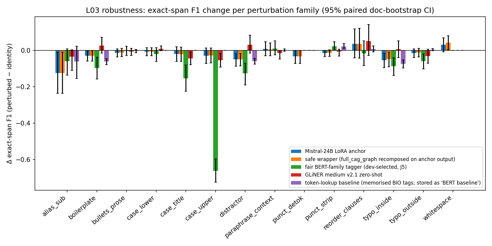

# L03_robustness — perturbation robustness, boundary cases, cross-dataset

**Headline:** anchor mean degradation of exact-span F1 over 14 perturbation families = **0.0223** [95% CI 0.0035, 0.0417] (n = 120 test docs; positive = worse than the identity copy).

## Design

- 120 stratified test docs (seed 42), 1373 perturbed rows incl. identity copies; 427 (doc, family) pairs not applicable (reasons in `inputs/evals/research/L03_robustness/not_available.jsonl`).
- Rows per family: {'identity': 120, 'whitespace': 120, 'bullets_prose': 120, 'case_lower': 103, 'case_upper': 120, 'case_title': 113, 'typo_outside': 93, 'typo_inside': 118, 'boilerplate': 120, 'distractor': 120, 'paraphrase_context': 51, 'reorder_clauses': 31, 'punct_detok': 65, 'punct_strip': 64, 'alias_sub': 15}
- Alias sources: [{'path': 'data/skillllm_v2/taxonomy/skill_aliases.jsonl', 'groups_used': 12}, {'path': '/home/923873155/Sem 4 Research/SkillLLM_v2_stage2/data/external/esco/v1.2.1/skills_en.jsonl', 'rows': 13939, 'groups_used': 12722}]
- Clean reference = identity copy of the same doc scored in the same run; Δ = perturbed − clean; paired doc bootstrap + approximate randomization (10k), Holm across families per system/metric.
- Families marked † change the gold surface (case, typo inside span, alias): exact-match loss there partly reflects a different target string, not only brittleness.

## Δ exact-span F1 per family

| family | system | n | clean | perturbed | delta | CI | p_holm | parse_err |
|---|---|---|---|---|---|---|---|---|
| alias_sub † | anchor | 15 | 0.8932 | 0.7692 | -0.1240 | [-0.236, -0.009] | 1.0000 | 0 |
| alias_sub † | safe_wrapper | 15 | 0.8932 | 0.7692 | -0.1240 | [-0.236, -0.009] | 0.9375 | 0 |
| alias_sub † | bert_fair | 15 | 0.8627 | 0.8039 | -0.0588 | [-0.136, 0.009] | 1.0000 | 0 |
| alias_sub † | gliner_zeroshot | 15 | 0.0727 | 0.0385 | -0.0343 | [-0.109, 0.003] | 1.0000 | 0 |
| alias_sub † | token_lookup | 15 | 0.4286 | 0.3688 | -0.0598 | [-0.154, 0.023] | 1.0000 | 0 |
| boilerplate | anchor | 120 | 0.7263 | 0.6972 | -0.0290 | [-0.059, -0.001] | 0.7691 | 0 |
| boilerplate | safe_wrapper | 120 | 0.7263 | 0.6972 | -0.0290 | [-0.059, -0.001] | 0.7050 | 0 |
| boilerplate | bert_fair | 120 | 0.6901 | 0.5936 | -0.0966 | [-0.157, -0.038] | 0.0060 | 0 |
| boilerplate | gliner_zeroshot | 120 | 0.0878 | 0.1140 | 0.0262 | [-0.015, 0.071] | 1.0000 | 0 |
| boilerplate | token_lookup | 120 | 0.1575 | 0.0970 | -0.0605 | [-0.078, -0.046] | 0.0014 | 0 |
| bullets_prose | anchor | 120 | 0.7263 | 0.7138 | -0.0125 | [-0.035, 0.009] | 1.0000 | 0 |
| bullets_prose | safe_wrapper | 120 | 0.7263 | 0.7151 | -0.0112 | [-0.034, 0.011] | 1.0000 | 0 |
| bullets_prose | bert_fair | 120 | 0.6901 | 0.6865 | -0.0036 | [-0.029, 0.023] | 1.0000 | 0 |
| bullets_prose | gliner_zeroshot | 120 | 0.0878 | 0.0807 | -0.0070 | [-0.028, 0.012] | 1.0000 | 0 |
| bullets_prose | token_lookup | 120 | 0.1575 | 0.1536 | -0.0039 | [-0.012, 0.005] | 1.0000 | 0 |
| case_lower † | anchor | 103 | 0.6972 | 0.6901 | -0.0071 | [-0.030, 0.014] | 1.0000 | 0 |
| case_lower † | safe_wrapper | 103 | 0.6972 | 0.6901 | -0.0071 | [-0.030, 0.014] | 1.0000 | 0 |
| case_lower † | bert_fair | 103 | 0.6667 | 0.6464 | -0.0202 | [-0.061, 0.015] | 1.0000 | 0 |
| case_lower † | gliner_zeroshot | 103 | 0.1045 | 0.1124 | 0.0079 | [-0.001, 0.024] | 1.0000 | 0 |
| case_lower † | token_lookup | 103 | 0.1167 | 0.1167 | 0.0000 | [0.000, 0.000] | 1.0000 | 0 |
| case_title † | anchor | 113 | 0.7108 | 0.6907 | -0.0201 | [-0.060, 0.020] | 1.0000 | 0 |
| case_title † | safe_wrapper | 113 | 0.7108 | 0.6894 | -0.0214 | [-0.061, 0.018] | 1.0000 | 0 |
| case_title † | bert_fair | 113 | 0.6827 | 0.5291 | -0.1537 | [-0.224, -0.081] | 0.0024 | 0 |
| case_title † | gliner_zeroshot | 113 | 0.0921 | 0.0486 | -0.0435 | [-0.079, -0.010] | 0.5108 | 0 |
| case_title † | token_lookup | 113 | 0.1508 | 0.1508 | 0.0000 | [0.000, 0.000] | 1.0000 | 0 |
| case_upper † | anchor | 120 | 0.7263 | 0.6969 | -0.0294 | [-0.072, 0.013] | 1.0000 | 0 |
| case_upper † | safe_wrapper | 120 | 0.7263 | 0.6982 | -0.0281 | [-0.069, 0.013] | 1.0000 | 0 |
| case_upper † | bert_fair | 120 | 0.6901 | 0.0282 | -0.6620 | [-0.725, -0.596] | 0.0014 | 0 |
| case_upper † | gliner_zeroshot | 120 | 0.0878 | 0.0332 | -0.0546 | [-0.092, -0.017] | 0.1778 | 0 |
| case_upper † | token_lookup | 120 | 0.1575 | 0.1575 | 0.0000 | [0.000, 0.000] | 1.0000 | 0 |
| distractor | anchor | 120 | 0.7263 | 0.6766 | -0.0497 | [-0.086, -0.018] | 0.0868 | 0 |
| distractor | safe_wrapper | 120 | 0.7263 | 0.6778 | -0.0485 | [-0.085, -0.017] | 0.1162 | 0 |
| distractor | bert_fair | 120 | 0.6901 | 0.5637 | -0.1264 | [-0.189, -0.070] | 0.0014 | 0 |
| distractor | gliner_zeroshot | 120 | 0.0878 | 0.1198 | 0.0320 | [-0.014, 0.084] | 1.0000 | 0 |
| distractor | token_lookup | 120 | 0.1575 | 0.0986 | -0.0589 | [-0.076, -0.045] | 0.0014 | 0 |
| paraphrase_context | anchor | 51 | 0.7008 | 0.7092 | 0.0084 | [-0.029, 0.047] | 1.0000 | 0 |
| paraphrase_context | safe_wrapper | 51 | 0.7036 | 0.7092 | 0.0056 | [-0.030, 0.040] | 1.0000 | 0 |
| paraphrase_context | bert_fair | 51 | 0.6517 | 0.6617 | 0.0100 | [-0.024, 0.053] | 1.0000 | 0 |
| paraphrase_context | gliner_zeroshot | 51 | 0.1067 | 0.0927 | -0.0140 | [-0.048, 0.001] | 1.0000 | 0 |
| paraphrase_context | token_lookup | 51 | 0.1239 | 0.1242 | 0.0002 | [-0.005, 0.008] | 1.0000 | 0 |
| punct_detok | anchor | 65 | 0.7019 | 0.6687 | -0.0331 | [-0.072, 0.000] | 1.0000 | 0 |
| punct_detok | safe_wrapper | 65 | 0.7019 | 0.6687 | -0.0331 | [-0.071, 0.000] | 1.0000 | 0 |
| punct_detok | bert_fair | 65 | 0.6667 | 0.6667 | 0.0000 | [0.000, 0.000] | 1.0000 | 0 |
| punct_detok | gliner_zeroshot | 65 | 0.1042 | 0.1042 | 0.0000 | [0.000, 0.000] | 1.0000 | 0 |
| punct_detok | token_lookup | 65 | 0.0980 | 0.0980 | 0.0000 | [0.000, 0.000] | 1.0000 | 0 |
| punct_strip | anchor | 64 | 0.6923 | 0.6773 | -0.0150 | [-0.034, 0.000] | 1.0000 | 0 |
| punct_strip | safe_wrapper | 64 | 0.6923 | 0.6795 | -0.0128 | [-0.032, 0.003] | 1.0000 | 0 |
| punct_strip | bert_fair | 64 | 0.6563 | 0.6791 | 0.0228 | [0.002, 0.048] | 1.0000 | 0 |
| punct_strip | gliner_zeroshot | 64 | 0.1070 | 0.1000 | -0.0070 | [-0.031, 0.006] | 1.0000 | 0 |
| punct_strip | token_lookup | 64 | 0.0937 | 0.1158 | 0.0221 | [0.011, 0.037] | 0.0014 | 0 |
| reorder_clauses | anchor | 31 | 0.6305 | 0.6667 | 0.0361 | [-0.042, 0.119] | 1.0000 | 0 |
| reorder_clauses | safe_wrapper | 31 | 0.6337 | 0.6700 | 0.0363 | [-0.043, 0.122] | 1.0000 | 0 |
| reorder_clauses | bert_fair | 31 | 0.6635 | 0.6479 | -0.0156 | [-0.083, 0.053] | 1.0000 | 0 |
| reorder_clauses | gliner_zeroshot | 31 | 0.1157 | 0.1667 | 0.0510 | [-0.028, 0.142] | 1.0000 | 0 |
| reorder_clauses | token_lookup | 31 | 0.1645 | 0.1710 | 0.0065 | [-0.009, 0.025] | 1.0000 | 0 |
| typo_inside † | anchor | 118 | 0.7223 | 0.6679 | -0.0544 | [-0.095, -0.017] | 0.0868 | 0 |
| typo_inside † | safe_wrapper | 118 | 0.7223 | 0.6741 | -0.0482 | [-0.090, -0.010] | 0.2301 | 0 |
| typo_inside † | bert_fair | 118 | 0.6916 | 0.6047 | -0.0870 | [-0.137, -0.042] | 0.0024 | 0 |
| typo_inside † | gliner_zeroshot | 118 | 0.0889 | 0.0952 | 0.0063 | [-0.039, 0.052] | 1.0000 | 0 |
| typo_inside † | token_lookup | 118 | 0.1551 | 0.0808 | -0.0743 | [-0.097, -0.053] | 0.0014 | 0 |
| typo_outside | anchor | 93 | 0.6745 | 0.6604 | -0.0141 | [-0.040, 0.009] | 1.0000 | 0 |
| typo_outside | safe_wrapper | 93 | 0.6761 | 0.6651 | -0.0110 | [-0.037, 0.012] | 1.0000 | 0 |
| typo_outside | bert_fair | 93 | 0.6636 | 0.6041 | -0.0595 | [-0.102, -0.020] | 0.0306 | 0 |
| typo_outside | gliner_zeroshot | 93 | 0.1124 | 0.0813 | -0.0311 | [-0.070, 0.007] | 1.0000 | 0 |
| typo_outside | token_lookup | 93 | 0.1119 | 0.1158 | 0.0039 | [-0.001, 0.010] | 1.0000 | 0 |
| whitespace | anchor | 120 | 0.7263 | 0.7575 | 0.0312 | [-0.008, 0.068] | 1.0000 | 1 |
| whitespace | safe_wrapper | 120 | 0.7263 | 0.7689 | 0.0426 | [0.003, 0.080] | 0.4356 | 0 |
| whitespace | bert_fair | 120 | 0.6901 | 0.6901 | 0.0000 | [0.000, 0.000] | 1.0000 | 0 |
| whitespace | gliner_zeroshot | 120 | 0.0878 | 0.0878 | 0.0000 | [0.000, 0.000] | 1.0000 | 0 |
| whitespace | token_lookup | 120 | 0.1575 | 0.1575 | 0.0000 | [0.000, 0.000] | 1.0000 | 0 |

## Mean degradation per system

| system | set | mean_degradation | CI |
|---|---|---|---|
| anchor | all | 0.0223 | [0.003, 0.042] |
| anchor | surface_preserving | 0.0086 | [-0.009, 0.030] |
| safe_wrapper | all | 0.0207 | [0.002, 0.040] |
| safe_wrapper | surface_preserving | 0.0068 | [-0.011, 0.028] |
| bert_fair | all | 0.0893 | [0.069, 0.110] |
| bert_fair | surface_preserving | 0.0299 | [0.012, 0.049] |
| gliner_zeroshot | all | 0.0049 | [-0.011, 0.021] |
| gliner_zeroshot | surface_preserving | -0.0056 | [-0.024, 0.014] |
| token_lookup | all | 0.0161 | [0.008, 0.025] |
| token_lookup | surface_preserving | 0.0101 | [0.005, 0.015] |

Determinism control (J4 identity copies vs J1 re-run of the same docs): {'n_docs': 120, 'identical': 120, 'identical_rate': 1.0, 'differing_ids': []}

## Natural boundary cases (974-doc test subset, no synthetic edits)

Slices are defined on GOLD spans: **coordination** = doc has a gold span containing '/', ' and ', ' or ', ' & ', or two gold spans separated only by and/or/'/'/&/,/+; **parentheses** = doc has a gold span containing '(' or ')' or directly preceded by '('; **nested_overlap** = doc has two overlapping gold spans (SkillSpan skill and knowledge spans may overlap); **any_boundary_case** = union of the three; boundary_span_recall = exact recall on those gold spans only

| system | slice | n_in | F1_in | F1_out | Δ in−out | Δ CI | bnd_span_recall | span_words in/out |
|---|---|---|---|---|---|---|---|---|
| anchor | coordination | 461 | 0.6218 | 0.7341 | -0.1123 | [-0.156, -0.067] | - | 3.2/2.3 |
| anchor | parentheses | 47 | 0.6475 | 0.6726 | -0.0251 | [-0.106, 0.049] | - | 2.7/2.8 |
| anchor | nested_overlap | 12 | 0.5965 | 0.6720 | -0.0755 | [-0.271, 0.055] | - | 3.8/2.8 |
| anchor | any_boundary_case | 477 | 0.6235 | 0.7387 | -0.1153 | [-0.160, -0.068] | 0.6009 | 3.1/2.3 |
| anchor_rerun_J1 | coordination | 461 | 0.6226 | 0.7362 | -0.1136 | [-0.158, -0.068] | - | 3.2/2.3 |
| anchor_rerun_J1 | parentheses | 47 | 0.6475 | 0.6741 | -0.0266 | [-0.107, 0.047] | - | 2.7/2.8 |
| anchor_rerun_J1 | nested_overlap | 12 | 0.5965 | 0.6733 | -0.0769 | [-0.272, 0.053] | - | 3.8/2.8 |
| anchor_rerun_J1 | any_boundary_case | 477 | 0.6242 | 0.7409 | -0.1167 | [-0.161, -0.071] | 0.6009 | 3.1/2.3 |
| safe_wrapper | coordination | 461 | 0.6230 | 0.7366 | -0.1136 | [-0.158, -0.068] | - | 3.2/2.3 |
| safe_wrapper | parentheses | 47 | 0.6503 | 0.6742 | -0.0239 | [-0.103, 0.050] | - | 2.7/2.8 |
| safe_wrapper | nested_overlap | 12 | 0.5965 | 0.6738 | -0.0773 | [-0.272, 0.052] | - | 3.8/2.8 |
| safe_wrapper | any_boundary_case | 477 | 0.6246 | 0.7414 | -0.1168 | [-0.162, -0.071] | 0.6009 | 3.1/2.3 |
| gliner_zeroshot | coordination | 461 | 0.0899 | 0.0699 | 0.0200 | [-0.013, 0.051] | - | 3.2/2.3 |
| gliner_zeroshot | parentheses | 47 | 0.0175 | 0.0875 | -0.0700 | [-0.097, -0.039] | - | 2.7/2.8 |
| gliner_zeroshot | nested_overlap | 12 | 0.0615 | 0.0819 | -0.0204 | [-0.094, 0.035] | - | 3.8/2.8 |
| gliner_zeroshot | any_boundary_case | 477 | 0.0865 | 0.0738 | 0.0127 | [-0.020, 0.044] | 0.0579 | 3.1/2.3 |
| token_lookup | coordination | 461 | 0.1005 | 0.1907 | -0.0902 | [-0.121, -0.063] | - | 3.2/2.3 |
| token_lookup | parentheses | 47 | 0.1104 | 0.1402 | -0.0298 | [-0.065, 0.010] | - | 2.7/2.8 |
| token_lookup | nested_overlap | 12 | 0.1033 | 0.1384 | -0.0351 | [-0.133, 0.020] | - | 3.8/2.8 |
| token_lookup | any_boundary_case | 477 | 0.1003 | 0.1961 | -0.0958 | [-0.127, -0.065] | 0.1629 | 3.1/2.3 |
| bert_fair | coordination | 461 | 0.5983 | 0.6800 | -0.0816 | [-0.130, -0.038] | - | 3.2/2.3 |
| bert_fair | parentheses | 47 | 0.6247 | 0.6341 | -0.0093 | [-0.085, 0.068] | - | 2.7/2.8 |
| bert_fair | nested_overlap | 12 | 0.5760 | 0.6347 | -0.0587 | [-0.297, 0.053] | - | 3.8/2.8 |
| bert_fair | any_boundary_case | 477 | 0.6025 | 0.6790 | -0.0765 | [-0.124, -0.029] | 0.5880 | 3.1/2.3 |

Δ in−out compares disjoint document sets (independent bootstraps); boundary-case docs also have longer gold spans, so the gap is not attributable to coordination/nesting alone.

## Cross-dataset (out-of-distribution), label-agnostic

Green et al. 2022 (CC BY 4.0) test sample and Sayfullina et al. 2018 soft-skill test sample (recall only). Different annotation guidelines: absolute numbers are NOT comparable with SkillSpan; compare systems.

**Label mapping (pre-registered, D-A3-05).** Scoring ignores predicted/gold labels: every predicted span (HARD_SKILL or SOFT_SKILL) is relabelled SKILL and matched to the target gold spans. Green gold: *primary* target = SKILL tags; *secondary* = SKILL + DOMAIN + QUALIFICATION (SkillSpan 'knowledge' partly covers domains and degrees); OCCUPATION and EXPERIENCE are never targets. Sayfullina gold: the single annotated SOFT span per sentence; only recall is valid (precision/F1 not_available). Samples: 300 sentences per dataset, seed 42; the same docs for every system (fair BERT = dev-selected JobBERT trained on SkillSpan only).

| dataset | target | system | metric | value | CI | n |
|---|---|---|---|---|---|---|
| green | primary | anchor | exact_span_recall | 0.4413 | [0.391, 0.494] | 300 |
| green | primary | anchor | partial_span_recall | 0.7047 | [0.653, 0.756] | 300 |
| green | primary | anchor | exact_span_precision | 0.4888 | [0.438, 0.546] | 300 |
| green | primary | anchor | exact_span_f1 | 0.4638 | [0.416, 0.512] | 300 |
| green | primary | anchor | partial_span_f1 | 0.7407 | [0.703, 0.778] | 300 |
| green | secondary | anchor | exact_span_recall | 0.4248 | [0.374, 0.477] | 300 |
| green | secondary | anchor | partial_span_recall | 0.6740 | [0.618, 0.725] | 300 |
| green | secondary | anchor | exact_span_precision | 0.5353 | [0.482, 0.590] | 300 |
| green | secondary | anchor | exact_span_f1 | 0.4737 | [0.426, 0.523] | 300 |
| green | secondary | anchor | partial_span_f1 | 0.7516 | [0.714, 0.788] | 300 |
| green | primary | safe_wrapper | exact_span_recall | 0.4396 | [0.389, 0.493] | 300 |
| green | primary | safe_wrapper | partial_span_recall | 0.7030 | [0.652, 0.753] | 300 |
| green | primary | safe_wrapper | exact_span_precision | 0.4916 | [0.440, 0.549] | 300 |
| green | primary | safe_wrapper | exact_span_f1 | 0.4641 | [0.417, 0.513] | 300 |
| green | primary | safe_wrapper | partial_span_f1 | 0.7422 | [0.705, 0.778] | 300 |
| green | secondary | safe_wrapper | exact_span_recall | 0.4233 | [0.372, 0.477] | 300 |
| green | secondary | safe_wrapper | partial_span_recall | 0.6726 | [0.617, 0.725] | 300 |
| green | secondary | safe_wrapper | exact_span_precision | 0.5385 | [0.484, 0.594] | 300 |
| green | secondary | safe_wrapper | exact_span_f1 | 0.4740 | [0.424, 0.524] | 300 |
| green | secondary | safe_wrapper | partial_span_f1 | 0.7531 | [0.715, 0.789] | 300 |
| green | primary | bert_fair | exact_span_recall | 0.3842 | [0.336, 0.435] | 300 |
| green | primary | bert_fair | partial_span_recall | 0.6728 | [0.619, 0.724] | 300 |
| green | primary | bert_fair | exact_span_precision | 0.4241 | [0.374, 0.479] | 300 |
| green | primary | bert_fair | exact_span_f1 | 0.4032 | [0.358, 0.451] | 300 |
| green | primary | bert_fair | partial_span_f1 | 0.7060 | [0.667, 0.744] | 300 |
| green | secondary | bert_fair | exact_span_recall | 0.3658 | [0.320, 0.412] | 300 |
| green | secondary | bert_fair | partial_span_recall | 0.6401 | [0.584, 0.693] | 300 |
| green | secondary | bert_fair | exact_span_precision | 0.4593 | [0.409, 0.512] | 300 |
| green | secondary | bert_fair | exact_span_f1 | 0.4072 | [0.363, 0.451] | 300 |
| green | secondary | bert_fair | partial_span_f1 | 0.7126 | [0.673, 0.749] | 300 |
| green | primary | gliner_zeroshot | exact_span_recall | 0.0923 | [0.062, 0.128] | 300 |
| green | primary | gliner_zeroshot | partial_span_recall | 0.1611 | [0.121, 0.204] | 300 |
| green | primary | gliner_zeroshot | exact_span_precision | 0.4508 | [0.340, 0.560] | 300 |
| green | primary | gliner_zeroshot | exact_span_f1 | 0.1532 | [0.105, 0.207] | 300 |
| green | primary | gliner_zeroshot | partial_span_f1 | 0.2674 | [0.208, 0.327] | 300 |
| green | secondary | gliner_zeroshot | exact_span_recall | 0.0811 | [0.054, 0.113] | 300 |
| green | secondary | gliner_zeroshot | partial_span_recall | 0.1460 | [0.110, 0.186] | 300 |
| green | secondary | gliner_zeroshot | exact_span_precision | 0.4508 | [0.340, 0.560] | 300 |
| green | secondary | gliner_zeroshot | exact_span_f1 | 0.1375 | [0.093, 0.187] | 300 |
| green | secondary | gliner_zeroshot | partial_span_f1 | 0.2475 | [0.192, 0.304] | 300 |
| green | primary | token_lookup | exact_span_recall | 0.1862 | [0.152, 0.223] | 300 |
| green | primary | token_lookup | partial_span_recall | 0.8490 | [0.815, 0.881] | 300 |
| green | primary | token_lookup | exact_span_precision | 0.0392 | [0.031, 0.049] | 300 |
| green | primary | token_lookup | exact_span_f1 | 0.0647 | [0.051, 0.079] | 300 |
| green | primary | token_lookup | partial_span_f1 | 0.2951 | [0.270, 0.321] | 300 |
| green | secondary | token_lookup | exact_span_recall | 0.1917 | [0.157, 0.226] | 300 |
| green | secondary | token_lookup | partial_span_recall | 0.8348 | [0.801, 0.867] | 300 |
| green | secondary | token_lookup | exact_span_precision | 0.0459 | [0.037, 0.056] | 300 |
| green | secondary | token_lookup | exact_span_f1 | 0.0741 | [0.060, 0.089] | 300 |
| green | secondary | token_lookup | partial_span_f1 | 0.3224 | [0.298, 0.347] | 300 |
| sayfullina | primary | anchor | exact_span_recall | 0.2027 | [0.156, 0.248] | 300 |
| sayfullina | primary | anchor | partial_span_recall | 0.5681 | [0.513, 0.623] | 300 |
| sayfullina | primary | safe_wrapper | exact_span_recall | 0.2027 | [0.156, 0.248] | 300 |
| sayfullina | primary | safe_wrapper | partial_span_recall | 0.5681 | [0.513, 0.623] | 300 |
| sayfullina | primary | bert_fair | exact_span_recall | 0.2126 | [0.166, 0.257] | 300 |
| sayfullina | primary | bert_fair | partial_span_recall | 0.5216 | [0.465, 0.577] | 300 |
| sayfullina | primary | gliner_zeroshot | exact_span_recall | 0.0731 | [0.043, 0.106] | 300 |
| sayfullina | primary | gliner_zeroshot | partial_span_recall | 0.1960 | [0.153, 0.241] | 300 |
| sayfullina | primary | token_lookup | exact_span_recall | 0.1661 | [0.126, 0.206] | 300 |
| sayfullina | primary | token_lookup | partial_span_recall | 0.9169 | [0.884, 0.947] | 300 |

## Pending / not available

- anchor / xdata_exact_precision:sayfullina: not_available — only one soft-skill span per sentence is annotated; other mentions are unlabelled, so precision/F1 are not measurable
- safe_wrapper / xdata_exact_precision:sayfullina: not_available — only one soft-skill span per sentence is annotated; other mentions are unlabelled, so precision/F1 are not measurable
- bert_fair / xdata_exact_precision:sayfullina: not_available — only one soft-skill span per sentence is annotated; other mentions are unlabelled, so precision/F1 are not measurable
- gliner_zeroshot / xdata_exact_precision:sayfullina: not_available — only one soft-skill span per sentence is annotated; other mentions are unlabelled, so precision/F1 are not measurable
- token_lookup / xdata_exact_precision:sayfullina: not_available — only one soft-skill span per sentence is annotated; other mentions are unlabelled, so precision/F1 are not measurable

Human validity sample (50 items, for L11): `perturbation_validity_sample.csv` — columns label_preserved / skills_still_skills / text_natural are blank for annotators.

## Caveats

- Perturbations are synthetic and rule-based; validity must be confirmed on the human sample before strong claims.
- 120 docs: CIs for families that apply to few docs (alias_sub, reorder_clauses) are wide; read them as indicative.
- The token-lookup baseline is the repository's stored 'BERT baseline' (memorised BIO tags), not a neural BERT.
- The safe wrapper is recomposed (full_cag_graph composition, gate not applied) from the run_safe_wrapper code on top of the perturbed-input anchor predictions; its verifier/calibrator were not re-fit.
