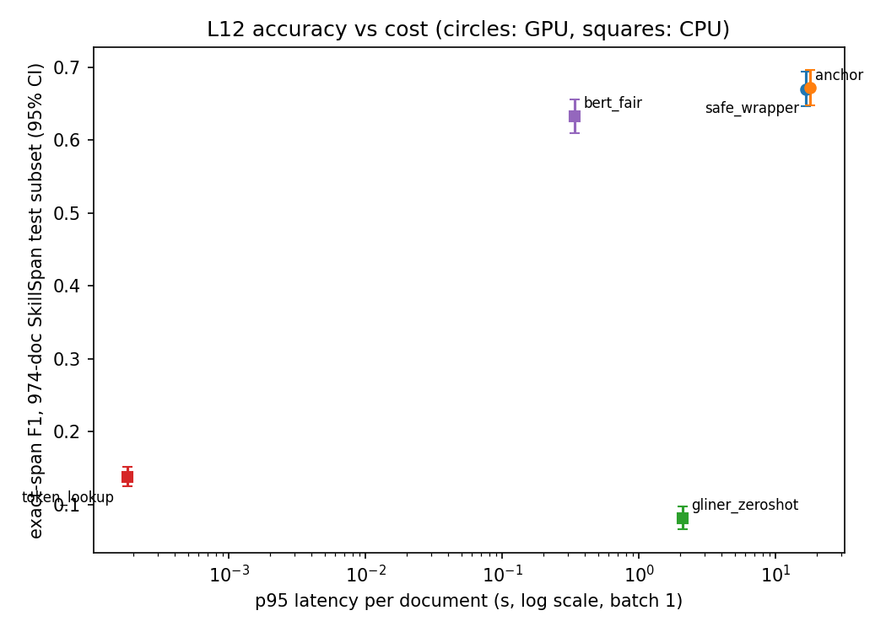
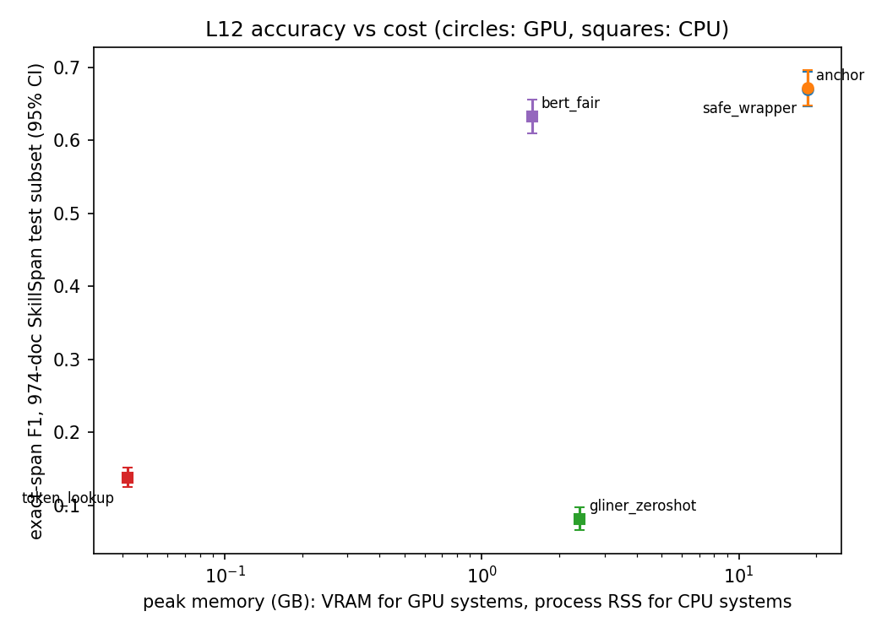

# L12_systems — size, memory, latency, accuracy-vs-cost, reproduction

**Headline:** anchor p95 latency **16.66 s/doc** [95% CI 15.15, 18.39] (p50 5.75, p99 28.51; n = 974 test docs, batch 1, one RTX 3090); peak VRAM **18.48 GB** (reserved; allocated 16.32 GB).

Latency is dominated by output length: OLS over J1 docs gives 0.10 s fixed (prompt + overhead) + 0.167 s per generated token (R² = 0.994).

## Parameters and disk

- Base Mistral-Small-3.1-24B (bf16 checkpoint, loaded in 4-bit NF4): 24,011,361,280 parameters (language model 23,572,403,200; vision tower 403,305,472; projector 35,652,608).
- LoRA adapter (r=16, alpha=32, all attention+MLP projections of the language model): 92,405,760 trainable parameters (0.38% of base).
- Disk (GB): base_model_hf_shards 48.023, base_model_dir_total 96.078, lora_adapter 0.370, span_verifier_joblib 0.001, token_lookup_table 0.000, bert_fair_model_pt 0.433, gliner_medium_v2.1_cache 1.562

## Anchor GPU jobs (batch 1, greedy, 4-bit NF4, RTX 3090)

| job | docs | p50_s | p95_s | p99_s | gen_tok/s | peak_alloc_GB | peak_reserved_GB | load_avg_p50 | shared_snaps | parse_err |
|---|---|---|---|---|---|---|---|---|---|---|
| anchor_test_logprobs | 974 | 5.7546 | 16.6614 | 28.5082 | 5.8185 | 16.3162 | 18.4843 | - | 0/39 | 0 |
| anchor_dev_logprobs | 914 | 6.2659 | 15.6289 | 24.5567 | 5.8559 | 16.2957 | 18.4822 | - | 0/37 | 0 |
| anchor_test_nospan | 2595 | 1.2356 | 1.3261 | 6.4933 | 4.8675 | 16.3054 | 18.4172 | 35.4165 | 0/104 | 0 |
| robustness_anchor | 1373 | 5.8883 | 17.7066 | 27.6732 | 5.7718 | 16.3091 | 18.4843 | 35.2629 | 0/56 | 1 |
| xdata_anchor | 600 | 4.0403 | 15.3025 | 26.1407 | 5.6989 | 16.3065 | 18.4906 | 34.9170 | 0/24 | 0 |

`shared_snaps` = nvidia-smi snapshots (every 25 docs) that showed another compute process on the same GPU.

## CPU systems on the same 974 docs (batch 1)

| system | p50_s | p95_s | p99_s | peak_rss_GB | n_params |
|---|---|---|---|---|---|
| token_lookup | 0.0001 | 0.0002 | 0.0003 | 0.0418 | - |
| gliner_zeroshot | 0.9298 | 2.0843 | 2.7563 | 2.4077 | 195175936 |
| bert_fair | 0.1978 | 0.3394 | 0.4745 | 1.5658 | 108314886 |
| safe_wrapper | 0.8063 | 1.4431 | 2.0496 | 2.4100 | - |

Safe-wrapper stage wall-clock (mean s/doc, CPU, excluding the anchor call): gliner 0.7941, dictionary 0.0150, merger 0.0002, boundary_refiner 0.0129, verifier 0.0001, calibrator 0.0000, linker 0.0640

## Accuracy vs cost

| system | exact_f1 | exact_f1_ci | latency_p95_s | memory_gb | memory_kind |
|---|---|---|---|---|---|
| anchor | 0.6701 | [0.646, 0.694] | 16.6614 | 18.4843 | GPU VRAM (reserved) |
| safe_wrapper | 0.6719 | [0.648, 0.696] | 17.8437 | 18.4843 | GPU VRAM (anchor) + CPU wrapper |
| gliner_zeroshot | 0.0814 | [0.066, 0.098] | 2.0843 | 2.4077 | CPU RSS (process) |
| token_lookup | 0.1376 | [0.125, 0.151] | 0.0002 | 0.0418 | CPU RSS (process) |
| bert_fair | 0.6331 | [0.610, 0.656] | 0.3394 | 1.5658 | CPU RSS (process) |

## Anchor re-run reproduction (J1)

- Model output identical (ordered surface + raw label) on 974/974 docs (100.00%); parse errors 0.
- Re-resolving the re-run surfaces with the legacy find_offsets reproduces the stored span sets on 974/974 docs; with today's offset code 971/974.
- Exact F1: stored 0.670069; re-run + legacy offsets 0.670069; re-run + current offsets 0.671400 (Δ current − stored +0.0013 [+0.0000, +0.0030], AR p = 0.2500).
- The stored predictions remain the official anchor artifact; both numbers are quotable with this explanation.

## Pending / not available

- span_verifier / n_params: not_available — the safe wrapper's SpanVerifier (src/skillllm_v2/verify/span_verifier.py) is rule-based (confidence threshold + generic-phrase / length rules); the TF-IDF+LR joblib in artifacts/skillllm_v2/span_verifier/model/verifier_model.joblib is a separate artifact, its size is reported as disk_gb
- taxonomy_reranker / n_params: not_available — never trained: artifacts/skillllm_v2/taxonomy_reranker/metrics.json training_mode=retrieval_only (placeholder README)
- anchor / cpu_peak_rss_gb: not_available — host process RSS was not recorded by the anchor GPU jobs (gpu_anchor_infer.py logs CUDA memory and nvidia-smi snapshots only); not re-measured to avoid a second 4-bit model load

## Caveats

- Latency was measured on a shared host (other projects' CPU jobs; load average 35-54 on 20 cores during the J1 anchor run and the CPU baseline runs, 1-min load: median 35 in J3/J4/J6, 41-54 at the end of the test974 CPU jobs, not recorded in J1/J2 snapshots; CPU latencies are therefore inflated by contention, GPU latency by launch-bound decoding). 4-bit decoding with bitsandbytes is CPU-launch-bound, so absolute latencies are upper-bound-ish for this hardware; an earlier quieter run of the same decoding path measured ~4.6 s/doc (qlora_loop_v4_eval timing).
- Batch size 1, no KV-cache reuse, no vLLM/TGI: these are research-prototype costs, not an optimised deployment.
- Memory for CPU systems is process RSS, not VRAM; the Pareto memory plot mixes the two kinds (marked).
